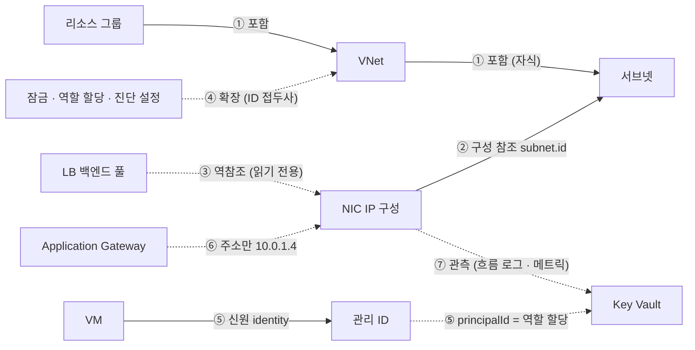

# Azure 리소스 관계 사전

> **대상**: 다이어그램(인프라 구성도·라이브 다이어그램) 코드를 고치는 개발자, 구성도를 검토하는 운영자
> **원칙**: 선·배지·포함 관계는 **이 사전의 행으로만** 만든다. 근거는 Microsoft 공식 문서(learn.microsoft.com)와 ARM 속성이다.
> **마지막 확인**: 2026-10-15 — Azure REST API 스펙 리버스 엔지니어링(유형 3,012 · 참조 속성 2,872) + providers API(유형 4,749) + 실제 테넌트 교차 검증 + 전문가 검토. 영역별 전체 사전은 [`relationships/`](relationships/), 기계용 목록은 [`relationships/catalog.json`](relationships/catalog.json)

## 입문 — Azure 리소스는 서로 어떻게 이어지나

> 이 절은 처음 읽는 사람을 위한 설명입니다. 코드가 인용하는 행은 "## 0. 사용법" 아래 표와 영역별 페이지에 있습니다. 이 절에는 ID를 새로 만들지 않습니다.

### 입문 1. 이 사전이 무엇이고 어떻게 만들어졌나 (이 사전이 만들어진 방법)

이 사전에는 **Azure 리소스 A가 리소스 B와 어떤 근거로 이어지는지**를 적습니다. 각 관계에는 ARM 속성 경로, 근거의 세기, 그리는 방법을 함께 적습니다. 구성도와 라이브 다이어그램의 모든 선은 이 사전의 행으로만 만듭니다(`relEdge("AGW-04", …)`). 사전에 없는 관계는 그리지 않습니다.

만든 과정은 네 단계입니다. 앞 단계가 원자료를 만들고, 뒤 단계가 그 원자료를 바로잡습니다.

| 단계 | 한 일 | 결과 |
|---|---|---|
| ① 스펙 리버스 엔지니어링 | `github.com/Azure/azure-rest-api-specs`에서 **파일마다** 최신 stable 버전을 골랐습니다(버전 폴더에는 그 버전에 바뀐 파일만 있으므로 폴더 단위로 고르면 서비스가 빠집니다). stable이 한 번도 없는 서비스는 최신 preview를 썼습니다. `$ref`로 이어진 공통 파일까지 약 2만 파일을 기계로 읽었습니다. 리소스 유형(PUT/GET 경로)마다 스키마를 끝까지 따라가며 다른 리소스를 가리키는 속성을 모두 기록했습니다. 기록 항목은 참조 종류(`arm-id`·`typed-ref`·`subresource`·`id-string`)와 읽기 전용 여부입니다 | **리소스 유형 3,012개(stable 2,602 · preview 410), 참조 속성 2,872개** |
| ② providers API | ARM `GET /subscriptions/{id}/providers`를 구독 1개에서 호출했습니다. 유형마다 허용 위치를 읽어 범위(regional·global·mixed·none)를 정했습니다 | 네임스페이스 309개, 유형 4,749개 |
| ③ 실제 테넌트 교차 검증 | 홈 테넌트를 읽기 전용으로 조회했습니다(리소스 579개, 유형 69개). 모든 리소스 속성 안의 ARM ID를 (출발 유형, 경로, 도착 유형)으로 집계해 ①과 맞춰 보았습니다. 리소스 ID·이름은 저장하지 않고 집계만 남겼습니다 | **일치 80 · 대상 미상 해결 18 · 대상 불일치 1(보정 전 8) · 테넌트에서만 보임 80** |
| ④ 전문가 검토 | 영역 6개마다 초안을 썼습니다. 검토자는 결함 7종을 기준으로 행을 하나씩 따졌습니다: (a) 경로 오류, (b) 의미·방향 오류, (c) 범위 오류, (d) 중복, (e) 누락, (f) 출처 불일치, (g) 오해를 부르는 비유. Learn 문서로 다시 확인한 결과를 반영했습니다 | 영역별 페이지 6개 + 이 입문 절 |

③의 숫자가 뜻하는 것은 다음과 같습니다.
- **대상 불일치 1(보정 전 8)**: 스펙이 적은 대상보다 실제 대상이 넓은 경우입니다. 예를 들어 스펙은 Private Endpoint `privateLinkServiceConnections[].privateLinkServiceId`의 대상을 `privateLinkServices`로만 적습니다. 실제로는 Key Vault·Storage·Web·Redis·Recovery Services 같은 **모든 Private Link 리소스**가 대상입니다. 이런 보정은 `scripts/relationships/overrides.json`에 이유와 Learn 출처를 함께 적습니다.
- **테넌트에서만 보임 80**: 최신 stable 스펙에 없지만 실제 리소스에는 있는 속성입니다. 예: 경고 규칙 → 작업 그룹, Application Insights → 작업 영역, 데이터 수집 규칙 → 작업 영역.
- **참고**: 커밋되는 `docs/architecture/relationships/catalog.json`은 테넌트 근거를 빼고 공개 자료(스펙·providers·`overrides.json`)만으로 만든 것입니다. 개수의 정본은 그 파일의 `types`·`references` 필드입니다. 코드가 그리는 관계(`REL`)는 저마다 그 관계를 **설정하는 ARM 속성**을 적어 두고, 테스트가 그 속성이 스펙에 실제로 있는지 검사합니다(23개 중 23개 확인, AKS-02는 이름으로 이어져 제외).

### 입문 2. 관계의 7가지 기본 모양

Azure의 모든 관계는 다음 일곱 가지 중 하나입니다. 같은 두 리소스가 여러 모양으로 동시에 이어질 수도 있습니다. 예를 들어 AKS와 ACR은 신원 관계(AcrPull)이면서 관측 관계(이미지 pull 로그)일 수 있습니다.



| # | 모양 | 무엇인가 | 아주 작은 예 | 어디서 찾나 | 그리는 법 |
|---|---|---|---|---|---|
| ① | **포함** (계층·자식 리소스) | 리소스 ID 경로 자체가 부모를 말합니다. 부모가 지워지면 자식도 사라집니다 | `…/virtualNetworks/v1/subnets/s1` = v1 ⊃ s1. 구독 ⊃ 리소스 그룹 ⊃ 리소스(HIER-01·02), Uniform VMSS ⊃ 인스턴스(VMSS-01) | ID 문자열 | contain(박스 안) |
| ② | **구성 참조** (ID 속성) | 한 리소스가 다른 리소스의 ARM ID를 속성에 적어 둡니다. 이쪽이 **설정 쪽(권위 있는 쪽)** 입니다 | NIC `ipConfigurations[].subnet.id` → 서브넷(CT-02), PE `privateLinkServiceConnections[].privateLinkServiceId` → 대상(PL-01) | 스펙 `arm-id`·`typed-ref`·`subresource` | line 또는 contain(배치를 뜻하는 경우만) |
| ③ | **읽기 전용 역참조** (back-reference) | Azure가 반대쪽 설정을 보고 **자동으로 채우는** 목록입니다. 읽을 수는 있지만 여기서 설정을 바꿀 수는 없습니다 | LB `backendAddressPools[].backendIPConfigurations`, NSG `subnets[]`, WAF 정책 `applicationGateways[]`. 풀 소속은 NIC 쪽 `loadBalancerBackendAddressPools`에서 설정합니다 | 스펙의 `readOnly` | "지금 상태"를 읽는 데만 씁니다. 고치는 방법은 설정 쪽을 안내합니다. **Resource Graph는 빈 배열을 생략**하므로, 목록이 없다고 "없음"으로 단정하지 않습니다(LB-04) |
| ④ | **확장 리소스** | 다른 리소스에 붙는 리소스입니다. 무엇에 붙었는지는 속성이 아니라 **자기 ID의 앞부분**에 있습니다. 범위는 어떤 리소스든, RG든, 구독이든, 관리 그룹이든 될 수 있습니다 | `{대상 ID}/providers/Microsoft.Authorization/roleAssignments/{guid}`, 잠금(`locks`), 진단 설정(`diagnosticSettings`), DCR 연결, Defender 평가, Event Grid 구독 | ID 접두사. 일부(진단 설정 등)는 Resource Graph에 없어 리소스마다 ARM 호출이 필요합니다 | 대상 카드의 chip·panel |
| ⑤ | **신원 관계** | 리소스 → 관리 ID → 역할 할당 → 대상으로 이어지는 세 단계 사슬입니다. 역할 할당의 `principalId`는 ARM ID가 아니라 **Entra 개체 GUID**입니다 | AKS kubelet ID(`identityProfile.kubeletidentity.resourceId`) → 역할 할당(AcrPull, 범위 = ACR) → ACR | `identity.userAssignedIdentities{}`, `identity.principalId`, 역할 할당 `principalId`·`scope` | 관리 ID 하나와 GUID가 **정확히 일치할 때만** 이어 그립니다(principalMatch). 권한 근거이므로 `perm` 등급입니다 |
| ⑥ | **주소로만 이어지는 관계** | 속성에 ID가 아니라 IP·FQDN·URI가 들어 있는 경우입니다 | AGW `backendAddresses[].ipAddress`(AGW-04)와 `fqdn`(AGW-05), UDR `nextHopIpAddress`(SEC-04), Key Vault 키 URI, Storage URI, 앱 설정의 연결 문자열 | 값 문자열 | 그 주소를 **지금 가진 리소스가 정확히 하나일 때만** 선을 긋고 근거를 패널에 적습니다(ipMatch·fqdnMatch). 0개이거나 여러 개면 '미확인'으로 둡니다 |
| ⑦ | **관측 관계** | 설정이 아니라 로그·메트릭으로 **실제로 쓰였음**을 본 관계입니다 | 흐름 로그로 본 워크로드 → PE 사용(PL-05), `tr:BytesReceived[Listener]`(AGW-02) | Azure Monitor 메트릭, Log Analytics | 측정값이 있을 때만 그립니다. 없으면 '미측정'으로 표시하고 0으로 바꾸지 않습니다 |

**리소스가 네트워크에 붙는 5가지 방식.** 같은 "subnet ID"라도 뜻이 다르므로 그림도 달라야 합니다.

| 방식 | 뜻 | 예 | 그림 |
|---|---|---|---|
| 주입·위임 (injection/delegation) | 서비스가 내 서브넷 안에 사설 IP로 들어옵니다 | PostgreSQL Flexible 사설 접근(PAAS-02), SQL MI(PAAS-06), Container Apps 환경(PAAS-07), APIM 주입 | **contain** |
| Private Endpoint | 내 서브넷의 NIC가 바깥 서비스의 하위 리소스(groupId)를 가리킵니다 | PE → Storage `blob` | 서비스로 들어가는 **인바운드 선**(PL-01) |
| VNet 통합 (integration) | 서비스가 내 서브넷을 통해 **나가기만** 합니다 | App Service `virtualNetworkSubnetId`(PAAS-01), APIM v2 통합 | **아웃바운드 선**. 포함하지 않습니다 |
| 서비스 엔드포인트·방화벽 규칙 | 서비스의 허용 목록에 내 서브넷이나 IP가 적혀 있습니다 | Storage `networkAcls.virtualNetworkRules[].id`, SQL `virtualNetworkRules` | **chip**. 절대 포함하지 않습니다(배치가 아님) |
| 관리형 VNet·관리형 PE·공유 프라이빗 링크 | Microsoft 쪽 네트워크에서 서비스가 대상까지 사설 연결을 만듭니다. 고객 쪽에 NIC가 생기지 않습니다 | Data Factory·Synapse·Kusto·Grafana 관리형 PE, AI Search 공유 프라이빗 링크 | 서비스 → 대상 **선**. 서브넷 안에 두지 않습니다. 승인 상태는 대상의 `privateEndpointConnections`에서 읽습니다 |

**같이 알아야 할 세 가지**

1. **모델과 인스턴스는 다릅니다.** VMSS 모델, VM `networkInterfaceConfigurations`, AKS `agentPoolProfiles`는 "이렇게 만들어 달라"는 의도입니다. 선은 실제 NIC와 인스턴스로 그어야 같은 관계가 두 번 그려지지 않습니다(CT-03, VMSS-04).
2. **플랫폼이 만든 리소스는 주인에게 흡수합니다.** 예: `MC_`/`ME_` 리소스 그룹, Databricks 관리 RG, AKS 사설 클러스터의 PE와 DNS 영역, Container Apps 환경의 LB. 이런 리소스는 '관리됨'으로 표시하고, 사용자 리소스처럼 그리거나 정리를 권하지 않습니다. RG 이름 접두사가 아니라 주인의 속성(`nodeResourceGroup`, `managedResourceGroupId`, 태그)으로 판별합니다.
3. **선마다 뜻이 정해져 있습니다.**
   - 데이터 경로 · DNS만(Traffic Manager·별칭 레코드 — 트래픽은 지나가지 않음) · 구성·신원·키 · 로그 전송 · 복제 · 미러(TAP)를 서로 다른 선 문법으로 그립니다.
   - **빨강은 장애 영향 전용**입니다.

### 입문 3. 리전 범위 — 어디에 그리나

providers API는 유형마다 허용 위치를 알려 줍니다(구독 1개 기준, 유형 4,749개).

| 범위 | 유형 수 | 뜻 | 예 | 그리는 곳 |
|---|---|---|---|---|
| regional | **2,995** | 리전을 고르는 리소스입니다 | VNet, VM, AKS, Storage, Key Vault, SQL 서버 | 그 리전 박스. 서브넷 안이면 서브넷에, 아니면 리전 PaaS 레인에 둡니다(REG-01) |
| global | **295** | `location: global`만 허용합니다 | DNS 영역·Private DNS 영역, Traffic Manager | 리전 밖 '글로벌' 박스(REG-02) |
| mixed | **129** | global과 리전 값이 섞여 있습니다 | `microsoft.cdn/profiles`(Front Door), `microsoft.network/frontdoors`, 작업 그룹, 메트릭 경고 | 실제 리소스의 `location` 값을 따릅니다 |
| 위치 없음 | **1,330** | 확장·프록시 유형입니다 | 역할 할당, 정책 할당, 잠금, 작업 상태 | 붙은 대상의 위치를 따릅니다(chip·panel) |
| (자식) | — | 부모와 같은 곳에 삽니다 | 서브넷, LB 프로브, SQL 데이터베이스 | 부모 안 |
| (확장) | — | ID 접두사의 대상에 붙습니다. providers API가 regional로 표기하는 경우도 있습니다 | `microsoft.insights/diagnosticsettings`, Event Grid 구독 | 대상 카드 |

**ARM `location` ≠ 서비스가 실제로 있는 곳**

| 사례 | 실제 |
|---|---|
| Static Web Apps | providers API는 regional로 표기하지만 Learn은 **글로벌 서비스**로 분류합니다. `location`은 관리·API 리전일 뿐입니다 |
| Cosmos DB `locations[]`, ACR 복제본 | 데이터는 여러 리전에 있습니다 |
| Global Load Balancer | 홈 리전에 배포되지만 여러 리전에 걸칩니다 |
| `location`이 없는 리소스 | **'리전 미상'** 박스에 둡니다(REG-03). 글로벌로 보내지 않습니다 |

**리전을 넘어도 되는 선**: PE → 다른 리전 대상(REG-04), 장애 조치 그룹, Event Hubs Capture, 복제(Storage 객체 복제·Cosmos), 전역 VNet 피어링, Global LB → 지역 LB. 이 밖의 선이 리전을 넘으면 데이터를 다시 확인합니다.

### 입문 4. 근거 등급 — 언제 선을 그어도 되나

스펙에서 얻은 근거는 강한 것부터 다음 순서입니다.

| 등급 | 뜻 | 대상 유형 확정? | 예 |
|---|---|---|---|
| `spec:arm-id` | `format: arm-id` + `x-ms-arm-id-details.allowedResources` | 예 | `fleets.hubProfile.agentProfile.subnetId` → 서브넷 |
| `spec:typed-ref` | 다른 리소스 본문 스키마를 `$ref`로 참조 | 예 | 서브넷 `routeTable` → `routeTables` |
| `spec:subresource` (tenant) | `{id}` 참조인데 실제 테넌트에서 대상이 확인됨 | 예 | NAT `publicIpAddresses[]` ✓ |
| `spec:subresource` (name) / `?` | `{id}` 참조인데 대상을 **속성 이름으로 짐작**했거나 모름 | **아니오 (가설)** | `dnsResolverOutboundEndpoints[]` → ? |
| `spec:id-string` | 이름이나 설명으로 찾은 문자열 ID | 약함 | Grafana `privateLinkResourceId` |
| `tenant` | 스펙에는 없고 실제 리소스에서만 본 경로 | 관찰된 범위만 | Application Insights `WorkspaceResourceId` |
| `docs` | ARM 경로가 다이제스트에 없고, Learn 문서로만 확인한 동작이나 속성 | 문서에 적힌 만큼 | VMSS는 LB를 만들지 않음(VMSS-05) |

**표시**
- ✓ = 실제 테넌트에서 그 경로를 본 경우입니다.
- ⚠ = 테넌트에 스펙에 없는 대상 유형이 있는 경우입니다. 테넌트와 문서를 따르고 `overrides.json`에 기록합니다.
- `(name)`·`?` = 대상 미확정입니다.
- 테넌트 경로는 소문자로 집계했으므로 코드에서는 **대소문자를 무시하고** 비교합니다.

**사전 근거 ↔ 플랫폼 근거 등급 (`obs|perm|cfg|unk`)**

| 플랫폼 등급 | 사전 근거 | 뜻 |
|---|---|---|
| `cfg` | 대상이 확정된 구성 참조(②·④), 정확히 1개로 맞춘 주소 조인(⑥) | 설정상 이어져 있음 |
| `perm` | 신원 관계(⑤) — 역할 할당 | 권한이 있음(실제 사용은 모름) |
| `obs` | 관측(⑦) — `tr:` 메트릭, 접근 로그, 흐름 로그 | 실제로 쓰였음 |
| `unk` | `(name)`·`?`, 후보가 0개이거나 여럿, 빈 배열 생략 | 모름. **위험색을 칠하지 않습니다** |

**선을 긋는 관문**
1. **실선** = `cfg`이고, 대상 유형이 확정되었고(arm-id·typed-ref·✓·문서 확인), 실제 리소스의 그 속성에서 ID를 읽은 경우입니다.
2. **점선(line-dashed)** = 모델 기준이거나 약한 근거입니다(VMSS-04, LB-07, SEC-04).
3. **`(name)`·`?`** = 테넌트에서 ✓가 나올 때까지 **패널에만** 적습니다. 다이제스트의 이름 추론은 틀릴 수 있습니다. 예: AGW `firewallPolicy`의 대상은 `firewallPolicies`처럼 보이지만 실제로는 `applicationGatewayWebApplicationFirewallPolicies`입니다.
4. **주소 조인** = 후보가 정확히 1개일 때만 긋습니다. 그 밖의 경우는 '미확인'(이유 포함)으로 둡니다.
5. **`none`** = 그리지 않습니다. 추측으로 선을 만들지 않습니다.

**평가 순서 — 선이 여러 개일 때 무엇이 이기나**

| 대상 | 순서 |
|---|---|
| NSG | 들어올 때는 서브넷 → NIC, 나갈 때는 NIC → 서브넷(둘 다 통과해야 함). AVNM 보안 관리 규칙이 NSG보다 먼저 평가됩니다 |
| 아웃바운드 출구 | 유효 경로 0.0.0.0/0의 다음 홉(UDR의 NVA·게이트웨이, 또는 BGP 전파 경로) > NAT 게이트웨이 > 인스턴스 공용 IP > LB 아웃바운드 규칙 > 기본 아웃바운드. 유효 경로는 ARM 속성이 아니라 런타임 API(`effectiveRouteTable`)입니다 |
| Front Door WAF 정책 | 라우트 > 도메인 > 프로필 (classic 모델 — Standard/Premium은 보안 정책이 **도메인**에 붙음, EDGE-10) |
| 흐름 로그 | NIC > 서브넷 > VNet |

**수명 달력 — 사라지는 관계**: 아래 항목은 모두 같은 '은퇴 예정' chip 하나로 표시합니다. 날짜가 없는 항목은 영역 페이지의 출처를 따릅니다.
- Front Door(클래식) 2027-03-31
- NSG 흐름 로그 2027-09-30
- 인바운드 NAT 풀: 2026-11-15부터 새로 만들 수 없음, 2027-09-30 은퇴
- Azure Cache for Redis 계층, Logic Apps ISE, Data Explorer VNet 주입, 게이트웨이 필요 VNet 통합, 기본 아웃바운드 접근

### 입문 5. 영역별 페이지

이 핵심 페이지에는 코드가 이미 쓰는 행만 둡니다. 나머지 Azure 관계는 영역 페이지 6개에 있습니다.

| 페이지 | ID 접두사 | 다루는 것 |
|---|---|---|
| [네트워크 기본](relationships/network-core.md) | `NET-` | VNet·서브넷·NIC IP 구성·NSG/ASG·UDR·NAT 게이트웨이·공용 IP/접두사·Load Balancer 구성 요소·서비스 엔드포인트 정책·DDoS·Virtual Network Manager(IPAM)·흐름 로그 |
| [네트워크 경계·연결](relationships/network-edge.md) | `EDG-` | Application Gateway+WAF·Azure Firewall·Bastion·VPN/ExpressRoute·Virtual WAN·Route Server·Private Endpoint/Link Service·DNS(공용·사설·Resolver)·Traffic Manager·Front Door |
| [컴퓨팅·컨테이너](relationships/compute-containers.md) | `CMP-` | VM·디스크·이미지·갤러리·VMSS·AKS·Fleet·Container Apps·ACI·ACR |
| [애플리케이션·통합](relationships/app-integration.md) | `APP-` | App Service·Functions·Logic Apps·Static Web Apps·API Management·Service Bus·Event Hubs·Event Grid·Relay·App Configuration·AI 서비스·Machine Learning·AI Search·SignalR |
| [데이터·스토리지](relationships/data.md) | `DAT-` | SQL DB/MI·PostgreSQL/MySQL Flexible·Cosmos DB·Redis·Storage·Data Factory·Synapse·Databricks·NetApp Files·Data Explorer |
| [신원·보안·모니터링·거버넌스](relationships/identity-security-monitoring.md) | `IDM-` | 관리 ID·RBAC·정책·잠금·Key Vault·CMK·진단 설정·DCR·경고·작업 영역·Defender·Backup·Network Security Perimeter |

**관계 하나에는 주인 페이지가 하나입니다.**
- 신원·키·로그 전송 관계는 IDM 페이지가 주인입니다.
- 배치·네트워크 관계는 그 서비스의 페이지가 주인입니다.
- 다른 페이지에는 "→ IDM-04 참고" 같은 한 줄만 둡니다.
- 핵심 사전의 행(예: PL-01)을 다시 쓰는 행은 새 ID를 만들지 않고 메모로 둡니다.
- 새 접두사는 `apps/api/test/relationshipCatalog.test.ts`가 검사하도록 등록합니다.

### 입문 6. 다시 만드는 법

스펙은 매달 바뀝니다. 아래 파이프라인으로 언제든 다시 만들 수 있습니다. 자세한 명령은 [`scripts/relationships/README.md`](../../scripts/relationships/README.md)에 있습니다.

```
스펙 sparse clone → 파일별 최신 stable 고르기 → closure.mjs($ref 닫힘)
  → extract.mjs        (스펙 → spec-refs.json: 유형별 참조 속성·읽기 전용 구분)
  → relationship-scan.ts (providers.json, 선택: tenant-refs.json — 집계만)
  → verify.mjs         (교차 검증 check.json / --public 이면 catalog.json)
  → digest.mjs         (영역별 요약 = 영역 페이지를 쓰는 원자료)
```

| 커밋함 | 커밋하지 않음 |
|---|---|
| `docs/architecture/relationships/catalog.json` — 스펙·providers·`overrides.json`만 사용, **테넌트 데이터·GUID 없음** | 스펙 체크아웃, `spec-refs.json`·`providers.json`·`check.json`·`tenant-refs.json`, 디지스트 |
| `scripts/relationships/*.mjs`, `overrides.json`(보정마다 `reason`·Learn `source`) | 리소스 ID·이름이 들어간 모든 파일 |
| 이 문서와 영역 페이지 | |

`relationshipCatalog.test.ts`는 코드의 관계(`REL`)마다 스펙 경로가 `catalog.json`에 있는지 검사합니다. 또 `catalog.json`에 테넌트 데이터나 GUID가 없는지도 검사합니다. 다시 만든 뒤 테넌트 교차 검증에서 "대상 불일치"가 새로 나오면 `overrides.json`에 넣을지 검토합니다.

### 입문 7. 5살 비유 — 사전 전체

Azure는 커다란 **아파트 단지**예요. 모든 영역 페이지가 같은 비유를 씁니다.

| Azure | 아파트 단지 |
|---|---|
| VNet | 단지 |
| 서브넷 | 동 |
| NIC | 집 현관문(문패 = IP) |
| NSG | 동 입구와 현관문의 경비원 명단 |
| Azure Firewall | 단지 출입을 모두 검사하는 경비실 |
| Private Endpoint | 이웃 가게로 통하는 전용 쪽문 |
| VNet 통합 | 밖으로만 열리는 뒷문 |
| 서비스 엔드포인트 규칙 | 가게 문지기의 "○○동 손님 통과" 명단 |
| 관리 ID | 목에 거는 이름표 |
| 역할 할당 | 방문에 붙인 "이 번호 이름표는 들어와도 돼" 쪽지 |
| Key Vault | 금고 |
| 진단 설정 | CCTV 선 |
| 작업 영역 | 녹화 창고 |

이 사전은 단지의 **연결 설명서**예요. 우리는 세 가지를 같이 봤어요.
1. 레고 설명서 전집(스펙)을 한 장씩 넘기며 "이 블록에는 저 블록을 끼우는 홈이 있다"를 받아 적었어요.
2. 우리 단지에 실제로 조립된 모습과 맞춰 봤어요.
3. 설명서가 틀린 곳은 공식 안내문(Learn)으로 고쳐 적었어요.

선은 설명서와 실제 조립이 둘 다 "이어져 있다"고 할 때만 그어요. "아마 이어졌을 거야"는 그리지 않고 메모장(패널)에만 적어요. 이름표 번호가 정확히 하나와 맞을 때만 "이 로봇이 그 방에 들어갈 수 있다"고 말해요.

## 0. 사용법

- **ID**: `영역-번호`(예: `AGW-04`). 코드는 `apps/api/src/services/relationships.ts`의 `REL`에 같은 ID를 두고, 그래프 간선은 모두 `relEdge("AGW-04", …)`로 만든다. 간선의 `metadata.rel`에 ID가 남는다.
- **새 관계 추가 순서**: ① 이 문서에 행 추가(출처 포함) → ② `REL`에 항목 → ③ 코드. `apps/api/test/relationshipCatalog.test.ts`가 순서를 검사한다(`REL`의 모든 ID가 이 문서에 있는지, "구현" 칸에 적힌 파일에 ID가 있는지, `azure.ts`가 `relEdge` 밖에서 간선을 만들지 않는지).
- **근거 유형**
  - `cfg` — 구성 참조(한 리소스가 다른 리소스의 ID를 속성으로 가짐). 사실로 그린다.
  - `ipMatch` / `fqdnMatch` — 주소로만 이어짐. **그 주소를 지금 가진 리소스가 정확히 하나일 때만** 선을 긋고 근거를 패널에 적는다. 0개·여러 개면 `미확인`(이유 포함)으로 남긴다.
  - `tr:<메트릭>[<차원>]` — 그 관계에 실측 값을 붙일 수 있는 Azure Monitor 메트릭.
  - `none` — 구성 근거가 없다. 그리지 않는다(추측 금지).
- **표현**: `contain`(박스 안) · `absorb`(다른 타일·카드에 흡수) · `line` · `line-dashed`(약한 근거) · `badge` · `chip` · `panel` · `none`
- **모르는 값은 모른다고 쓴다**: 미측정, 미확인, 리전 미상. 0이나 정상으로 바꾸지 않는다.
- 표의 "구현"은 해당 ID를 다루는 파일(`azure.ts` = `apps/api/src/services/azure.ts`, `specGenerator.ts`, `archModel.ts` = `apps/web/src/lib/archModel.ts`), `—`는 아직 구현하지 않음.

## §0 계층 (HIER)

| ID | 관계 | 의미·방향 | ARM 속성 경로 | 근거 | 표현 (구성도 / 라이브) | 구현 | 출처 |
|---|---|---|---|---|---|---|---|
| HIER-01 | 구독 ⊃ 리소스 그룹 | 포함 | 리소스 그룹 ID의 `/subscriptions/{id}` | cfg | none / none | azure.ts | ARM 리소스 ID 형식 |
| HIER-02 | 리소스 그룹 ⊃ 리소스 | 포함 | 리소스 ID의 `/resourceGroups/{rg}` | cfg | 강조 필터 / 추정 배치(`rg-guess`)에만 | azure.ts | ARM 리소스 ID 형식 |

## §1 포함·배치 (CT)

| ID | 관계 | 의미·방향 | ARM 속성 경로 | 근거 | 표현 | 구현 | 출처 |
|---|---|---|---|---|---|---|---|
| CT-01 | VNet ⊃ 서브넷 | 포함 | `virtualNetworks.properties.subnets[]`, 서브넷 ID `…/subnets/{name}` | cfg | contain / contain | azure.ts | learn.microsoft.com/azure/virtual-network/virtual-networks-overview |
| CT-02 | 서브넷 ← NIC IP 구성 | NIC가 서브넷에 있음 | `networkInterfaces.properties.ipConfigurations[].properties.subnet.id` | cfg | absorb(서브넷 NIC 수) / absorb | azure.ts | templates/microsoft.network/networkinterfaces |
| CT-03 | NIC → VM | VM의 NIC | `virtualMachines.properties.networkProfile.networkInterfaces[].id` | cfg | absorb(VM 타일) / absorb(VM 카드) | azure.ts | templates/microsoft.compute/virtualmachines |
| CT-04 | 서브넷 ← Application Gateway | 게이트웨이 전용 서브넷 | `applicationGateways.properties.gatewayIPConfigurations[].properties.subnet.id` | cfg | contain / contain | azure.ts | application-gateway/configuration-infrastructure — "dedicated subnet" |
| CT-05 | 서브넷 ← LB 사설 프런트엔드 | 내부 LB 위치 | `loadBalancers.properties.frontendIPConfigurations[].properties.subnet.id` | cfg | contain / contain | azure.ts | load-balancer/components |
| CT-06 | 서브넷 ← Private Endpoint | PE와 그 NIC | `privateEndpoints.properties.subnet.id` | cfg | contain / contain | azure.ts | private-link/private-endpoint-overview |
| CT-07 | Bastion·Firewall·VPN/ER 게이트웨이 → 전용 서브넷 | `AzureBastionSubnet`·`AzureFirewallSubnet`·`GatewaySubnet` | `ipConfigurations[].properties.subnet.id` | cfg | contain / contain (게이트웨이·Bastion 타일, 공용 IP는 PIP-01로 흡수) | azure.ts | bastion/configuration-settings · vpn-gateway/vpn-gateway-about-vpn-gateway-settings |
| CT-08 | 서브넷 위임 | 서브넷을 한 서비스에 맡김 | `subnets.properties.delegations[].properties.serviceName` | cfg | badge / badge | — | virtual-network/subnet-delegation-overview |
| CT-09 | 서브넷 ← 리소스 (속성 검색 대체) | 위 행으로 못 찾은 서브넷 참조 | 리소스 속성 안의 서브넷 ID (PaaS 제외 — 서비스 엔드포인트는 배치가 아님) | cfg (약함) | contain / contain | azure.ts | — (대체 규칙) |

## §2 보안·경로 (SEC)

| ID | 관계 | 의미·방향 | ARM 속성 경로 | 근거 | 표현 | 구현 | 출처 |
|---|---|---|---|---|---|---|---|
| SEC-01 | NSG → 서브넷 / NIC | 규칙이 적용되는 곳 | `networkSecurityGroups.properties.subnets[]`, `.networkInterfaces[]` | cfg | badge / badge(분리된 NSG는 '미사용·분리됨' 레인) | azure.ts | virtual-network/network-security-groups-overview |
| SEC-02 | ASG ← NIC IP 구성 | 애플리케이션 보안 그룹 | `ipConfigurations[].properties.applicationSecurityGroups[]` | cfg | chip | — | virtual-network/application-security-groups |
| SEC-03 | 경로 테이블 → 서브넷 | UDR 적용 | `routeTables.properties.subnets[]` | cfg | badge | — | virtual-network/virtual-networks-udr-overview |
| SEC-04 | UDR 다음 홉 → 가상 어플라이언스 | 트래픽 우회 | `routes[].properties.nextHopIpAddress` | ipMatch | line-dashed | — | 〃 |
| SEC-05 | 서브넷 서비스 엔드포인트 | 서브넷 → PaaS 공용 엔드포인트 경로 | `subnets.properties.serviceEndpoints[]` | cfg | chip (배치 아님) | — | virtual-network/virtual-network-service-endpoints-overview |
| SEC-07 | 서브넷 기본 아웃바운드 | 명시적 출구 없음 | `subnets.properties.defaultOutboundAccess` | cfg | chip / 서브넷 출구 칩 | specGenerator.ts | virtual-network/ip-services/default-outbound-access |

## §3 공용 IP (PIP)

| ID | 관계 | 의미·방향 | ARM 속성 경로 | 근거 | 표현 | 구현 | 출처 |
|---|---|---|---|---|---|---|---|
| PIP-01 | 공용 IP → 소유자 | NIC·LB·AGW·Bastion·게이트웨이의 IP 구성 | `publicIPAddresses.properties.ipConfiguration.id` (소유자 = ID 앞 9칸) | cfg | absorb(소유자 배지) + 진입 선 / 칩 | archModel.ts | virtual-network/ip-services/public-ip-addresses |
| PIP-02 | NAT 게이트웨이 → 공용 IP | 아웃바운드 주소 | `natGateways.properties.publicIpAddresses[]` | cfg | absorb / 칩 | azure.ts | nat-gateway/nat-overview |
| PIP-03 | 연결 안 된 공용 IP | 미사용 | `ipConfiguration`·`natGateway` 없음 | cfg | '정리 필요' / '미사용·분리됨' 레인 | archModel.ts | 〃 |
| PIP-04 | 인터넷 → 인스턴스 공용 IP(VM) 진입 | NIC IP 구성에 공용 IP가 있고 **서브넷 NSG → NIC NSG가 둘 다** 인터넷 출발을 허용할 때만 인터넷이 연결을 열 수 있음. Standard는 NSG가 없으면 닫힘(secure by default), Basic은 열림. 규칙은 우선순위 순 첫 일치, 목적지는 공용 IP가 사설 IP로 바뀐 뒤 매칭(사설 IP·ASG·VirtualNetwork·`*`). VirtualNetwork 태그는 UDR 접두사를 포함하므로 0.0.0.0/0 경로가 있으면 기본 규칙 65000이 넓어짐, AVNM 보안 관리 규칙은 NSG보다 먼저 | `networkInterfaces.properties.ipConfigurations[].properties.publicIPAddress.id` + `subnets[].networkSecurityGroup`·`networkInterfaces.properties.networkSecurityGroup`의 `securityRules[]` | cfg (정적 계산 — 유효 보안 규칙 API는 실행 중 VM·/action 권한이 필요해 쓰지 않음) | open·scoped = 인입 실선, unknown = 점선(위험 색 없음), closed·noNsg = 선 없이 칩. 실측: 공용 IP `SynCount`·`ByteCount` `Direction eq 'In'`(포트 차원은 인스턴스 공용 IP에서 0 하나) | specGenerator.ts | virtual-network/ip-services/public-ip-addresses · virtual-network/network-security-group-how-it-works · virtual-network/service-tags-overview · virtual-network/ip-services/monitor-public-ip-reference |

## §4 Load Balancer (LB)

| ID | 관계 | 의미·방향 | ARM 속성 경로 | 근거 | 표현 | 구현 | 출처 |
|---|---|---|---|---|---|---|---|
| LB-01 | 프런트엔드 공용/사설 | 진입점 | `frontendIPConfigurations[].properties.{publicIPAddress.id \| privateIPAddress}` | cfg | 진입 선 / 프런트엔드 칩 | specGenerator.ts | load-balancer/components |
| LB-02 | 백엔드 풀 → NIC IP 구성 (Uniform VMSS 인스턴스 NIC면 그 VMSS) | 인바운드 대상 | `backendAddressPools[].properties.backendIPConfigurations[].id`, `loadBalancerBackendAddresses[].properties.networkInterfaceIPConfiguration.id` | cfg, `tr:DipAvailability[BackendIPAddress]` | line / line + 프로브 % | azure.ts | load-balancer/backend-pool-management — "Network Interface Card (NIC) … IP address" |
| LB-03 | 백엔드 풀 → IP + VNet | IP 기반 풀 | `loadBalancerBackendAddresses[].properties.{ipAddress, virtualNetwork.id}` | ipMatch (그 VNet 안에서만) | line / line | azure.ts | 〃 — "IP-based backend pools require a Standard Load Balancer" |
| LB-04 | 풀을 쓰는 규칙 | 규칙이 없는 풀은 인바운드 경로가 아님 | `backendAddressPools[].properties.{loadBalancingRules, inboundNatRules, outboundRules}` (빈 배열은 Resource Graph가 생략 → LB 전체 규칙 수로 대체) | cfg | 선 생성 여부 | azure.ts | load-balancer/components |
| LB-05 | 프런트엔드 수신 바이트 | 인터넷 → 공용 LB | — | `tr:ByteCount[Direction=In]` | — / 인입 선 값 | specGenerator.ts | load-balancer/monitor-load-balancer-reference |
| LB-06 | 백엔드 → LB 아웃바운드 규칙 (SNAT) | 아웃바운드 | 풀의 `outboundRules` + NIC 기반 풀 | cfg | 선(양방향 병합) / SNAT 출구 | azure.ts | load-balancer/outbound-rules — IP 기반 풀은 기본 아웃바운드 |
| LB-07 | Gateway LB 체인 | NVA 삽입 | `frontendIPConfigurations[].properties.gatewayLoadBalancer.id` | cfg | line-dashed | — | load-balancer/gateway-overview |

## §5 Application Gateway (AGW)

| ID | 관계 | 의미·방향 | ARM 속성 경로 | 근거 | 표현 | 구현 | 출처 |
|---|---|---|---|---|---|---|---|
| AGW-01 | 프런트엔드 공용/사설 | v2는 공용·사설·둘 다 | `frontendIPConfigurations[].properties.{publicIPAddress.id \| privateIPAddress}` | cfg | 진입 선 / 프런트엔드 칩(둘 다) | azure.ts | application-gateway/configuration-frontend-ip — "Private IP address and public IP address" |
| AGW-02 | 리스너 → 프런트엔드, 규칙 → 리스너·풀·설정 | 공용 프런트엔드의 규칙 연결 리스너만 인터넷 진입 | `httpListeners[].properties.frontendIPConfiguration.id`, `requestRoutingRules[].properties.{httpListener, backendAddressPool, backendHttpSettings}`, `urlPathMaps[]` | cfg, `tr:BytesReceived[Listener]` | 진입 선 여부 / 인입 선 값(공용 리스너만 + 전체 수신 참고값) | azure.ts | application-gateway/application-gateway-components |
| AGW-03 | 백엔드 풀 → NIC IP 구성 | 구성 참조 | `backendAddressPools[].properties.backendIPConfigurations[].id` | cfg | line / line | azure.ts | 〃 — "NICs" |
| AGW-04 | 백엔드 풀 → IP 주소 | 주소의 현재 보유자 (자기 VNet + Connected 피어링 VNet, 또는 공용 IP 소유자) | `backendAddressPools[].properties.backendAddresses[].ipAddress` | ipMatch | line / line + 근거 표시 | azure.ts | 〃 — "Internal IP addresses" |
| AGW-05 | 백엔드 풀 → FQDN | App Service `defaultHostName`·`hostNames`, Container App ingress `fqdn` 정확 일치 (DNS 조회 안 함) | `backendAddresses[].fqdn` | fqdnMatch | line / line, 없으면 미확인 | azure.ts | 〃 — "FQDN" |
| AGW-06 | 백엔드 멤버 응답·연결 시간 | 멤버별 품질 (바이트는 없음) | 차원 값 `IP:포트`(포트 = 그 풀을 쓰는 규칙의 HTTP 설정) | `tr:BackendResponseStatus[BackendServer]`, `tr:BackendConnectTime[BackendServer]` | — / 선 값 "응답 n/분" | specGenerator.ts | application-gateway/monitor-application-gateway-reference |
| AGW-07 | 풀별 정상 호스트 | 풀 단위(멤버 단위 아님) | 차원 `BackendSettingsPool` = `pool~settings` | `tr:HealthyHostCount` | — / 카드 지표(멤버 선에 붙이지 않음) | — | 〃 |
| AGW-08 | AGW → WAF 정책 (게이트웨이·리스너·경로, v1 구성) | WAF_v2만 정책을 받음 — 우선순위 **경로 규칙 > 리스너 > 게이트웨이**, v1은 정책 대신 `webApplicationFirewallConfiguration`. 단위 = 규칙이 쓰는 HTTP 리스너(공용만 집계, 사설은 목록만). 경로 규칙의 정책 상태가 리스너와 다르면 그 리스너는 '미확인'(경로 한정). Standard/Standard_v2는 WAF 불가(`skuNoWaf`). 정책은 노드가 아니라 카드 WAF 배지·정책 하위 카드·패널 (EDG-01) | `properties.firewallPolicy.id` · `httpListeners[].properties.firewallPolicy.id` · `urlPathMaps[].pathRules[].properties.firewallPolicy.id` · `webApplicationFirewallConfiguration.{enabled, firewallMode}` → `applicationgatewaywebapplicationfirewallpolicies.properties.policySettings.{mode, state}` | cfg | 배지 + 하위 카드 + 패널(선 없음, 카드 상태·장애 영향에 안 씀) | azure.ts | web-application-firewall/ag/policy-overview · application-gateway/application-gateway-waf-configuration |

## §5a Application Gateway for Containers (AGC)

AKS용 관리형 L7 로드 밸런서(Gateway API·Ingress). 클러스터 안의 ALB 컨트롤러가 구성을 밀어 넣고, AGC는 **위임 서브넷**(`Microsoft.ServiceNetworking/trafficControllers`)에 연결(association)되어 그 VNet의 Pod IP로 직접 보냅니다. 프런트엔드는 `*.alb.azure.com` FQDN입니다. 영역 페이지 행: [EDG-44](relationships/network-edge.md).

| ID | 관계 | 의미·방향 | ARM 속성 경로 | 근거 | 표현 | 구현 | 출처 |
|---|---|---|---|---|---|---|---|
| AGC-01 | 서브넷 ← AGC association | AGC가 들어가는 위임 서브넷 (association 1개) | `trafficControllers/associations.properties.subnet.id` (`associationType: subnets`) | cfg | 위임 서브넷 안 카드 | azure.ts | application-gateway/for-containers/application-gateway-for-containers-components |
| AGC-02 | AGC ⊃ 프런트엔드·association·보안 정책 | 자식 리소스 — 노드가 아니라 부모에 흡수 | `trafficControllers/frontends`(`fqdn`, `publicNetworkAccess`) · `/associations` · `/securityPolicies`(`wafPolicy.id`) | cfg | 카드·패널 사실 | azure.ts | 〃 |
| AGC-03 | 인터넷 → AGC | 공용 프런트엔드(`publicNetworkAccess`≠Disabled, Succeeded)가 1개 이상일 때만 진입 | 규칙(AGC-02의 프런트엔드) | rule | 인입 선 (요청/분, 바이트 지표 없음 → 파티클 없음) | specGenerator.ts | application-gateway/for-containers/application-gateway-for-containers-metrics |
| AGC-04 | AGC → AKS 클러스터 | 같은 VNet의 Pod로 전달. (a) AGC가 association VNet 안 클러스터 **하나의** 노드 RG에 있음 = 관리형 배포(실선) (b) 그 VNet에 클러스터가 정확히 하나(점선, 약한 근거) (c) 그 밖은 선 없음 + 칩 '클러스터 후보 n' | 규칙: association 서브넷의 VNet ∩ `agentPoolProfiles[].vnetSubnetID`의 VNet, `nodeResourceGroup` | rule (nodeRg / sameVnet) | routes 선 (sameVnet은 점선) | azure.ts | application-gateway/for-containers/container-networking |
| AGC-05 | AGC → WAF 정책 | 보안 정책이 가리키는 WAF | `trafficControllers/securityPolicies.properties.wafPolicy.id` | cfg | 칩 | — | application-gateway/for-containers/web-application-firewall |

## §6 VMSS (VMSS)

| ID | 관계 | 의미·방향 | ARM 속성 경로 | 근거 | 표현 | 구현 | 출처 |
|---|---|---|---|---|---|---|---|
| VMSS-01 | Uniform 인스턴스 = 자식 리소스 | 포함 | `virtualMachineScaleSets/{n}/virtualMachines/{i}`, NIC도 그 아래 | cfg | absorb(VMSS 타일) / 인스턴스 펼치기 | azure.ts | virtual-machine-scale-sets/virtual-machine-scale-sets-orchestration-modes — "Scale Set specific VMs" |
| VMSS-02 | 서브넷 ← VMSS 모델 NIC 구성 | 인스턴스가 만들어질 서브넷 | `virtualMachineProfile.networkProfile.networkInterfaceConfigurations[].properties.ipConfigurations[].properties.subnet.id` | cfg | contain / contain | azure.ts | templates/microsoft.compute/virtualmachinescalesets |
| VMSS-03 | Flexible 인스턴스 VM → 확장 집합 | 소속(포함 아님) — 일반 VM 리소스 | `virtualMachines.properties.virtualMachineScaleSet.id` | cfg | absorb(VMSS 타일, 인스턴스 n) / 칩 '확장 집합 x' | azure.ts | 〃 orchestration-modes — "Standard Azure IaaS VM" |
| VMSS-04 | LB·AGW 풀 ← Uniform VMSS 모델 참조 | 모델 기준(업그레이드 안 된 인스턴스는 빠질 수 있음) | `…ipConfigurations[].properties.{loadBalancerBackendAddressPools, applicationGatewayBackendAddressPools}[].id` | cfg (약함) | line-dashed | azure.ts | templates/microsoft.compute/virtualmachinescalesets — "array of references to backend address pools" |
| VMSS-05 | VMSS는 LB를 만들지 않는다 | 생성 도구가 만든다 | — | — | 문서만 | — | cli/azure/vmss#az-vmss-create — "creating a new load balancer (default)" |

## §7 AKS (AKS)

| ID | 관계 | 의미·방향 | ARM 속성 경로 | 근거 | 표현 | 구현 | 출처 |
|---|---|---|---|---|---|---|---|
| AKS-01 | 서브넷 ← 에이전트 풀 | 노드 서브넷 | `managedClusters.properties.agentPoolProfiles[].vnetSubnetID` | cfg | contain / contain | azure.ts | aks/configure-azure-cni |
| AKS-02 | AKS → 노드 풀 VMSS | 노드 리소스 그룹(MC_*)의 VMSS | `managedClusters.properties.nodeResourceGroup` | cfg | absorb(노드풀 n) / aks-vmss 카드 | azure.ts | aks/core-aks-concepts — "node resource group" |
| AKS-03 | AKS가 만든 LB | 태그 `aks-managed-cluster-name` 또는 노드 리소스 그룹. **이름(`kubernetes`)으로 판단 금지** | `tags`, `resourceGroup` | cfg | — / 칩 'AKS 관리' (+ 규칙 0·아웃바운드 규칙 있음 = '아웃바운드 전용') | azure.ts | aks/load-balancer-standard — "Provide outbound connections to the cluster nodes" |
| AKS-04 | 아웃바운드 유형 | loadBalancer / userDefinedRouting / managedNATGateway | `networkProfile.outboundType` | cfg | — / 출구 칩 | — | aks/egress-outboundtype |

## §8 엣지·연결 (EDGE)

| ID | 관계 | 의미·방향 | ARM 속성 경로 | 근거 | 표현 | 구현 | 출처 |
|---|---|---|---|---|---|---|---|
| EDGE-01 | 서브넷 → NAT 게이트웨이 | 아웃바운드 | `natGateways.properties.subnets[]` | cfg | 출구 선 / 호버 선 | azure.ts | nat-gateway/nat-overview |
| EDGE-02 | VNet ↔ VNet 피어링 | 양방향 — 각 쪽 피어링이 따로 있고 플래그도 따로(접근·전달·게이트웨이 전송 허용·원격 게이트웨이 사용). 선의 `stateA`/`stateB` = 각 쪽 상태, `peeringState` = 더 나쁜 값. VNet 머리글·패널의 원천은 **각 VNet 자기 쪽 피어링 전체**(그래프 밖 원격 포함, 원격 ARM ID는 웹에 보내지 않음). 게이트웨이 전송 = 내 `useRemoteGateways` ∧ 상대 `allowGatewayTransit` ∧ 양쪽 Connected(영역 NET-37), 동기화 = `peeringSyncLevel`·`remoteAddressSpace`≠`remoteVirtualNetworkAddressSpace`(NET-38) | `virtualNetworkPeerings[].properties.{remoteVirtualNetwork.id, peeringState, peeringSyncLevel, allowGatewayTransit, useRemoteGateways, remoteAddressSpace}` | cfg | line / 피어링 칩(+n)·패널 | azure.ts | virtual-network/virtual-network-peering-overview · virtual-network/virtual-network-manage-peering |
| EDGE-04 | Front Door → 오리진 (호스트 이름) | 글로벌 → 지역 백엔드. 활성 라우트가 쓰는 그룹의 활성 오리진만 | `originGroups/origins.properties.hostName` = App Service·Container App·AGC 프런트엔드·공용 IP DNS 이름 중 **정확히 하나** (DNS 조회 안 함) | fqdnMatch | line (리전을 넘음) / 패널 오리진 표 | azure.ts | frontdoor/origin · frontdoor/front-door-route-matching |
| EDGE-05 | Front Door → 오리진 (IP 주소) | 오리진 hostName이 IP 리터럴이고 그 주소를 가진 공용 IP의 소유자(LB·AGW·VM)가 정확히 하나 | `origins.properties.hostName` = `publicIPAddresses.properties.ipAddress` → PIP-01 소유자 | ipMatch | line / 0개면 칩 '외부 오리진 n' | azure.ts | frontdoor/origin |
| EDGE-06 | Front Door → 오리진 (Azure 리소스 선택) | 오리진을 Azure 리소스에서 고른 경우 | `origins.properties.azureOrigin.id` | cfg | line | azure.ts | frontdoor/origin — "autodiscovery of your application backends" |
| EDGE-07 | Front Door → Private Link 오리진 (Premium) | Front Door가 대상에 관리형 PE를 만들고 대상 소유자가 승인 (고객 쪽 NIC 없음) | `origins.properties.sharedPrivateLinkResource.privateLink.id` (+ `status`) | cfg | privateLink 선, Approved 아니면 회색 | azure.ts | frontdoor/private-link — "You must approve the private endpoint connection" |
| EDGE-08 | 연결(S2S) → VNet 게이트웨이 | 게이트웨이 쪽 끝 — 연결은 노드가 아니라 게이트웨이에 흡수('연결 n'), LNG와 함께 `metadata.s2s` | `connections.properties.virtualNetworkGateway1.id` | cfg | 흡수(게이트웨이 패널) | azure.ts | vpn-gateway/vpn-gateway-about-vpn-gateway-settings |
| EDGE-09 | 연결(S2S) → 로컬 네트워크 게이트웨이 | 온프레미스 쪽 끝 — 라이브 다이어그램은 연결마다 '온프레미스 사이트' 카드(왼쪽 레인)와 게이트웨이 → 사이트 선(`hybrid`, 연결 메트릭 BitsIn/OutPerSecond). LNG `localNetworkAddressSpace` = 라우팅 **구성**(관측 아님): 미확인 사설 IP가 사이트 대역 정확히 하나에 들면 '온프레미스 사이트 대역(구성 기준)', 선 없음 | `connections.properties.localNetworkGateway2.id` | cfg | 사이트 카드 + 선 / 패널 | azure.ts | vpn-gateway/vpn-gateway-howto-site-to-site-resource-manager-portal · vpn-gateway/monitor-vpn-gateway-reference |
| EDGE-10 | Front Door 보안 정책 → WAF 정책 (도메인별) | Standard/Premium의 WAF는 **도메인(엔드포인트 기본 도메인·사용자 지정 도메인)에 보안 정책으로** 붙음 — 한 프로필 안에서도 도메인마다 다른 정책·모드(방지/탐지). 정책은 노드가 아니라 Front Door 카드 칩('WAF 방지'·'WAF 방지 n/m'·'WAF 탐지'·'WAF 없음'·'WAF 미확인')과 패널. 보안 정책을 못 읽으면 '미확인'(없음 아님), 정책이 Resource Graph에 없으면(다른 구독·권한) 그 도메인만 미확인 | `profiles/securityPolicies.properties.parameters`(`type='WebApplicationFirewall'`, `wafPolicy.id`, `associations[].domains[].id`, `associations[].patternsToMatch`) → `frontdoorwebapplicationfirewallpolicies.properties.policySettings.mode`·`enabledState`·`managedRules.managedRuleSets[]` | cfg | 칩 + 패널(선 없음, 카드 상태·장애 영향에 안 씀). 판정 수 `WebApplicationFirewallRequestCount`(Action) 1시간 합계는 패널만 | azure.ts | web-application-firewall/afds/afds-overview · frontdoor/front-door-security-policy |
| EDGE-11 | Front Door 라우트 → 도메인 | WAF 범위의 분모 — 활성 엔드포인트의 활성 라우트가 서비스하는 도메인 = 사용자 지정 도메인 + (기본 도메인 연결을 끄지 않았으면) 엔드포인트 도메인. 라우트가 쓰지 않는 도메인은 개수에서 빼고 패널에만 | `afdEndpoints/routes.properties.customDomains[].id`, `linkToDefaultDomain` | cfg | 칩의 n/m · 패널 | azure.ts | frontdoor/front-door-route-matching · frontdoor/standard-premium/how-to-add-custom-domain |

## §9 Private Link (PL)

| ID | 관계 | 의미·방향 | ARM 속성 경로 | 근거 | 표현 | 구현 | 출처 |
|---|---|---|---|---|---|---|---|
| PL-01 | Private Endpoint → 대상 리소스 | 사설 접근 (승인 상태 확인) | `privateEndpoints.properties.privateLinkServiceConnections[].properties.{privateLinkServiceId, groupIds, privateLinkServiceConnectionState.status}` | cfg, `tr:PEBytesIn/Out` | line / line (승인 안 됨 = 회색 '연결 끊김') | azure.ts | private-link/private-endpoint-overview |
| PL-03 | 사설 DNS 영역 → VNet 링크 | 이름 해석 | `privateDnsZones/virtualNetworkLinks.properties.virtualNetwork.id` | cfg | chip | — | dns/private-dns-privatednszone |
| PL-05 | 워크로드 → PE 사용 (관측) | 로그로 본 실제 사용 | 접근 로그·흐름 로그 | observed | — / 실선(`privateLinkUsage`) | — (`privateLinkUsage.ts`) | CLAUDE.md Private Link 사용 |

## §10 PaaS 네트워크 방식·로그 (PAAS, LOG)

| ID | 관계 | 의미·방향 | ARM 속성 경로 | 근거 | 표현 | 구현 | 출처 |
|---|---|---|---|---|---|---|---|
| PAAS-01 | App Service·Functions → 통합 서브넷 | **아웃바운드만** (인바운드는 PE) | `sites.properties.virtualNetworkSubnetId` | cfg | vnetIntegration 선 (포함 아님) | azure.ts | app-service/overview-vnet-integration — outbound |
| PAAS-02 | 위임 서브넷 ← PostgreSQL / MySQL Flexible (사설 접근) | 서버가 서브넷 안에 주입 | `flexibleServers.properties.network.delegatedSubnetResourceId` | cfg | contain / contain | azure.ts | postgresql/flexible-server/concepts-networking |
| PAAS-03 | PostgreSQL·SQL 공용 + PE | 서브넷 밖 | (PAAS-02 없음) + PL-01 | cfg | 리전 PaaS 레인 + PE 선 | archModel.ts | 〃 |
| PAAS-04 | 서브넷 ← Redis (VNet 주입, Premium) | 캐시가 서브넷 안 | `redis.properties.subnetId` | cfg | contain / contain | azure.ts | azure-cache-for-redis/cache-network-isolation |
| PAAS-05 | SQL Database 논리 서버 | 서브넷에 들어가지 않음 | — | — | 리전 PaaS 레인 | archModel.ts | azure-sql/database/network-access-controls-overview |
| PAAS-06 | SQL Managed Instance → 위임 서브넷 | 주입 | `managedInstances.properties.subnetId` | cfg | contain | — | azure-sql/managed-instance/connectivity-architecture-overview |
| PAAS-07 | Container Apps 환경 → 인프라 서브넷 | 주입 | `managedEnvironments.properties.vnetConfiguration.infrastructureSubnetId` | cfg | contain | — | container-apps/networking |
| LOG-01 | 진단 설정 → Log Analytics / Storage | 로그 전송 | `diagnosticSettings.properties.{workspaceId, storageAccountId}` | cfg | 로그 선 (기본 끔) | azure.ts | azure-monitor/data-collection/diagnostic-settings |
| LOG-02 | Application Insights → Log Analytics | 작업 영역 기반 | `components.properties.WorkspaceResourceId` | cfg | 로그 선 | azure.ts | azure-monitor/app/create-workspace-resource |

## §11 리전 범위 (REG)

| ID | 규칙 | 근거 | 표현 | 구현 | 출처 |
|---|---|---|---|---|---|
| REG-01 | 리전 리소스(AKS·SQL·PostgreSQL·Storage·Redis·Key Vault·App Service …)는 그 리전 박스 안 | `location` | 리전 박스(서브넷 안이면 서브넷, 아니면 리전 PaaS 레인) | archModel.ts | reliability/regions-overview |
| REG-02 | 비지역(non-regional) 서비스는 리전 밖 '글로벌' | Front Door·Traffic Manager·DNS 영역 (`location: "global"`) | 글로벌 박스 | archModel.ts | reliability/regions-nonregional-services |
| REG-03 | 위치가 없으면 **리전 미상** — 글로벌로 보내지 않음 | `location` 없음 | '리전 미상' 박스(맨 뒤) | archModel.ts | (추측 금지 원칙) |
| REG-04 | PE의 대상은 다른 리전일 수 있음 | PL-01 | 리전을 넘는 선 허용 | archModel.ts | private-link/private-endpoint-overview |

## §12 사례: IP 백엔드를 쓰는 Application Gateway (2026-10-15 실측)

| 증상 | 원인 | 고친 것 |
|---|---|---|
| 백엔드 풀에 2개가 등록돼 있는데 연결 리소스가 없음 | 두 풀 모두 **IP 주소**(`backendAddresses`)로 등록 — 코드는 NIC 참조(`backendIPConfigurations`)만 읽었음 | AGW-04: `10.0.30.4` → Flexible VMSS 인스턴스 VM의 NIC, `10.0.30.5` → VM의 NIC (같은 VNet, 정확히 1개) |
| 인바운드 트래픽 미측정 | 대표 주소가 사설 프런트엔드(`10.0.20.10`)라 공용 진입점으로 판정 안 됨 | AGW-01/02: 프런트엔드 둘 다 칩, 규칙 연결 공용 리스너(2개)만 진입 판정 → 인터넷 인입 선 생성 |
| (실측) 공용 리스너 트래픽 | 6시간 동안 **공용 리스너 기록 없음**, `BytesReceived`는 사설 리스너 `private-8082`·`private-8083`에만 | 인입 선 = 공용 리스너 값(없으면 미측정) + 게이트웨이 전체 수신 참고값 "사설 리스너로 들어온 트래픽" |
| 백엔드별 측정 | Azure Monitor에 멤버별 바이트 없음 | AGW-06: `BackendResponseStatus`·`BackendConnectTime` by `BackendServer = IP:80` → 멤버 선 "응답 54/분 · 연결 <1 ms" |

## §13 VMSS와 LB — 판정

"VMSS 하위에 VM이 있고, 자체적으로 생성되는 LB를 통해 하위 VM에 트래픽이 전달된다"는 **일반적으로 거짓**이다.

| 부분 | Uniform | Flexible | 근거 |
|---|---|---|---|
| VMSS 하위에 VM | 참 — 자식 리소스(`virtualMachineScaleSets/virtualMachines`) | 소속만 — 일반 VM이 `virtualMachineScaleSet.id`로 확장 집합을 가리킴 | orchestration-modes 문서, 실측: Flexible 인스턴스 2개가 일반 `virtualMachines` 리소스 |
| VMSS가 LB를 스스로 만든다 | 거짓 — VMSS는 풀을 **참조**만 함. `az vmss create`·`New-AzVmss`·포털 마법사가 기본으로 함께 만드는 경우가 많고, AKS는 자기 LB를 만듦 | 거짓 (같음) | templates/virtualmachinescalesets, cli az vmss create `--lb` "(default)", aks/internal-lb |
| LB를 통해 트래픽이 간다 | 모델이 풀을 참조할 때만 | 인스턴스 NIC가 풀에 있거나 IP로 등록될 때만 | virtual-machine-scale-sets-networking |

실측 반례: 웹 계층 Flexible VMSS는 LB가 없고 AGW가 IP로 직접 보냄. WAS 계층 Flexible VMSS의 LB는 owner·project 태그가 있는 사람/IaC가 만든 리소스. AKS(Uniform)의 `kubernetes` LB는 태그 `aks-managed-cluster-name`, 부하 분산 규칙 0·아웃바운드 규칙 1 → **아웃바운드 전용**(인바운드 선 없음).

## §14 아직 확인 못 한 것

- AGW 백엔드 상태 API(`backendhealth`, 장기 실행 POST)의 권한·`ipConfiguration` 채움 여부
- AGW v2 TCP/TLS 프록시(`listeners`·`routingRules`)의 실제 속성 모양
- Lighthouse로 위임된 구독에서 `computeresources` 테이블 조회 가능 여부
- ~~Front Door 오리진의 ARM 경로(EDGE-04)~~ → 확인됨: 오리진·라우트는 Resource Graph에 없고 ARM 자식 GET(`originGroups/{g}/origins`, `afdEndpoints/{e}/routes`)으로 읽음. 실측 오리진은 대부분 공인 IP 리터럴 → EDGE-05

## §15 변경 기록

| 날짜 | 변경 |
|---|---|
| 2026-10-15 | 최초 작성 — AGW IP/FQDN 백엔드, 공용·사설 프런트엔드, VMSS Uniform/Flexible, AKS LB, 리전 규칙, PaaS 주입, 코드의 모든 간선에 ID |
