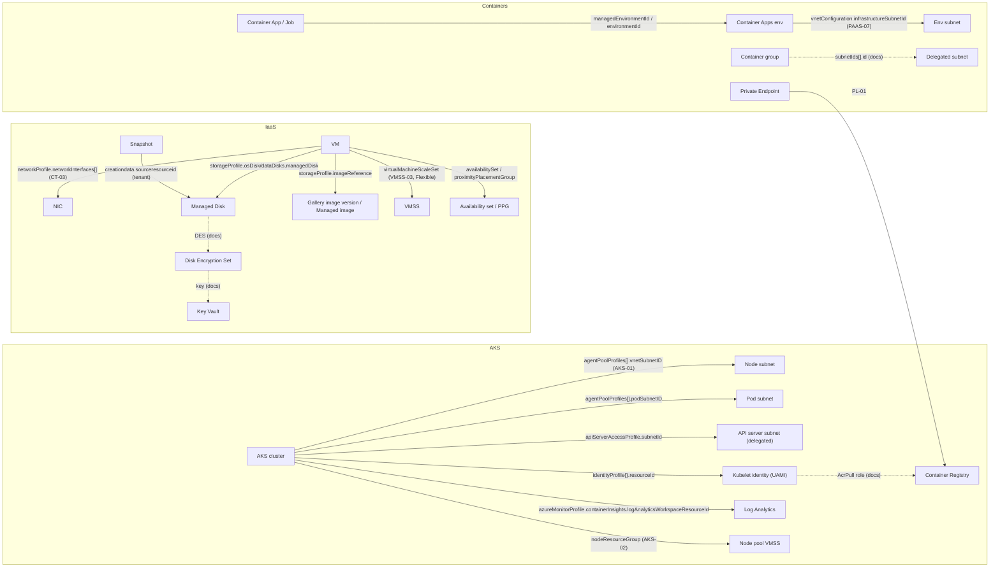

# 컴퓨팅·컨테이너 — Azure 리소스 관계 사전

> 대상: VM·디스크·이미지·갤러리·VMSS·AKS·Container Apps·ACI·ACR를 그리거나 검토하는 개발자와 운영자, Azure를 새로 배우는 사람
> 근거: Azure REST API 최신 스펙(파일별 최신 stable, stable이 없으면 최신 preview) + providers API + 실제 테넌트 교차 검증 (2026-10-15)
> - 스펙 버전: compute `2026-04-01`, containerservice `2026-07-01`, app `2026-07-01`, containerinstance `2026-07-01`, containerregistry `2025-11-01`
> - **디스크·스냅숏·디스크 암호화 집합(DES)·갤러리의 스펙**은 이번 파싱 결과에 들어 있지 않습니다. 이 유형들의 경로는 실제 테넌트에서 관찰한 것(`tenant`)과 문서(`docs`)로만 적었습니다.

## 1. 한눈에 보기

이 영역은 일하는 쪽(컴퓨팅)과 그 짐(디스크·이미지)을 다룹니다.

- **VM**은 NIC로 서브넷에 붙고, 관리 디스크(OS·데이터)를 ID로 참조합니다. 디스크는 DES를 거쳐 Key Vault의 키로 암호화될 수 있습니다.
- **VMSS**는 VM의 모델(틀)입니다.
  - Uniform 인스턴스는 VMSS의 자식입니다.
  - Flexible 인스턴스는 일반 VM이 확장 집합을 가리키는 구조입니다(핵심 사전 VMSS-01·03).
- **AKS**는 노드 풀(VMSS)을 노드 리소스 그룹에 만듭니다.
  - 노드·파드·API 서버가 각각 다른 서브넷을 쓸 수 있습니다.
  - 아웃바운드는 LB 또는 NAT의 공용 IP로 나갑니다.
  - 이미지는 kubelet 관리 ID가 ACR에서 가져옵니다(역할 할당으로 연결되며, ARM 속성은 없습니다).
- **Container Apps 환경**은 서브넷 하나에 주입되고, 관리 리소스 그룹(`ME_`/`MC_`)에 LB와 공용 IP를 둡니다. 앱·작업은 환경을 가리킵니다.
- **ACI 컨테이너 그룹**은 위임된 서브넷에 들어갑니다.
- **ACR**은 Private Endpoint로 사설 접근을 받습니다.

**5살 비유**
- Azure는 커다란 아파트 단지예요. VNet은 단지, 서브넷은 동이에요.
- VM은 어느 동(서브넷)에 있는 한 집이에요. NIC는 그 집 현관문(문패 = IP)이고, 디스크는 집 안의 서랍장이에요.
- DES는 금고(Key Vault)에 가서 열쇠를 빌려 오는 심부름꾼이에요. 심부름꾼 목에도 이름표(관리 ID)가 있어야 금고가 열쇠를 내줘요.
- AKS는 같은 모양의 집을 줄지어 짓고 돌보는 관리인이에요.
  - 집(노드)이 있는 동, 아이들(파드)이 노는 동, 관리 사무소(API 서버)가 있는 동이 따로일 수 있어요.
  - 물건(이미지)이 있는 창고(ACR) 방문에 "이 번호 이름표는 들어와도 돼" 쪽지(역할 할당 AcrPull)가 붙어 있어야, 이름표(kubelet 관리 ID)를 단 관리인이 물건을 꺼내 올 수 있어요.

(비유 대응표: 핵심 사전 입문 7)

## 2. 리소스 유형

| 유형 (ARM type) | 범위 | 한 줄 설명 | 문서 |
|---|---|---|---|
| `microsoft.compute/virtualmachines` | 리전 | 가상 머신. NIC·디스크·이미지·배치 그룹을 ID로 참조 | https://learn.microsoft.com/en-us/azure/templates/microsoft.compute/virtualmachines |
| `microsoft.compute/virtualmachines/extensions` | 자식 | VM 안에서 실행되는 에이전트·스크립트(모니터링·백업·ADE 등) | https://learn.microsoft.com/en-us/azure/virtual-machines/extensions/overview |
| `microsoft.compute/disks` | 리전 | 관리 디스크(OS·데이터). VM과 별개인 리소스 | https://learn.microsoft.com/en-us/azure/virtual-machines/managed-disks-overview |
| `microsoft.compute/snapshots` | 리전 | 디스크의 특정 시점 사본(증분 가능) | https://learn.microsoft.com/en-us/azure/virtual-machines/disks-incremental-snapshots |
| `microsoft.compute/diskencryptionsets` | 리전 | 고객 관리 키(CMK)로 디스크를 암호화하는 연결 고리 | https://learn.microsoft.com/en-us/azure/virtual-machines/disk-encryption |
| `microsoft.compute/diskaccesses` | 리전 | 디스크 가져오기·내보내기용 Private Link 대상 | https://learn.microsoft.com/en-us/azure/virtual-machines/disks-enable-private-links-for-import-export-portal |
| `microsoft.compute/galleries` (+ `/images`, `/images/versions`) | 리전 (하위는 자식) | Azure Compute Gallery: 갤러리 ⊃ 이미지 정의 ⊃ 이미지 버전 | https://learn.microsoft.com/en-us/azure/virtual-machines/azure-compute-gallery |
| `microsoft.compute/images` | 리전 | 레거시 관리 이미지(갤러리 사용 권장) | https://learn.microsoft.com/en-us/azure/virtual-machines/capture-image-resource |
| `microsoft.compute/restorepointcollections` | 리전 | VM 복원 지점 묶음(구성 + 디스크 스냅숏) | https://learn.microsoft.com/en-us/azure/virtual-machines/virtual-machines-create-restore-points |
| `microsoft.compute/availabilitysets` | 리전 | 장애·업데이트 도메인 분산 묶음 | https://learn.microsoft.com/en-us/azure/virtual-machines/availability-set-overview |
| `microsoft.compute/proximityplacementgroups` | 리전 | 지연 시간을 줄이려는 같은 데이터센터 배치 제약 | https://learn.microsoft.com/en-us/azure/virtual-machines/co-location |
| `microsoft.compute/hostgroups` (+ `/hosts`) | 리전 | 전용 물리 호스트 | https://learn.microsoft.com/en-us/azure/virtual-machines/dedicated-hosts |
| `microsoft.compute/capacityreservationgroups` | 리전 | VM 크기별 용량 예약 | https://learn.microsoft.com/en-us/azure/virtual-machines/capacity-reservation-overview |
| `microsoft.compute/sshpublickeys` | 리전 | SSH 공개 키 보관(VM이 ID로 참조하지 않음 — 생성 시 값 복사) | https://learn.microsoft.com/en-us/azure/virtual-machines/ssh-keys-portal |
| `microsoft.compute/virtualmachinescalesets` | 리전 | 확장 집합(Uniform/Flexible). 인스턴스의 모델 | https://learn.microsoft.com/en-us/azure/virtual-machine-scale-sets/virtual-machine-scale-sets-orchestration-modes |
| `microsoft.compute/virtualmachinescalesets/virtualmachines` | 자식 | Uniform 인스턴스(자기 NIC·디스크를 가짐) | 〃 |
| `microsoft.containerservice/managedclusters` | 리전 | AKS 클러스터(제어 평면은 Microsoft 관리) | https://learn.microsoft.com/en-us/azure/aks/core-aks-concepts |
| `microsoft.containerservice/managedclusters/agentpools` | 자식 | 노드 풀(실체는 노드 RG의 VMSS) | https://learn.microsoft.com/en-us/rest/api/aks/agent-pools/create-or-update |
| `microsoft.containerservice/snapshots` | 리전 | 노드 풀 구성 스냅숏(새 풀의 원본) | 〃 |
| `microsoft.containerservice/fleets` (+ `/members`) | 리전 (멤버는 자식) | 여러 AKS의 업그레이드·배치를 묶는 Fleet Manager | https://learn.microsoft.com/en-us/azure/kubernetes-fleet/overview |
| `microsoft.app/managedenvironments` | 리전 | Container Apps 환경(네트워크·로그 경계) | https://learn.microsoft.com/en-us/azure/container-apps/environment |
| `microsoft.app/containerapps` | 리전 | 컨테이너 앱(환경 안에서 실행) | 〃 |
| `microsoft.app/jobs` | 리전 | 일회성·예약 작업(환경 안에서 실행) | 〃 |
| `microsoft.app/sessionpools` | 리전 | 동적 세션 풀(환경 참조) | 〃 |
| `microsoft.containerinstance/containergroups` | 리전 | ACI 컨테이너 그룹(서버리스, 선택적으로 VNet 주입) | https://learn.microsoft.com/en-us/azure/container-instances/container-instances-vnet |
| `microsoft.containerregistry/registries` | 리전 | ACR 레지스트리 | https://learn.microsoft.com/en-us/azure/container-registry/container-registry-private-endpoints |
| `microsoft.containerregistry/registries/replications` | 자식 (복제본마다 자기 위치) | 지역 복제(geo-replication) | https://learn.microsoft.com/en-us/azure/container-registry/container-registry-geo-replication |

## 3. 관계 표

핵심 사전에 이미 있는 행은 반복하지 않습니다: **CT-03, VMSS-01, VMSS-02, VMSS-03, VMSS-04, VMSS-05, AKS-01, AKS-02, AKS-03, AKS-04, PAAS-07, AGW-05(Container App ingress FQDN), PL-01(ACR·AKS 사설 클러스터 PE의 선), LOG-01**

관계 하나에 주인 페이지 하나: 신원·키·로그 전송은 IDM, 배치·네트워크는 서비스 페이지. 다른 페이지에는 '→ <ID> 참고' 한 줄만 둔다. 핵심 사전 행을 다시 쓰는 행은 새 ID 없이 메모로 둔다.

| ID | 관계 (source → target) | 의미·방향 | ARM 속성 경로 | 근거 | 다이어그램 표현 | 출처 |
|---|---|---|---|---|---|---|
| CMP-01 | VM → 관리 디스크 (OS·데이터) | 구성 참조. 디스크는 독립 리소스라 VM을 지워도 따로 남을 수 있음 | `storageProfile.osDisk.managedDisk`, `storageProfile.dataDisks[].managedDisk` (디스크 쪽 역참조 경로는 이번 다이제스트에 없음) | `spec+tenant` ✓ | absorb — VM 카드·Inspector에 "디스크 n"과 목록. 디스크 타일을 따로 그리면 소음 | https://learn.microsoft.com/en-us/azure/virtual-machines/managed-disks-overview |
| CMP-02 | VM → 이미지 원본 | 구성 참조(생성 원본). Marketplace 이미지는 ID가 없고 게시자·제품·SKU로 지정(docs) | `storageProfile.imageReference` | `spec+tenant` ✓ ⚠ — 스펙은 gallery image version만 적었지만 테넌트에서는 `microsoft.compute/images`(관리 이미지)도 대상 | panel — 계보 정보, 운영 선 아님 | https://learn.microsoft.com/en-us/azure/virtual-machines/azure-compute-gallery |
| CMP-03 | VM 모델 NIC 구성 → 서브넷·NSG·ASG·LB/AGW 풀 | 구성 참조(모델). 플랫폼이 이 구성으로 실제 NIC를 만듦(주로 Flexible 인스턴스) | `networkProfile.networkInterfaceConfigurations[].ipConfigurations[].subnet`, `…networkSecurityGroup`, `…ipConfigurations[].{applicationSecurityGroups[], loadBalancerBackendAddressPools[], applicationGatewayBackendAddressPools[]}` | `spec:subresource` (대상은 이름에서 추정) | none — 실제 NIC(CT-02·CT-03·LB-02)로 그림. 모델 값으로 그리면 같은 선이 두 번 생김 | https://learn.microsoft.com/en-us/azure/templates/microsoft.compute/virtualmachines |
| CMP-04 | VM → 가용성 집합 | 소속. 기존 VM은 넣을 수 없고 생성할 때만 지정 | `availabilitySet` (가용성 집합 쪽 `virtualMachines[]`는 같은 관계의 역방향 목록 — 권위는 VM 쪽) | `spec:subresource` (대상 이름 추정, 문서로 확인) | badge — VM 카드에 "AS x". 포함 박스 아님(서브넷과 무관) | https://learn.microsoft.com/en-us/azure/virtual-machines/windows/change-availability-set |
| CMP-05 | VM·VMSS·가용성 집합·AKS 노드 풀 → 근접 배치 그룹(PPG) | 배치 제약(같은 데이터센터) | VM·VMSS·AS: `proximityPlacementGroup` / AKS: `agentPoolProfiles[].proximityPlacementGroupID`. **PPG 쪽 `virtualMachines[]`·`virtualMachineScaleSets[]`·`availabilitySets[]`는 읽기 전용** | `spec:subresource` / AKS `spec:arm-id` | chip — "PPG x". 데이터센터 하나의 장애가 그룹 전체에 미침을 Inspector에 적음 | https://learn.microsoft.com/en-us/azure/virtual-machines/co-location |
| CMP-06 | VM·VMSS·AKS 노드 풀 → 전용 호스트·호스트 그룹·용량 예약 그룹 | 배치·용량 제약 | VM: `host`, `hostGroup`, `capacityReservation.capacityReservationGroup` / VMSS: `hostGroup`, `virtualMachineProfile.capacityReservation.capacityReservationGroup` / AKS: `agentPoolProfiles[].{hostGroupID, capacityReservationGroupID}` | `spec:subresource` / AKS `spec:arm-id` | panel — 비용·용량 검토용 | https://learn.microsoft.com/en-us/azure/virtual-machines/capacity-reservation-overview |
| CMP-07 | → IDM-19 참고 (`sourceVault`) | | | | | |
| CMP-08 | → IDM-01·IDM-05 참고 | | | | | |
| CMP-09 | VM ⊃ 확장 | 포함(자식 리소스 `virtualMachines/{vm}/extensions/{name}`) | 리소스 ID 계층 | `docs` (유형 계층) | panel — Inspector 목록(AMA·백업·ADE 등). 카드에 그리지 않음 | https://learn.microsoft.com/en-us/azure/virtual-machines/extensions/overview |
| CMP-10·CMP-11 | 디스크 CMK 배지 — 관계 본문은 IDM-14·IDM-15 참고 (DES → Key Vault). | | | | | |
| CMP-12 | 디스크·스냅숏 → 원본 (디스크·스냅숏·갤러리 버전) | 계보(무엇에서 만들어졌나) | 디스크: `creationdata.sourceresourceid`(→ snapshots), `creationdata.imagereference`·`creationdata.galleryimagereference`(→ gallery image versions) / 스냅숏: `creationdata.sourceresourceid`(→ disks, snapshots) — 테넌트 관찰 경로(소문자 정규화) | `tenant` | panel — 복구·고아 분석용. 구성도 선 아님 | https://learn.microsoft.com/en-us/azure/virtual-machines/disks-incremental-snapshots |
| CMP-13 | 갤러리 ⊃ 이미지 정의 ⊃ 이미지 버전 → 원본 VM | 포함(ID 계층) + 원본 계보 | 이미지 버전: `storageprofile.source.virtualmachineid`(→ VM), `storageprofile.source`(→ 다른 이미지 버전) — 테넌트 관찰 | `tenant` + `docs`(계층) | panel — 이미지 계보 | https://learn.microsoft.com/en-us/azure/virtual-machines/azure-compute-gallery |
| CMP-14 | 관리 이미지 → 원본 VM·디스크·스냅숏 | 계보(레거시) | `sourceVirtualMachine`, `storageProfile.osDisk.{managedDisk, snapshot}`, `storageProfile.dataDisks[].{managedDisk, snapshot}` | `spec:subresource` (`managedDisk` 대상만 이름 추정, 나머지 "?") | panel | https://learn.microsoft.com/en-us/azure/virtual-machines/capture-image-resource |
| CMP-15 | VMSS 모델·AKS 노드 풀 → NSG·ASG | 보안 규칙 적용 | VMSS: `virtualMachineProfile.networkProfile.networkInterfaceConfigurations[].networkSecurityGroup`, `…ipConfigurations[].applicationSecurityGroups[]` / AKS: `agentPoolProfiles[].networkProfile.applicationSecurityGroups[]` | `spec:subresource` / AKS `spec:arm-id` | badge — SEC-01·SEC-02와 같은 배지. 실제 인스턴스 NIC에도 적용되는지는 NIC 쪽에서 확인 | https://learn.microsoft.com/en-us/azure/virtual-machine-scale-sets/virtual-machine-scale-sets-networking |
| CMP-16 | VMSS 모델 → LB 상태 프로브 | 롤링 업그레이드·자동 복구용 상태 신호. 인바운드 NAT 풀은 → NET-19 참고 | `virtualMachineProfile.networkProfile.healthProbe` → `loadBalancers/probes` (docs: 'A reference to a load balancer probe…') | `spec:subresource` + `docs` | line-dashed — VMSS-04와 같은 모델 기준 약한 근거 | https://learn.microsoft.com/en-us/azure/virtual-machine-scale-sets/virtual-machine-scale-sets-automatic-instance-repairs |
| CMP-17 | Uniform 인스턴스 → 자기 NIC·디스크 | 인스턴스 단위 구성(VMSS 자식 경로 아래 NIC) | `virtualMachineScaleSets/virtualMachines`: `networkProfile.networkInterfaces[]`, `storageProfile.osDisk.managedDisk`, `storageProfile.dataDisks[].managedDisk` (역참조 `virtualMachineResourceId`는 읽기 전용) | `spec:subresource` (대상 이름 추정. LB 백엔드가 이 NIC IP 구성을 가리킴은 핵심 사전 LB-02에서 테넌트로 확인) | absorb — VMSS 타일(VMSS-01) | https://learn.microsoft.com/en-us/azure/virtual-machine-scale-sets/virtual-machine-scale-sets-orchestration-modes |
| CMP-18 | VMSS 모델 → 이미지 | 생성 원본 | `virtualMachineProfile.storageProfile.imageReference` | `spec+tenant` ✓ | panel | https://learn.microsoft.com/en-us/azure/virtual-machines/azure-compute-gallery |
| CMP-19 | AKS 노드 풀 → 파드 서브넷 | 파드 IP를 노드와 **다른** 서브넷에서 받음(Azure CNI Pod Subnet). 없으면 노드 서브넷 또는 오버레이 | `agentPoolProfiles[].podSubnetID` (노드 풀 자식: `podSubnetID`) | `spec:arm-id` | badge — 서브넷에 "파드 (AKS x)". 노드처럼 contain하지 않음. 비어 보이는 서브넷 오해를 막음 | https://learn.microsoft.com/en-us/azure/aks/concepts-network-azure-cni-pod-subnet — "assigns IP addresses to pods from a separate subnet from your cluster nodes" |
| CMP-20 | AKS → API 서버 서브넷 (위임 `Microsoft.ContainerService/managedClusters`) | API 서버 VNet 통합: API 서버 ILB VIP가 이 서브넷에 들어옴. 노드 → API 서버 트래픽은 사설로만 감 | `apiServerAccessProfile.subnetId` | `spec:arm-id` | badge — 서브넷에 "API 서버 (AKS x)". 고객 리소스(LB)가 없으므로 카드 없음 | https://learn.microsoft.com/en-us/azure/aks/api-server-vnet-integration — "projects the API server endpoint directly into a delegated subnet" |
| CMP-21 | AKS 사설 클러스터 → Private Endpoint·사설 DNS 영역 | 노드가 Private Link로 API 서버에 접속. PE 리소스와 사설 DNS 영역은 노드 리소스 그룹에, PE의 IP는 첫 노드 풀 서브넷에 있다 (Learn: 'a private endpoint (1) and a private DNS zone (2) are created in the cluster-managed resource group'). PE를 지우거나 바꾸면 클러스터가 멈춤 | `apiServerAccessProfile.enablePrivateCluster`, `apiServerAccessProfile.privateDNSZone` (`system` \| `none` \| 사설 DNS 영역 리소스 ID). AKS 쪽 `privateLinkResources[].privateLinkServiceID`는 읽기 전용 역참조. PE 쪽은 PL-01 | `docs` (+ 읽기 전용 역참조) | PE 카드(첫 노드 풀 서브넷 — 고객 쪽 NIC가 있는 일반 PE) + PL 선 → 클러스터 카드(VNet 밖) + chip '사설 API'. 공용 API = 칩만(VNet 밖, Azure 관리 끝점). 식별: PE가 `nodeResourceGroup`에 있고 대상 PLS가 그래프 밖이다. 관리형 PE 공통 규칙: "관리형 PE·공유 프라이빗 링크는 고객 쪽 NIC를 만들지 않는다 — Learn: 'Managed private endpoints … don't create customer-visible network interfaces' (foundry/how-to/managed-virtual-network). 서비스 → 대상 선으로 그리고 서브넷 안에 두지 않는다. 승인 상태는 대상의 `privateEndpointConnections`에서 읽는다." | https://learn.microsoft.com/en-us/azure/aks/private-clusters — "places the API server private endpoint in the subnet used by the first node pool" |
| CMP-22 | AKS LB 프로필 → 아웃바운드 공용 IP·접두사 | 아웃바운드(SNAT 출구). 관리형 IP는 AKS가 노드 RG에 만듦 | 직접 지정(BYO): `networkProfile.loadBalancerProfile.outboundIPs.publicIPs[]`, `networkProfile.loadBalancerProfile.outboundIPPrefixes.publicIPPrefixes[]` / 실제 적용(관리형 포함): `networkProfile.loadBalancerProfile.effectiveOutboundIPs[]` (읽기 전용) | `spec:subresource` (대상 이름 추정. 문서로 확인) | chip — AKS 카드 출구 "IP n"(AKS-04 `loadBalancer`) | https://learn.microsoft.com/en-us/azure/aks/egress-outboundtype — "A public IP address is created for cluster egress." |
| CMP-23 | AKS NAT 게이트웨이 프로필 → 아웃바운드 IP | 아웃바운드(`managedNATGateway`). `userAssignedNATGateway`는 서브넷의 NAT(EDGE-01)를 씀 | `networkProfile.natGatewayProfile.outboundIPs.publicIPs[]`, `networkProfile.natGatewayProfile.outboundIPPrefixes.publicIPPrefixes[]`, 실제: `networkProfile.natGatewayProfile.effectiveOutboundIPs[]` (읽기 전용) | `spec:arm-id` | chip — 출구 칩 "NAT (AKS 관리)" | https://learn.microsoft.com/en-us/azure/aks/nat-gateway |
| CMP-24 | AKS 노드 풀 → 노드 공용 IP 접두사 | 노드마다 공용 IP(인스턴스 수준). 인터넷에서 노드로 직접 들어오는 노출면 | `agentPoolProfiles[].enableNodePublicIP`(판정 키), `agentPoolProfiles[].nodePublicIPPrefixID`(선택) | `spec:arm-id` (접두사) + docs (`enableNodePublicIP` 판정 키) | badge — 노드 풀에 "노드 공용 IP" 경고 배지(보안 검토). 배지 조건은 `agentPoolProfiles[].enableNodePublicIP=true`이다. `nodePublicIPPrefixID`는 선택이라 접두사 없이 공용 IP를 쓰는 노드 풀도 있다 | https://learn.microsoft.com/en-us/azure/aks/use-node-public-ips |
| CMP-25 | → IDM-04 참고 (kubelet 관리 ID). | | | | | |
| CMP-26 | AKS ⇢ ACR ("attach") | 이미지 끌어오기 권한. **ARM 속성이 아니라** ACR 범위의 역할 할당(`AcrPull`, ABAC 모드면 `Container Registry Repository Reader`)을 kubelet ID에 줌 | — (역할 할당: 범위 = 레지스트리 ID, 주체 = CMP-25의 objectId) | `docs` | line-dashed — 역할 할당을 찾았을 때만. 못 찾으면 그리지 않음(추측 금지) | https://learn.microsoft.com/en-us/azure/aks/cluster-container-registry-integration — "assigns the AcrPull role to the … managed identity associated with the agent pool" |
| CMP-27 | → IDM-28 참고 (AKS → Log Analytics) | | | | | |
| CMP-28 | → IDM-18 참고 (KMS / Istio CA) | | | | | |
| CMP-29 | AKS 앱 라우팅 → DNS 영역(공용·사설) | 추가 기능이 레코드를 관리 | `ingressProfile.webAppRouting.dnsZoneResourceIds[]` | `spec:arm-id` | panel — 인그레스 이름 해석 | https://learn.microsoft.com/en-us/azure/aks/app-routing-dns-ssl |
| CMP-30 | AKS 노드 풀 → 노드 풀 스냅숏 | 생성 원본(구성 복제) | `agentPoolProfiles[].creationData.sourceResourceId` (노드 풀 자식: `creationData.sourceResourceId`) | `spec:arm-id` (허용 대상 `*`. 스냅숏 유형은 REST 예시로 확인) | panel | https://learn.microsoft.com/en-us/rest/api/aks/agent-pools/create-or-update |
| CMP-31 | Fleet 멤버 → AKS 클러스터 | 소속(다중 클러스터 업그레이드 묶음) | `fleets/members`: `clusterResourceId` | `spec:arm-id` | chip — AKS 카드 "Fleet x" | https://learn.microsoft.com/en-us/azure/kubernetes-fleet/overview |
| CMP-32 | Container App·Job·세션 풀 → 환경 | 포함(앱은 환경 안에서 실행) | 앱: `managedEnvironmentId`, `environmentId` / 작업: `environmentId` / 세션 풀: `environmentId` | 앱·작업 `spec:id-string`(대상 "?" — 문서상 환경) / 세션 풀 `spec:arm-id`(→ managedenvironments) | contain — 환경 박스 안의 앱 카드. 환경이 서브넷에 있으면 PAAS-07로 그 서브넷 안 | https://learn.microsoft.com/en-us/azure/container-apps/environment |
| CMP-33 | Container Apps 환경 → 워크로드 프로필 | 앱이 돌 계산 자원(Consumption·Dedicated). 서브넷 규칙이 환경 유형에 따라 다름 | — (ID 참조 아님: 이름으로 연결. 이번 다이제스트에 경로 없음) | `docs` | chip — 환경 카드 "Dedicated n". 워크로드 프로필 환경은 서브넷 `/27` 이상 + `Microsoft.App/environments` 위임, Consumption 전용은 `/23` 이상 + 위임 금지 | https://learn.microsoft.com/en-us/azure/container-apps/custom-virtual-networks — "You must delegate your subnet to `Microsoft.App/environments`." |
| CMP-34 | Container Apps 환경 → Log Analytics | 로그 전송. 대상이 `log-analytics`일 때만 작업 영역을 **ARM ID가 아닌 작업 영역 ID(GUID) `customerId` + 공유 키**로 지정. `azure-monitor`면 진단 설정(LOG-01) | — (ARM 템플릿 문서의 `appLogsConfiguration.logAnalyticsConfiguration.customerId`. 이번 다이제스트에 경로 없음) | `docs` | line-dashed — 작업 영역의 고객 ID와 **정확히 하나** 일치할 때만. 아니면 미확인 | https://learn.microsoft.com/en-us/azure/templates/microsoft.app/managedenvironments |
| CMP-35 | Container Apps 환경 → 관리 리소스 그룹 (LB·공용 IP) | 플랫폼이 만든 인프라. 워크로드 프로필 환경은 `ME_`(이름 변경 가능), Consumption 전용은 `MC_`. 외부 환경엔 인바운드용 공용 IP + LB, 내부 환경엔 LB만 | `managedEnvironments.infrastructureResourceGroup`(이름 문자열, ARM ID 아님). 이름을 바꿀 수 있어 `ME_`/`MC_` 접두사로 판별하지 않는다 | `docs` | chip — 그 LB·공용 IP에 "Container Apps 관리"(AKS-03처럼). 사용자 LB로 오해하지 않게 함 | https://learn.microsoft.com/en-us/azure/container-apps/custom-virtual-networks — "prefixed with `ME_` by default" |
| CMP-36 | Container App → 아웃바운드 서브넷 ⚠ | **의미 미확인** — 최신 스펙에만 있음 | `networking.outboundVnetSubnetId` | `spec:id-string` (대상 "?", 테넌트·문서 미확인) | none — 확인 전까지 그리지 않음. CT-09 깊은 스캔이 이 값으로 앱을 서브넷에 넣지 않게 막아야 함 | (문서 미확인) |
| CMP-37 | ACI 컨테이너 그룹 → 위임 서브넷 | 주입. 위임 대상 `Microsoft.ContainerInstance/containerGroups`. 그 서브넷엔 컨테이너 그룹만 들어감. 아웃바운드는 NAT 게이트웨이만 지원 | `containerGroups.subnetIds[].id` (위임 서브넷). 레거시 `networkProfile.id` → `microsoft.network/networkprofiles` (`containerNetworkInterfaceConfigurations[].ipConfigurations[].subnet`, spec:typed-ref) — Learn: network profiles 'are retired as of the 2021-07-01 API version' | `docs` / 레거시 `spec:typed-ref` | contain — 서브넷 안 카드. 출구 = 서브넷의 NAT(EDGE-01) | https://learn.microsoft.com/azure/container-instances/container-instances-vnet — "you must use a NAT gateway for outbound connectivity" |
| CMP-38 | ACI 컨테이너 그룹 → Log Analytics | 로그 전송 | `diagnostics.logAnalytics.workspaceResourceId` | `spec:id-string` (대상 이름 추정) | line-dashed — 로그 레이어 | https://learn.microsoft.com/en-us/azure/container-instances/container-instances-log-analytics |
| CMP-40 | ACR ⊃ 복제 | 포함(자식 `registries/replications`). 각 복제본은 자기 `location`을 가짐 | 리소스 ID 계층 | `docs` (유형 계층) | chip — "복제 n (지역 목록)". 리전 박스는 레지스트리 홈 리전만(REG-01) | https://learn.microsoft.com/en-us/azure/container-registry/container-registry-geo-replication |
| CMP-41 | AKS → Application Gateway (AGIC 애드온) | 인그레스 데이터 경로 | `addonProfiles.ingressApplicationGateway.config.applicationGatewayId` / `effectiveApplicationGatewayId` | docs | line (AGW → AKS) | https://learn.microsoft.com/azure/application-gateway/tutorial-ingress-controller-add-on-existing |
| CMP-42 | 복원 지점 컬렉션 → VM | 원본 VM | `restorePointCollections.source` | tenant ✓ | panel (VM 카드 '복원 지점 n') | https://learn.microsoft.com/azure/virtual-machines/virtual-machines-create-restore-points |
| CMP-43 | VM → 부트 진단 Storage | 진단 데이터 저장 | `diagnosticsProfile.bootDiagnostics.storageUri` (URI — 비면 관리형 Storage) | docs, fqdnMatch | 로그 선(기본 끔), 후보가 정확히 1개일 때만 | https://learn.microsoft.com/azure/virtual-machines/boot-diagnostics |
| CMP-44 | Fleet 허브 → 서브넷 | 허브 클러스터의 API 서버·에이전트 서브넷 | `fleets.hubProfile.apiServerAccessProfile.subnetId`, `hubProfile.agentProfile.subnetId` | spec:arm-id | contain | https://learn.microsoft.com/azure/kubernetes-fleet/concepts-fleet |
| CMP-45 | AKS → 부트스트랩 ACR | 네트워크 격리 클러스터가 이미지를 가져오는 캐시 레지스트리(`bootstrapProfile.artifactSource=Cache`) | `bootstrapProfile.containerRegistryId` | spec:arm-id | line-dashed (AKS → ACR, cfg) | https://learn.microsoft.com/azure/aks/concepts-network-isolated |

- **PL-01 메모**: ACR PE는 PL-01 그대로 (groupId `registry`, 지역 복제본마다 데이터 엔드포인트).

## 4. 자주 하는 오해

- **"AKS에 ACR을 붙이면 클러스터 리소스에 ACR ID가 저장된다."** → 거짓입니다.
  - `--attach-acr`는 레지스트리 범위의 역할 할당(`AcrPull`)을 kubelet 관리 ID에 주는 것뿐입니다(CMP-26). AKS 속성에서 찾으면 안 되고, 역할 할당에서 찾아야 합니다.
  - `bootstrapProfile.containerRegistryId`는 다른 용도의 속성이므로 attach의 근거로 쓰지 않습니다. 의미는 CMP-45에 있습니다.
  - 출처: https://learn.microsoft.com/en-us/azure/aks/cluster-container-registry-integration
- **"kubelet ID = 클러스터(제어 평면) ID."** → 거짓입니다.
  - 제어 평면 ID는 LB·공용 IP·CSI 드라이버를 관리합니다.
  - kubelet ID(`<클러스터>-agentpool`)는 ACR 인증에 쓰고, 기본으로 노드 리소스 그룹에 만들어집니다.
  - 출처: https://learn.microsoft.com/en-us/azure/aks/managed-identity-overview
- **"파드는 노드 서브넷의 IP를 쓴다."** → 구성에 따라 다릅니다.
  - `podSubnetID`가 있으면 파드는 별도 서브넷에서 IP를 받습니다(CMP-19).
  - 오버레이 모드면 VNet 밖의 파드 CIDR을 씁니다.
  - 노드 서브넷만 보고 "IP가 부족하다"거나 "비었다"고 판정하면 틀립니다.
  - 출처: https://learn.microsoft.com/en-us/azure/aks/concepts-network-azure-cni-pod-subnet
- **"사설 클러스터의 Private Endpoint는 내가 만든 것이라 정리해도 된다."** → 거짓입니다.
  - AKS가 첫 노드 풀 서브넷에 PE를 만들고, 노드 RG에 사설 DNS 영역을 만듭니다.
  - 고객 서브넷의 PE를 지우거나 바꾸면 클러스터가 멈춥니다.
  - 출처: https://learn.microsoft.com/en-us/azure/aks/private-clusters
- **"PPG·가용성 집합에서 VM을 추가한다."** → 거짓입니다.
  - 관계는 구성원 쪽(`proximityPlacementGroup`, `availabilitySet`)에 설정합니다. PPG의 구성원 목록은 읽기 전용입니다.
  - 가용성 집합은 VM을 만들 때만 지정할 수 있습니다. 바꾸려면 VM을 다시 만들어야 합니다.
  - 출처: https://learn.microsoft.com/en-us/azure/virtual-machines/windows/change-availability-set
- **"Container Apps 환경 서브넷은 항상 위임해야 한다."** → 절반만 맞습니다.
  - 워크로드 프로필 환경은 `Microsoft.App/environments`로 위임해야 합니다(`/27` 이상).
  - Consumption 전용 환경은 위임하면 **안 됩니다**(`/23` 이상).
  - 출처: https://learn.microsoft.com/en-us/azure/container-apps/custom-virtual-networks
- **"VNet에 넣은 ACI는 기본 아웃바운드나 공용 IP로 나간다."** → 거짓입니다.
  - VNet에 배포한 컨테이너 그룹의 아웃바운드는 NAT 게이트웨이만 지원합니다.
  - 위임된 서브넷에는 컨테이너 그룹만 들어갈 수 있습니다.
  - 출처: https://learn.microsoft.com/en-us/azure/container-instances/container-instances-vnet
- **"`ME_`/`MC_` 리소스 그룹의 LB는 사용자가 만든 LB다."** → 거짓입니다.
  - Container Apps(또는 AKS)가 관리하는 인프라이며, 문서는 수정하지 말라고 합니다(CMP-35, AKS-03).
  - 출처: https://learn.microsoft.com/en-us/azure/container-apps/custom-virtual-networks

## 5. 이 플랫폼 반영 상태

### 이미 그리는 것

| 관계 | 핵심 사전 ID | 구현 위치 |
|---|---|---|
| VM ← NIC 흡수 | CT-03 | `azure.ts` |
| VMSS Uniform 자식 · 모델 서브넷 · Flexible 소속 · 풀 참조 | VMSS-01~04 | `azure.ts` |
| AKS 노드 서브넷 · 노드 풀 VMSS · AKS 관리 LB | AKS-01~03 | `azure.ts` |
| Container App ingress FQDN → AGW 백엔드 | AGW-05 | `azure.ts` |
| ACR 등 Private Endpoint 선 | PL-01 | `azure.ts` |
| 로그 선 | LOG-01 | `azure.ts` |

- AKS 노드에는 `azure.ts`가 `apiServerAccessProfile.enablePrivateCluster`·`privateFQDN`·`authorizedIPRanges`를 메타데이터로만 읽습니다.
- 아직 없는 것:
  - AKS-04(아웃바운드 유형 칩)
  - PAAS-07(Container Apps 환경 → 인프라 서브넷)
- **CT-09 위험**: `findSubnetReferenceInProps`의 깊은 스캔(`deepScanForSubnetId`)이 Container Apps 환경·ACI를 **우연히** 서브넷에 넣을 수 있습니다. 앱의 `networking.outboundVnetSubnetId`(CMP-36, 의미 미확인)로 앱을 서브넷 안에 잘못 둘 수도 있습니다. 명시 규칙(PAAS-07·CMP-37)을 먼저 두고, CMP-36 경로는 스캔에서 빼야 합니다.

### 다음에 추가할 것 (우선순위순)

1. **CMP-19 파드 서브넷 · CMP-20 API 서버 서브넷 배지**
   - 이유: 이미 읽는 `agentPoolProfiles`·`apiServerAccessProfile` 옆의 값이라 비용이 낮습니다. 지금은 이 서브넷들이 "비었거나 미사용"으로 보입니다.
   - 속성: `agentPoolProfiles[].podSubnetID`, `apiServerAccessProfile.subnetId`
2. **PAAS-07 + CMP-32 + CMP-35 Container Apps 환경 박스**
   - 이유: 앱이 환경 안에 담기고, `ME_`/`MC_` RG의 LB·공용 IP에 "Container Apps 관리" 칩을 답니다. 사용자 LB 오인과 인터넷 진입 오판을 막습니다. AKS-03과 같은 방식입니다.
   - 속성: `vnetConfiguration.infrastructureSubnetId`, `managedEnvironmentId`/`environmentId`, RG 이름
3. **CMP-22·23 + AKS-04 AKS 출구 칩**
   - 이유: `effectiveOutboundIPs[]`(읽기 전용)로 실제 출구 IP를 보여 줍니다. 방화벽 허용 목록 검토에 바로 쓰입니다.
   - 속성: `networkProfile.outboundType`, `loadBalancerProfile.effectiveOutboundIPs[]`, `natGatewayProfile.effectiveOutboundIPs[]`
4. **CMP-25·26 kubelet ID → ACR 역할 할당**
   - 이유: 통합 위험(`/security/risk`)과 정책 인사이트가 "어떤 클러스터가 어느 레지스트리를 당길 수 있나"를 근거 등급 `perm`으로 보여 줄 수 있습니다. 역할 할당 조회가 필요합니다.
   - 속성: `identityprofile.kubeletidentity.resourceid` → objectId → ACR 범위 roleAssignments
5. **CMP-27 Container Insights 작업 영역**
   - 이유: AKS 모니터링 화면이 클러스터별 작업 영역을 자동으로 고릅니다. 새 경로를 먼저 읽고, 없으면 레거시 경로를 읽습니다.
   - 속성: `azureMonitorProfile.containerInsights.logAnalyticsWorkspaceResourceId`, 그다음 `addonProfiles.omsagent.config.logAnalyticsWorkspaceResourceID`(대소문자 무시)
6. **CMP-01·10 VM Inspector의 디스크·CMK 배지**
   - 이유: 보안 권고(디스크 CMK)와 구성도를 잇습니다. 디스크 스펙이 다이제스트에 없으므로, DES는 실제 디스크 응답으로 먼저 확인해야 합니다.
7. **CMP-37 ACI 서브넷 포함 + 출구 = NAT**
   - 이유: ACI가 아니라면 "NAT 없음 = 기본 아웃바운드"로 오판할 수 있습니다.

### 미확인으로 남긴 것

| 항목 | 상태 |
|---|---|
| `networking.outboundVnetSubnetId` (Container App, CMP-36) | 스펙에만 있음 |
| `hostedSystemProfile.{systemNodeSubnetID, nodeSubnetID}` (AKS) | 스펙에만 있음, 의미 미확인 |
| 앱의 `environmentId` vs `managedEnvironmentId` | 둘 다 스펙에 있음. 연결 환경(`connectedenvironments`)을 가리킬 수 있는지 미확인 |
| 디스크·DES·갤러리 스펙 경로 | 다이제스트에 없음. 디스크 쪽 DES·`managedBy` 경로는 실제 응답으로 확인 필요 |
| 사설 클러스터 PE의 대상 PLS (CMP-21) | 그래프에 나타나는지 테넌트 미검증 |

**5살 설명**
단지 지도에 집(VM)과 현관문(NIC)은 이미 잘 그려요. 이제는 아이들이 노는 동(파드 서브넷)과 관리 사무소가 있는 동(API 서버 서브넷)에도 이름표를 붙이려고 해요. 관리업체가 지어 준 창고(관리 리소스 그룹의 LB)에는 "관리업체가 지은 것" 딱지를 붙일 거예요. 그리고 창고 방문에 "이 번호 이름표는 들어와도 돼" 쪽지(역할 할당 AcrPull)가 붙어 있는지는 그 쪽지를 직접 봐야만 알 수 있어요. 그래서 쪽지가 확인될 때만 선을 그어요. (비유 대응표: 핵심 사전 입문 7)
