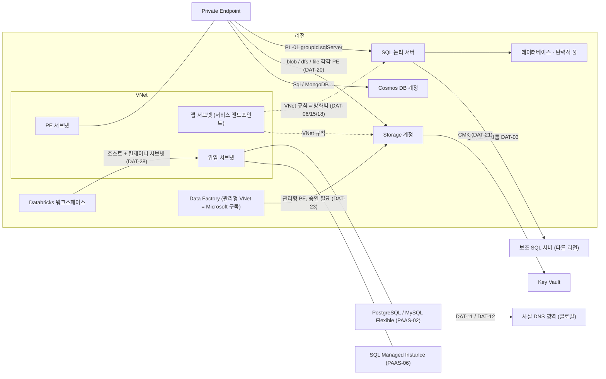

# 데이터·스토리지 — Azure 리소스 관계 사전

> **대상**: SQL Database·SQL Managed Instance·PostgreSQL/MySQL Flexible·Cosmos DB·Redis·Storage·Data Factory·Synapse·Databricks·NetApp Files·Data Explorer를 다루는 개발자, 운영자, 보안 검토자
> **근거**: Azure REST API 최신 스펙(파일별 최신 stable, stable이 없으면 최신 preview) + providers API + 실제 테넌트 교차 검증 (2026-10-15)
> - 스펙 버전: sql 2025-01-01, postgresql 2026-10-01, mysql 2024-12-30, cosmos-db 2026-03-15, redis 2024-11-01, redisenterprise 2026-09-01, storage 2026-09-01, datafactory 2018-06-01, synapse 2021-06-01, databricks 2026-01-01, netapp 2026-06-01, azure-kusto 2025-02-14
> - ⚠ 다이제스트는 `microsoft.sql/servers`·`servers/databases`·`servers/elasticpools`를 **2014-04-01 스펙**으로 파싱했다. 그래서 최신 API에 있는 데이터베이스 쪽 속성(풀 소속 등)은 다이제스트에 없고, 여기서는 "docs only"로 적었다.
> **상위 문서**: [핵심 관계 사전](../azure-resource-relationships.md) — 이 페이지는 핵심 사전의 ID를 바꾸지 않는다. 새 행은 `DAT-` 접두사를 쓴다.

## 1. 한눈에 보기

데이터 서비스가 네트워크에 붙는 방식은 세 가지뿐이다.

1. **서브넷 안으로 주입**: 서비스가 위임 서브넷 안에 사설 IP로 들어간다. PostgreSQL·MySQL Flexible(사설 접근), SQL Managed Instance, NetApp Files 볼륨, Databricks 클러스터, Premium Redis가 이 방식이다.
2. **Private Endpoint로 끌어오기**: 서비스는 밖에 있고, 내 서브넷에 생긴 NIC 하나가 그 서비스의 특정 하위 리소스(groupId)를 가리킨다. SQL 논리 서버, Storage, Cosmos DB, Redis, Synapse, ADF가 이 방식이다.
3. **공용 엔드포인트 + 방화벽**: VNet 규칙(서비스 엔드포인트), IP 규칙, 리소스 인스턴스 규칙으로 막는다. 이 경우 서비스는 **서브넷 안에 있지 않다**.

같은 "subnet ID"라도 1번은 배치이고 3번은 허용 목록이다. 이 둘을 섞으면 구성도가 거짓말을 한다. 그 밖에 데이터끼리의 관계(장애 조치 그룹, 복제본, 지역 복제)와 키·신원 관계(CMK in Key Vault, 사용자 할당 ID)가 있다.

**5살 비유**: Azure는 커다란 아파트 단지이고, 데이터 서비스는 물건을 맡아 두는 가게예요.

- **위임 서브넷**은 가게가 단지 안의 한 동(서브넷)으로 이사 와서 그 동을 통째로 혼자 쓰는 거예요.
- **Private Endpoint**는 가게는 단지 밖에 있지만, 우리 동에 그 가게로 통하는 전용 쪽문을 하나 낸 거예요. 쪽문은 진열대(blob, file…)마다 따로 내야 해요.
- **VNet 규칙**은 가게 문지기가 들고 있는 "○○동 손님 통과" 명단이에요. 명단에 우리 동이 있다고 가게가 우리 단지 안에 있는 건 아니에요.

(비유 대응표: 핵심 사전 입문 7)

## 2. 리소스 유형

| 유형 (ARM type) | 범위 | 한 줄 설명 | 문서 |
|---|---|---|---|
| `microsoft.sql/servers` | 리전 | SQL Database 논리 서버. 로그인·방화벽·장애 조치 그룹의 관리 지점이자 `<name>.database.windows.net` 엔드포인트. 서브넷에 들어가지 않는다 | https://learn.microsoft.com/azure/azure-sql/database/logical-servers |
| `microsoft.sql/servers/databases` | 자식 (서버와 같은 리전) | 단일 데이터베이스 또는 풀 소속 데이터베이스 | 〃 |
| `microsoft.sql/servers/elasticpools` | 자식 | 같은 서버의 데이터베이스들이 자원을 나눠 쓰는 풀 | https://learn.microsoft.com/azure/azure-sql/database/elastic-pool-overview |
| `microsoft.sql/servers/failovergroups` | 자식 | 데이터베이스 묶음의 지역 간 복제와 장애 조치. 수신기 DNS `<fog>.database.windows.net` | https://learn.microsoft.com/azure/azure-sql/database/failover-group-sql-db |
| `microsoft.sql/servers/virtualnetworkrules` | 자식 | 서비스 엔드포인트 기반 서버 방화벽 규칙 | https://learn.microsoft.com/azure/azure-sql/database/vnet-service-endpoint-rule-overview |
| `microsoft.sql/managedinstances` | 리전 | SQL Managed Instance. `Microsoft.Sql/managedInstances` 위임 서브넷에 주입된다 | https://learn.microsoft.com/azure/azure-sql/managed-instance/connectivity-architecture-overview |
| `microsoft.sql/virtualclusters` | 리전 | MI 서브넷마다 자동으로 생기고 지워지는 가상 클러스터. 사용자가 만들지 않는다 | https://learn.microsoft.com/azure/azure-sql/managed-instance/virtual-cluster-architecture |
| `microsoft.sql/instancepools` | 리전 | MI 여러 개가 자원을 나누는 인스턴스 풀 | 〃 |
| `microsoft.dbforpostgresql/flexibleservers` | 리전 | PostgreSQL Flexible. 네트워크 모드는 "사설 접근(VNet 통합)"과 "공용 + PE" 중 하나 | https://learn.microsoft.com/azure/postgresql/network/concepts-networking-private |
| `microsoft.dbformysql/flexibleservers` | 리전 | MySQL Flexible. 위임 서브넷 + 사설 DNS 영역, 또는 공용/PE | https://learn.microsoft.com/azure/mysql/flexible-server/concepts-networking-vnet |
| `microsoft.documentdb/databaseaccounts` | 리전 (데이터는 `locations[]`의 모든 리전에 복제) | Cosmos DB 계정 | https://learn.microsoft.com/azure/cosmos-db/distribute-data-globally |
| `microsoft.documentdb/mongoclusters` | 리전 | Cosmos DB for MongoDB vCore 클러스터 | https://learn.microsoft.com/azure/private-link/private-endpoint-dns |
| `microsoft.cache/redis` | 리전 | Azure Cache for Redis (Basic/Standard/Premium). **전 SKU 은퇴 일정이 발표됨** | https://learn.microsoft.com/azure/azure-cache-for-redis/cache-network-isolation |
| `microsoft.cache/redisenterprise` | 리전 | Azure Managed Redis와 Redis Enterprise. 데이터베이스 단위 활성 지역 복제 | https://learn.microsoft.com/azure/redis/how-to-active-geo-replication |
| `microsoft.storage/storageaccounts` | 리전 | Storage 계정 (blob·dfs·file·queue·table·web 하위 서비스) | https://learn.microsoft.com/azure/storage/common/storage-network-security |
| `microsoft.datafactory/factories` | 리전 | Data Factory. 관리형 VNet은 팩터리와 같은 리전, Microsoft 구독에 있다 | https://learn.microsoft.com/azure/data-factory/managed-virtual-network-private-endpoint |
| `microsoft.datafactory/factories/integrationruntimes` | 자식 | 실행 환경: Azure IR(관리형 VNet 가능), 자체 호스팅 IR(고객 VM), Azure-SSIS IR | https://learn.microsoft.com/azure/data-factory/concepts-integration-runtime |
| `microsoft.datafactory/factories/linkedservices` | 자식 | 데이터 저장소 연결 정의(연결 문자열과 같음) | https://learn.microsoft.com/azure/data-factory/concepts-linked-services |
| `microsoft.datafactory/factories/managedvirtualnetworks/managedprivateendpoints` | 자식 | 관리형 VNet 안의 PE. 대상 소유자의 승인이 필요하다 | https://learn.microsoft.com/azure/data-factory/managed-virtual-network-private-endpoint |
| `microsoft.synapse/workspaces` | 리전 | Synapse 워크스페이스. 기본 ADLS Gen2 계정이 필수이고, 관리형 VNet은 생성할 때만 정한다 | https://learn.microsoft.com/azure/synapse-analytics/security/synapse-workspace-managed-vnet |
| `microsoft.synapse/privatelinkhubs` | 리전 | Synapse Studio 접근용 PE 대상 (groupId `Web`) | https://learn.microsoft.com/azure/private-link/private-endpoint-dns |
| `microsoft.databricks/workspaces` | 리전 | Databricks 워크스페이스. VNet 주입 시 위임 서브넷 2개, 관리형 리소스 그룹 1개를 쓴다 | https://learn.microsoft.com/azure/databricks/security/network/classic/vnet-inject |
| `microsoft.databricks/accessconnectors` | 리전 | 관리 ID를 Databricks(Unity Catalog)에 연결하는 리소스 | https://learn.microsoft.com/azure/databricks/connect/unity-catalog/cloud-storage/azure-managed-identities |
| `microsoft.netapp/netappaccounts` | 리전 | NetApp 계정. CMK용 Key Vault를 지정한다 | https://learn.microsoft.com/azure/azure-netapp-files/configure-customer-managed-keys |
| `microsoft.netapp/netappaccounts/capacitypools/volumes` | 자식 (리전) | NetApp 볼륨. `Microsoft.NetApp/volumes` 위임 서브넷에 들어간다 | https://learn.microsoft.com/azure/azure-netapp-files/azure-netapp-files-delegate-subnet |
| `microsoft.kusto/clusters` | 리전 | Azure Data Explorer. 네트워크 격리는 이제 PE로 한다 (VNet 주입은 폐지 공지) | https://learn.microsoft.com/azure/data-explorer/security-network-overview |
| `microsoft.network/privateendpoints/privatednszonegroups` | 자식 | PE가 A 레코드를 쓰는 사설 DNS 영역 지정 (네트워크 영역 유형이지만 데이터 서비스 이름 해석의 핵심) | https://learn.microsoft.com/azure/private-link/private-endpoint-dns |

## 3. 관계 표

핵심 사전에 이미 있는 행은 반복하지 않는다: **CT-06, CT-08, CT-09, SEC-05, PL-01, PL-03, PL-05, PAAS-02, PAAS-03, PAAS-04, PAAS-05, PAAS-06, LOG-01, REG-01, REG-04**. 아래 행은 이 행들을 보강하거나 새 관계를 더한다.

관계 하나에 주인 페이지 하나: 신원·키·로그 전송은 IDM, 배치·네트워크는 서비스 페이지. 다른 페이지에는 '→ <ID> 참고' 한 줄만 둔다. 핵심 사전 행을 다시 쓰는 행은 새 ID 없이 메모로 둔다.

### SQL Database와 SQL Managed Instance

| ID | 관계 (source → target) | 의미·방향 | ARM 속성 경로 | 근거 | 다이어그램 표현 | 출처 |
|---|---|---|---|---|---|---|
| DAT-01 | SQL 논리 서버 ⊃ 데이터베이스·탄력적 풀 | 포함. 부모 리소스이고 같은 리전. 서버를 지우면 자식도 지워진다 | 속성이 아니라 리소스 ID 계층 `servers/{s}/databases/{d}`, `servers/{s}/elasticPools/{p}` | docs | absorb (서버 타일에 "데이터베이스 n · 풀 n"). 데이터베이스를 노드로 펼치면 리전 PaaS 레인이 넘친다 | https://learn.microsoft.com/azure/azure-sql/database/logical-servers — "Is the parent resource for databases and elastic pools." |
| DAT-02 | 데이터베이스 → 탄력적 풀 | 소속. **같은 서버의 풀만** 가능 | `servers/databases.elasticPoolId` ('resource identifier of the elastic pool', 템플릿 2023-08-01 이후) | docs (다이제스트는 2014-04-01 스펙이라 없음) | chip (데이터베이스 패널 "풀 x") | https://learn.microsoft.com/azure/azure-sql/database/elastic-pool-overview — "you can't add databases from different servers into the same pool." |
| DAT-03 | 장애 조치 그룹 → 파트너(보조) 서버 | 지역 간 비동기 복제. 클라이언트 트래픽 경로가 아니다. 보조 서버는 다른 리전에 있어야 한다(Learn 인용과 일치) | `partnerServers[].id` | spec:arm-id | line (관계 라벨 "장애 조치 그룹", REG-04처럼 리전을 넘는 선 허용). 점선이 아니다: 근거는 강한 구성 참조 | https://learn.microsoft.com/azure/azure-sql/database/failover-group-sql-db — "The secondary can't be in the same Azure region as the primary." |
| DAT-04 | 장애 조치 그룹 → 데이터베이스 | 그룹 구성원. 서버의 일부 데이터베이스만 묶을 수 있다 | `databases[]` | spec:arm-id | panel (서버 패널의 그룹별 데이터베이스 목록) | https://learn.microsoft.com/azure/azure-sql/database/failover-group-sql-db — "You can choose all, or a subset of, user databases"  |
| DAT-05 | 장애 조치 그룹 읽기 전용 수신기 → 대상 서버 | `<fog>.secondary.database.windows.net`이 가리키는 서버 | `readOnlyEndpoint.targetServer` | spec:arm-id | panel | https://learn.microsoft.com/azure/azure-sql/database/failover-group-sql-db — "The read-only listener can be configured to only one of the secondary servers"  |
| DAT-06 | SQL 서버 VNet 규칙 → 서브넷 | 그 서브넷에서 오는 요청을 **허용**(방화벽). 서버는 서브넷에 들어가지 않는다. 서브넷은 서버와 같은 리전이어야 한다 | `virtualNetworkSubnetId` (`servers/virtualnetworkrules`) | spec:id-string. 대상 = 이름 추정 (서브넷) | chip (서버 "VNet 규칙 n") + 서브넷 쪽 SEC-05 칩. **포함·선 금지** | https://learn.microsoft.com/azure/azure-sql/database/vnet-service-endpoint-rule-overview — "Virtual network rules are a firewall security feature" |
| DAT-07 | 인스턴스 풀 → 위임 서브넷 | 풀(과 그 MI들)이 주입되는 서브넷 | `subnetId` (`instancepools`) | spec:id-string. 대상 = 이름 추정 (서브넷) | contain (PAAS-06과 같은 서브넷 박스) | https://learn.microsoft.com/azure/azure-sql/managed-instance/virtual-cluster-architecture — "Instance pools are placed into different VM groups than single instances." |
| DAT-08 | SQL MI → 인스턴스 풀 | 소속. 풀 안의 인스턴스 | `instancePoolId` (`managedinstances`) | spec:id-string. 대상 `?`, 문서상 instancePools (가설) | absorb (풀 타일 "인스턴스 n") | https://learn.microsoft.com/azure/azure-sql/managed-instance/virtual-cluster-architecture  |
| DAT-09 | 가상 클러스터 ← MI 서브넷 | 서브넷마다 자동 생성·삭제되는 내부 구현. 서브넷과는 서비스 연결 링크로 묶인다 | 읽기 전용 back-ref: `virtualclusters`의 `subnetId`, `managedinstances`의 `virtualClusterId` | spec (읽기 전용) | none. 별도 노드로 그리지 않고 MI 패널에만 적는다. 사용자가 만든 리소스가 아니다 | https://learn.microsoft.com/azure/azure-sql/managed-instance/virtual-cluster-architecture — "Each virtual cluster is associated with one subnet"  |
| DAT-10 | SQL MI → DNS 영역 파트너 MI | 보조 MI가 주 MI의 DNS 영역 ID(`<mi>.<dns_zone>.database.windows.net`)를 공유한다. DNS 영역 파트너는 MI 지역 장애 조치의 전제 조건일 뿐이다. 장애 조치 자체는 DAT-35 | `dnsZonePartner` | spec:arm-id. 대상 `*`, 문서상 다른 MI | panel (MI 패널 "DNS 영역 공유: x") | https://learn.microsoft.com/azure/azure-sql/managed-instance/connectivity-architecture-overview — "it shares its zone ID with the primary cluster" |
| DAT-35 | MI 장애 조치 그룹 → 주·보조 MI | 지역 간 복제·장애 조치 | `locations/instanceFailoverGroups.managedInstancePairs[].primaryManagedInstanceId` / `partnerManagedInstanceId` (docs) | docs | line(리전을 넘는 복제 선) | https://learn.microsoft.com/azure/azure-sql/managed-instance/failover-group-sql-mi |
| DAT-39 | SQL 서버 아웃바운드 방화벽 | 서버가 나갈 수 있는 FQDN 허용 목록 | `servers.restrictOutboundNetworkAccess`, 자식 `outboundFirewallRules`(이름 = FQDN) | docs | chip '아웃바운드 제한 n' | https://learn.microsoft.com/azure/azure-sql/database/outbound-firewall-rule-overview |

### PostgreSQL와 MySQL Flexible

| ID | 관계 (source → target) | 의미·방향 | ARM 속성 경로 | 근거 | 다이어그램 표현 | 출처 |
|---|---|---|---|---|---|---|
| DAT-11 | PostgreSQL Flexible (사설 접근) → 사설 DNS 영역 | 서버의 A 레코드를 이 영역에 쓴다. 영역 이름은 `.postgres.database.azure.com`으로 끝나야 한다. 다른 VNet에서 쓰려면 PL-03 VNet 링크가 필요하다 | `network.privateDnsZoneArmResourceId` | spec+tenant ✓ | chip (서버 카드 "DNS 영역 x"). 영역에 서버 VNet 링크가 없으면 "이름 해석 미구성" 경고 | https://learn.microsoft.com/azure/postgresql/network/concepts-networking-private — "create Private DNS zones that end with `.postgres.database.azure.com`" |
| DAT-12 | MySQL Flexible (사설 접근) → 위임 서브넷 / 사설 DNS 영역 | PAAS-02의 MySQL 쪽 실제 경로. **속성 이름이 PostgreSQL과 다르다** (`privateDnsZoneResourceId` ↔ PG `privateDnsZoneArmResourceId`). 영역 이름은 `mysql.database.azure.com`으로 끝나야 하고, 배포 후에는 바꿀 수 없다 | `network.delegatedSubnetResourceId`, `network.privateDnsZoneResourceId` | spec:id-string. 대상 `?`, 문서로 확인 | contain (서브넷) + chip (DNS 영역) | https://learn.microsoft.com/azure/mysql/flexible-server/concepts-networking-vnet — "Private DNS integration config can't be changed after deployment." |
| DAT-13 | PostgreSQL Flexible 복제본·복원 서버 → 원본 서버 | 읽기 복제본 또는 복원의 원본. 리전을 넘을 수 있다 | `sourceServerResourceId` | spec:arm-id | line (라벨 "복제", 리전 간 허용) | https://learn.microsoft.com/azure/postgresql/read-replica/concepts-read-replicas |
| DAT-14 | 네트워크 모드 판정: VNet 통합 ⊕ PE | 생성할 때 정하는 상호 배타 모드다. VNet 통합(PAAS-02) 서버는 PE(PL-01) 대상이 될 수 없다. MySQL은 사설 → 공용/PE로 한 번만 바꿀 수 있고 되돌릴 수 없다 | (PAAS-02 경로 유무) + PL-01 | docs | 판정 규칙. 한 서버에 PAAS-02와 PL-01이 함께 보이면 데이터 이상으로 패널에 표시한다 | https://learn.microsoft.com/azure/postgresql/network/concepts-networking-private-link — "Servers that use virtual network (VNet) integration aren't eligible for private endpoint configuration." |

### Cosmos DB와 Redis

| ID | 관계 (source → target) | 의미·방향 | ARM 속성 경로 | 근거 | 다이어그램 표현 | 출처 |
|---|---|---|---|---|---|---|
| DAT-15 | Cosmos DB 계정 VNet 규칙 → 서브넷 | 서브넷 → 계정 허용(방화벽). 서브넷에 `Microsoft.AzureCosmosDB` 서비스 엔드포인트가 필요하다. 피어링된 VNet은 자동으로 포함되지 않는다 | `virtualNetworkRules[].id` | spec:arm-id | chip (계정 "VNet 규칙 n") + SEC-05. **포함·선 금지** (azure.ts CT-09 PaaS 제외와 같은 이유) | https://learn.microsoft.com/azure/cosmos-db/how-to-configure-vnet-service-endpoint — "Enable a service endpoint on a subnet within a virtual network" |
| DAT-16 | Cosmos DB 계정 → 복제 리전 | 리소스의 `location`은 하나지만, 데이터는 연결된 모든 리전에 복제된다 | docs only. 리전 이름 목록이라 리소스 참조가 아니다 | docs | chip "리전 n" (리전 박스는 `location` 한 곳에만 그린다) | https://learn.microsoft.com/azure/cosmos-db/distribute-data-globally — "add or remove the regions associated with your account at any time" |
| DAT-17 | Azure Managed Redis 데이터베이스 ↔ 연결된 데이터베이스 | 활성 지역 복제. 최대 5개 인스턴스가 하나의 캐시처럼 동작하고, 모두 쓰기 가능(최종 일관성) | `geoReplication.linkedDatabases[].id` (`redisenterprise/databases`) | spec:arm-id | line (양방향 병합, 라벨 "활성 지역 복제", 리전 간 허용) | https://learn.microsoft.com/azure/redis/how-to-active-geo-replication — "groups up to five instances of Azure Managed Redis into a single cache" |
| DAT-36 | Cosmos DB → 리소스 인스턴스 예외 | 특정 Azure 리소스의 방화벽 우회 | `databaseAccounts.networkAclBypassResourceIds[]` (+`networkAclBypass=AzureServices`) | docs | chip(DAT-19와 같은 모양) | https://learn.microsoft.com/azure/cosmos-db/how-to-configure-firewall |

### Storage

| ID | 관계 (source → target) | 의미·방향 | ARM 속성 경로 | 근거 | 다이어그램 표현 | 출처 |
|---|---|---|---|---|---|---|
| DAT-18 | Storage 계정 VNet 규칙 → 서브넷 | 서브넷 → 계정 허용(방화벽). `Microsoft.Storage`는 같은 리전, `Microsoft.Storage.Global`은 모든 리전에 적용된다. 다른 테넌트의 서브넷도 가능하다 | `networkAcls.virtualNetworkRules[].id` (tenant ✓, 템플릿 참조) | **tenant**. 최신 stable 스펙 파싱에서는 참조로 잡히지 않았다(스펙 갭) | chip (계정 "VNet 규칙 n") + SEC-05. **포함·선 금지** | https://learn.microsoft.com/azure/storage/common/storage-network-security — "In the subnet's virtual network settings, you must also enable a Virtual Network service endpoint." |
| DAT-19 | Storage 리소스 인스턴스 규칙 → Azure 리소스 | 그 리소스 인스턴스(예: Databricks access connector, Synapse 워크스페이스)에서 오는 요청 허용. 권한은 그 리소스의 역할 할당으로 정해진다 | `networkAcls.resourceAccessRules[].resourceId` | spec:id-string. 대상 `?` (아무 리소스 유형) | chip/panel (계정 "허용된 리소스 n"). 대상이 그래프에 있으면 패널에서 이동한다 | https://learn.microsoft.com/azure/storage/common/storage-network-security — "enable traffic from those resources by creating a resource instance network rule"  |
| DAT-20 | Private Endpoint → Storage 하위 서비스 | **하위 서비스마다 PE가 하나씩** 필요하다(blob·dfs·file·queue·table·web, 읽기용 `_secondary`). ADLS Gen2는 blob과 dfs 둘 다 만들어야 한다. PE를 만들어도 공용 엔드포인트는 자동으로 막히지 않는다 | 설정은 PE 쪽(PL-01 `groupIds`). Storage 쪽 `privateendpointconnections[].privateendpoint`는 읽기 전용 back-ref | spec(PL-01) + tenant (Storage back-ref) | line (PE별 하나) + PE 칩에 groupId. 계정 패널에 "PE 없는 하위 서비스" 표시 | https://learn.microsoft.com/azure/storage/common/storage-private-endpoints — "You need a separate private endpoint for each storage resource that you need to access" |
| DAT-21 | → IDM-16 참고 (Storage CMK) | | | | | |
| DAT-22 | → EDG-25 참고 (PE DNS 영역 그룹). 이 페이지에는 아래 groupId ↔ 권장 영역 이름 표만 둔다 | | | | | |
| DAT-38 | Storage 객체 복제 원본 → 대상 | 데이터 이동(비동기) | `objectReplicationPolicies.sourceAccount` / `destinationAccount` (docs) | docs | line(복제 선, 리전 넘기 허용) | https://learn.microsoft.com/azure/storage/blobs/object-replication-overview |

DAT-22 — 데이터 서비스 groupId ↔ 권장 영역 이름 (PE DNS 영역 그룹은 EDG-25):

| 서비스 | groupId | 권장 영역 |
|---|---|---|
| SQL Database | `sqlServer` | `privatelink.database.windows.net` |
| SQL MI | `managedInstance` | `privatelink.{dnsPrefix}.database.windows.net` |
| Cosmos DB | `Sql` | `privatelink.documents.azure.com` |
| PostgreSQL Flexible | `postgresqlServer` | `privatelink.postgres.database.azure.com` |
| MySQL Flexible | `mysqlServer` | `privatelink.mysql.database.azure.com` |
| Azure Cache for Redis | `redisCache` | `privatelink.redis.cache.windows.net` |
| Azure Managed Redis | `redisEnterprise` | `privatelink.redis.azure.net` |
| Storage blob | `blob` | `privatelink.blob.core.windows.net` |
| Storage dfs | `dfs` | `privatelink.dfs.core.windows.net` |
| Data Factory | `dataFactory` | `privatelink.datafactory.azure.net` |
| Synapse | `Sql` | `privatelink.sql.azuresynapse.net` |
| Databricks | `databricks_ui_api` | `privatelink.azuredatabricks.net` |

### Data Factory와 Synapse

| ID | 관계 (source → target) | 의미·방향 | ARM 속성 경로 | 근거 | 다이어그램 표현 | 출처 |
|---|---|---|---|---|---|---|
| DAT-23 | ADF 관리형 PE → 대상 리소스 | 팩터리 관리형 VNet → 대상 (아웃바운드, 사설). 대상 쪽에 **Pending** 연결이 생기고 대상 소유자가 승인해야 트래픽이 흐른다. PE와 VNet은 Microsoft 구독에 있어서 고객 구독의 `privateEndpoints`에는 보이지 않는다. 관리형 PE 공통 규칙: 관리형 PE·공유 프라이빗 링크는 고객 쪽 NIC를 만들지 않는다 — Learn: 'Managed private endpoints … don't create customer-visible network interfaces' (foundry/how-to/managed-virtual-network). 서비스 → 대상 선으로 그리고 서브넷 안에 두지 않는다. 승인 상태는 대상의 `privateEndpointConnections`에서 읽는다 | `privateLinkResourceId` (`factories/managedvirtualnetworks/managedprivateendpoints`) | spec:id-string. 대상 `?` (Private Link를 지원하는 모든 리소스) | line ADF → 대상 (라벨 "관리형 PE"). 승인 안 됨 = 회색 "연결 끊김"(PL-01과 같은 문법). 서브넷 포함 없음 | https://learn.microsoft.com/azure/data-factory/managed-virtual-network-private-endpoint — "Both managed virtual network and managed private endpoint are under Microsoft subscription." |
| DAT-24 | ADF Azure IR → 관리형 VNet | IR이 관리형 VNet 안에 만들어진다. 관리형 VNet은 팩터리와 같은 리전만 가능하다. 자체 호스팅 IR은 고객 VM에서 돈다(ARM 참조 없음) | docs only. IR의 관리형 VNet 참조는 이름 참조(`referenceName: "default"`)로, 다이제스트에 ARM 참조가 없다 | docs | chip (ADF "Managed VNet"). VNet 박스로 그리지 않는다(고객 VNet이 아님) | https://learn.microsoft.com/azure/data-factory/managed-virtual-network-private-endpoint — "supports the managed virtual network only in the same region as the data factory"  |
| DAT-25 | ADF 연결된 서비스 → IR / 데이터 저장소 | 연결된 서비스는 연결 문자열이다. IR은 팩터리 안의 **이름 참조**로, 저장소는 연결 문자열이나 URL로 가리킨다. ARM ID가 아니다 | docs only (다이제스트: `linkedservices` 참조 0개) | docs | none. 선을 그리려면 데이터 평면 조회 + fqdnMatch가 필요하다. 현재 플랫폼 범위 밖 | https://learn.microsoft.com/azure/data-factory/concepts-linked-services — "Linked services are much like connection strings" |
| DAT-26 | Synapse 워크스페이스 → 기본 ADLS Gen2 계정 | 워크스페이스의 기본 저장소(필수). 워크스페이스 관리 ID에 Storage Blob Data Contributor가 필요하다 | `defaultDataLakeStorage.resourceId` | spec:id-string. 대상 `?`, 문서상 계층 네임스페이스를 켠 Storage 계정 | line (라벨 "기본 저장소") | https://learn.microsoft.com/azure/synapse-analytics/quickstart-create-workspace — "uses this storage account as the primary storage account" |
| DAT-27 | Synapse 워크스페이스 → 관리형 워크스페이스 VNet | Spark·데이터 통합은 관리형 VNet 안에서 돈다. 전용·서버리스 SQL 풀은 VNet 밖에 있고 자동 사설 링크로 연결된다. 생성 후 바꿀 수 없다 | docs only | docs | chip ("Managed VNet", "유출 방지"). VNet 박스로 그리지 않는다 | https://learn.microsoft.com/azure/synapse-analytics/security/synapse-workspace-managed-vnet — "You can't change this workspace configuration after the workspace is created." |
| DAT-37 | Synapse·Kusto 관리형 PE → 대상 | 관리형 VNet의 사설 연결. 관리형 PE 공통 규칙: 관리형 PE·공유 프라이빗 링크는 고객 쪽 NIC를 만들지 않는다 — Learn: 'Managed private endpoints … don't create customer-visible network interfaces' (foundry/how-to/managed-virtual-network). 서비스 → 대상 선으로 그리고 서브넷 안에 두지 않는다. 승인 상태는 대상의 `privateEndpointConnections`에서 읽는다 | Synapse `workspaces/managedVirtualNetworks/managedPrivateEndpoints.privateLinkResourceId` (docs), Kusto `clusters/managedPrivateEndpoints.privateLinkResourceId` (spec:id-string → ?) | spec+docs | 서비스 → 대상 line (DAT-23과 같은 규칙, 서브넷 밖) | https://learn.microsoft.com/azure/synapse-analytics/security/synapse-workspace-managed-private-endpoints |

### Databricks

| ID | 관계 (source → target) | 의미·방향 | ARM 속성 경로 | 근거 | 다이어그램 표현 | 출처 |
|---|---|---|---|---|---|---|
| DAT-28 | Databricks 워크스페이스 (VNet 주입) → 호스트 서브넷 + 컨테이너 서브넷 | 클러스터 노드 NIC가 두 서브넷에 생긴다. 두 서브넷 모두 `Microsoft.Databricks/workspaces`에 위임되고, 워크스페이스끼리나 다른 리소스와 공유할 수 없다. VNet은 같은 리전·같은 구독이어야 한다 | 워크스페이스 쪽: `workspaces.parameters.customVirtualNetworkId.value`, `parameters.customPublicSubnetName.value`, `parameters.customPrivateSubnetName.value`, `parameters.enableNoPublicIp.value` (docs, 템플릿 참조). 서브넷 쪽: CT-08 `delegations[].properties.serviceName` | docs + CT-08 cfg | badge (두 서브넷 "Databricks 위임") + 워크스페이스 칩. 워크스페이스 노드 자체는 서브넷에 넣지 않는다(제어 평면은 Microsoft 쪽) | https://learn.microsoft.com/azure/databricks/security/network/classic/vnet-inject — "You can't share subnets across workspaces or deploy other Azure resources on the subnets" |
| DAT-29 | Databricks 워크스페이스 → 관리형 리소스 그룹 | 클러스터 VM·디스크·NIC·IP가 생기는 곳. 사용자가 수정할 수 없다(AKS-02의 MC_* 그룹과 같은 모양) | `managedResourceGroupId` (docs, 템플릿 참조) | docs | absorb (워크스페이스 타일 "클러스터 VM n"). 관리형 RG의 VM을 일반 VM으로 그리지 않는다. 리소스 그룹이 `managedResourceGroupId`와 같은 VM은 워크스페이스에 흡수('관리됨') | https://learn.microsoft.com/azure/databricks/security/network/classic/vnet-inject — "The managed resource group isn't modifiable, and can't be used to create virtual machines."  |
| DAT-30 | Databricks 워크스페이스 → Access Connector (→ 사용자 할당 ID) | Unity Catalog와 기본 저장소가 Storage에 접근할 때 쓰는 관리 ID. Storage 쪽에서는 DAT-19 리소스 인스턴스 규칙으로 허용하는 대상이 된다 | `accessConnector.id`, `accessConnector.userAssignedIdentityId` | spec:arm-id | chip (워크스페이스 "Access Connector") + panel. Storage의 DAT-19 대상과 같으면 패널에서 연결해 보여 준다 | https://learn.microsoft.com/azure/databricks/connect/unity-catalog/cloud-storage/azure-managed-identities — "lets you connect managed identities to an Azure Databricks account." |

### NetApp Files, Data Explorer, 신원

| ID | 관계 (source → target) | 의미·방향 | ARM 속성 경로 | 근거 | 다이어그램 표현 | 출처 |
|---|---|---|---|---|---|---|
| DAT-31 | NetApp 볼륨 → 위임 서브넷 | 볼륨이 `Microsoft.NetApp/volumes` 위임 서브넷에 주입된다. VNet당 위임 서브넷 1개만 실제로 쓸 수 있다. 같은 VNet이나 같은 리전 피어링 VNet에서 접근한다 | `subnetId` (`capacitypools/volumes`). `volumegroups`는 `volumes[].subnetId` | spec:id-string. 대상 = 이름 추정 (서브넷) | contain | https://learn.microsoft.com/azure/azure-netapp-files/azure-netapp-files-delegate-subnet — "only one subnet can be delegated to Azure NetApp Files" |
| DAT-32 | NetApp 계정 → Key Vault (CMK), 볼륨 → Key Vault용 PE | CMK는 계정이 Key Vault를 가리키고, 볼륨은 **Key Vault로 가는 PE**를 가리킨다. 그 PE는 위임 서브넷이 아닌 같은 VNet의 다른 서브넷에 있어야 한다 | `encryption.keyVaultProperties.keyVaultResourceId` (계정), `keyVaultPrivateEndpointResourceId` (볼륨) | spec:arm-id (계정) · spec:id-string (볼륨, 대상 `?`) | badge "CMK" + line-dashed 볼륨 → PE (키 경로, 데이터 경로 아님) | https://learn.microsoft.com/azure/azure-netapp-files/configure-customer-managed-keys — "The key vault must have an Azure Private Endpoint." |
| DAT-33 | Data Explorer 클러스터 → 서브넷 (옛 VNet 주입) | 폐지 공지된 방식이다(VNet 주입 폐지 — 미검증). 현재 Learn 네트워크 보안 문서는 PE만 안내한다. 값이 있는 클러스터는 이전 대상이다 | `virtualNetworkConfiguration.subnetId` (+ `enginePublicIpId`, `dataManagementPublicIpId`) | spec:id-string. 대상 = 이름 추정 (서브넷) | contain + chip "폐지된 VNet 주입 — PE로 이전". 값이 없으면 리전 PaaS 레인 | https://learn.microsoft.com/azure/data-explorer/security-network-overview — VNet 주입 폐지 — 미검증 (은퇴 공지 원문 인용 필요. 'designed to be accessible using public URLs'는 폐지를 뒷받침하지 않는다) |
| DAT-34 | → IDM-05 참고 (MongoDB vCore CMK 사용자 할당 ID 경로 포함) | | | | | |

## 4. 자주 하는 오해

- **"VNet 규칙(서비스 엔드포인트)을 걸면 SQL·Storage·Cosmos DB가 그 서브넷 안에 들어간다"** → 거짓이다.
  - 방화벽 허용 목록일 뿐이다. 트래픽은 여전히 서비스의 공용 엔드포인트로 가고, 바뀌는 것은 출발지 신원(서브넷)이다. 그래서 구성도에서는 칩으로만 표시하고 포함하지 않는다(DAT-06/15/18, PAAS-05, CT-09 PaaS 제외).
  - 출처: [SQL VNet 규칙](https://learn.microsoft.com/azure/azure-sql/database/vnet-service-endpoint-rule-overview) "Virtual network rules are a firewall security feature", [Cosmos DB](https://learn.microsoft.com/azure/cosmos-db/how-to-configure-vnet-service-endpoint) "sent to Azure Cosmos DB with the identity of the subnet".
- **"Storage 계정에 PE 하나만 만들면 계정 전체가 사설이 된다"** → 거짓이다.
  - blob·dfs·file·queue·table·web마다 PE가 따로 필요하다. ADLS Gen2는 blob과 dfs 둘 다 필요하다.
  - PE를 만들어도 공용 엔드포인트는 열려 있다. 막으려면 Storage 방화벽을 따로 설정해야 한다.
  - 출처: [storage-private-endpoints](https://learn.microsoft.com/azure/storage/common/storage-private-endpoints) "Creating a private link does not automatically block connections on the public endpoint."
- **"PostgreSQL Flexible은 VNet 통합과 PE를 함께 쓸 수 있다"** → 거짓이다.
  - 생성할 때 고르는 상호 배타 모드다(DAT-14).
  - MySQL은 사설 → 공용/PE로 한 번만 바꿀 수 있고 되돌릴 수 없다.
  - 출처: [concepts-networking-private-link](https://learn.microsoft.com/azure/postgresql/network/concepts-networking-private-link).
- **"SQL MI의 PE나 공용 엔드포인트로 장애 조치 그룹 복제가 된다"** → 거짓이다.
  - PE와 공용 엔드포인트는 클라이언트 트래픽만 나른다. 인스턴스 간 복제에는 VNet 로컬 연결(피어링 등)이 필요하다.
  - 출처: [connectivity-architecture-overview](https://learn.microsoft.com/azure/azure-sql/managed-instance/connectivity-architecture-overview) "can't be used for data replication between two instances".
- **"ADF·Synapse의 관리형 VNet은 내 VNet이다"** → 거짓이다.
  - Microsoft 구독에 있다. 내 구독의 `privateEndpoints` 목록에는 관리형 PE가 나타나지 않는다.
  - 흔적은 대상 리소스의 `privateEndpointConnections`(Pending/Approved)에만 남는다(DAT-23).
- **"Databricks VNet 주입은 서브넷 하나면 되고, 다른 워크스페이스와 나눠 쓸 수 있다"** → 거짓이다.
  - 호스트와 컨테이너 두 서브넷이 필요하다. 둘 다 위임되고 공유할 수 없다(DAT-28).
  - 클러스터 VM은 사용자가 수정할 수 없는 관리형 리소스 그룹에 생긴다(DAT-29).
- **"Storage VNet 규칙도 SQL처럼 같은 리전 서브넷만 된다"** → 반만 맞다.
  - SQL VNet 규칙은 같은 리전만 된다.
  - Storage는 `Microsoft.Storage`(같은 리전)와 `Microsoft.Storage.Global`(모든 리전)이 있고, 다른 테넌트의 서브넷도 허용한다.
  - 출처: [storage-network-security](https://learn.microsoft.com/azure/storage/common/storage-network-security).
- **"Redis는 Premium VNet 주입이 표준 격리 방식이다"** → 거짓이다.
  - Microsoft 문서는 VNet 주입을 권장하지 않고("Virtual Network injection is not recommended."), Private Link를 권장한다.
  - Azure Cache for Redis는 전 SKU의 은퇴 일정이 발표됐다. Basic/Standard/Premium은 2028-09-30, Enterprise는 2027년 3월이다. 후속은 Azure Managed Redis(`microsoft.cache/redisenterprise`)다.
  - 출처: [cache-network-isolation](https://learn.microsoft.com/azure/azure-cache-for-redis/cache-network-isolation).
- **"Cosmos DB 계정은 `location` 한 리전에만 있다"** → 거짓이다.
  - 리소스 위치는 하나지만, 데이터는 연결된 모든 리전에 복제된다(DAT-16). 리전 박스는 하나에만 그리고, 나머지 리전은 칩으로 보여 준다.

## 5. 이 플랫폼 반영 상태

**지금 그리는 것** (핵심 사전 ID, `apps/api/src/services/azure.ts`·`apps/web/src/lib/archModel.ts`)

| 관계 | 상태 |
|---|---|
| PL-01 PE → 대상 (SQL·Storage·Cosmos DB·Redis·Key Vault 등) | 선 + 승인 상태. PE의 `groupIds`는 칩에 쓰지 않는다 |
| PAAS-02 PostgreSQL/MySQL Flexible 위임 서브넷 | contain. ⚠ MySQL은 아래 1번 문제로 실제로는 실행되지 않는다 |
| PAAS-04 Redis Premium 주입 | contain |
| PAAS-03/05 | 공용 SQL·PostgreSQL을 리전 PaaS 레인에 둔다 |
| `LOG-01` | 진단 설정 → Storage |
| `CT-09` | PaaS 종류(storage·sql·cosmosDb·redis·postgres…)를 대체 서브넷 검색에서 제외. 서비스 엔드포인트 VNet 규칙을 배치로 오인하지 않는다 (DAT-06/15/18과 일치) |
| REG-01/04 | 리전 규칙 |

Resource Graph 조회 유형(azure.ts)에는 `storage/storageaccounts`, `sql/servers`, `documentdb/databaseaccounts`, `cache/redis`, `dbforpostgresql/flexibleservers`, `dbforpostgresql/servers`만 있다. `azureEndpoints.ts`(정책 인사이트 매칭)는 MySQL Flexible과 Redis Enterprise의 FQDN을 이미 알고 있다.

**추가 제안 (우선순위 순)**

1. **MySQL Flexible 조회 누락 수정 (버그급)**: azure.ts의 PAAS-02 분기는 `microsoft.dbformysql/flexibleservers`를 처리하지만, Resource Graph 쿼리 유형 목록에 이 유형이 없어서 MySQL 서버가 그래프에 들어오지 않는다. 쿼리에 추가하고, `mapKind`에 종류를 더하고, PaaS 제외 집합에는 넣지 않는다(실제 주입이므로). 속성은 DAT-12 `network.delegatedSubnetResourceId`.
2. **SQL MI (PAAS-06, 현재 구현 —)**: `microsoft.sql/managedinstances`를 조회하고 `subnetId`로 contain한다. `virtualclusters`는 노드로 만들지 않는다(DAT-09). 인스턴스 풀은 DAT-07/08로 흡수한다. MI의 지역 장애 조치에 필요한 상대는 DAT-10 `dnsZonePartner`로 패널에 적는다.
3. **PE 하위 리소스·DNS 표시 (DAT-20, DAT-22)**: PL-01 칩에 `groupIds`를 쓰고, Storage 패널에 "PE 없는 하위 서비스(blob만 있고 dfs 없음 등)"를 경고한다. `privatednszonegroups`가 없는 PE는 "이름 해석 미구성 가능"으로 표시한다. 보안 검토에서 가장 자주 나오는 실수다.
4. **서비스 엔드포인트 VNet 규칙 칩 (DAT-06/15/18)**: 리소스 카드에 "VNet 규칙 n", 서브넷에 SEC-05 칩을 단다. 선과 포함은 금지한다. 이렇게 하면 "공용 엔드포인트 + 서브넷 허용"을 "사설"로 오인하지 않는다. SQL 규칙은 자식 유형(`servers/virtualnetworkrules`)이라 별도 조회가 필요하다.
5. **사설 DNS 영역 교차 검사 (DAT-11/12 + PL-03)**: 서버의 DNS 영역에 클라이언트 VNet 링크가 없으면 "다른 VNet에서 이름 해석 안 됨"을 경고한다. 피어링만 하고 DNS 링크를 안 하는 실수가 문서에 명시돼 있다.
6. **장애 조치 그룹 선 (DAT-03)**: 리전 간 선이다(REG-04와 같은 허용 방식). 장애 영향 분석(`buildFaultImpacts`)에서 보조 서버를 "복구 경로"로 표시할 수 있다.
7. **관리형 PE 흔적 (DAT-23)**: 대상 리소스의 `privateEndpointConnections[].privateEndpoint.id`가 그래프의 어떤 PE와도 맞지 않으면, 칩 "외부 PE n (관리형/타 구독)"을 단다. 지금은 PL-01이 내 구독의 PE만 읽어서 ADF·Synapse·ADX 관리형 PE가 보이지 않는다.
8. **Databricks (DAT-28/29/30)**: CT-08 위임 배지로 두 서브넷을 표시하고, 관리형 RG의 VM·NIC는 워크스페이스 타일로 흡수한다(AKS-02와 같은 패턴). 그렇지 않으면 클러스터 NIC가 CT-02로 서브넷에 "주인 없는 NIC"로 쌓인다.
9. **은퇴·폐지 칩**: `cache/redis`에는 "은퇴 예정 → Azure Managed Redis", `kusto/clusters`에서 `virtualNetworkConfiguration.subnetId`가 있으면 "폐지된 VNet 주입"을 단다.

**아직 확인 못 한 것**

- ADF·Synapse의 Purview 연결(`purviewConfiguration.purviewResourceId`, id-string, 대상 `?`)의 의미 출처.
- NetApp 지역 간 복제(`dataProtection.replication.remoteVolumeResourceId`)와 백업 볼트(`dataProtection.backup.backupVaultId`, arm-id)의 문서 근거.
- Cassandra Managed Instance의 위임 서브넷(`delegatedManagementSubnetId`, `datacenters` `delegatedSubnetId`).
- MongoDB vCore 복제본(`replicaParameters.sourceResourceId`, arm-id)의 문서 근거.
- Data Explorer VNet 주입 폐지(DAT-33)를 뒷받침하는 Learn 은퇴 공지 원문.

이 항목들은 Learn 출처를 확인한 뒤 행으로 추가한다.

**행을 코드에 넣는 순서** (핵심 사전 §0과 같음): ① 이 페이지에 행 → ② `apps/api/src/services/relationships.ts`의 `REL`에 같은 ID → ③ `relEdge("DAT-xx", …)`. `apps/api/test/relationshipCatalog.test.ts`가 순서를 검사한다. 새 `DAT-` ID를 테스트가 읽게 하려면, 카탈로그 검사가 `docs/architecture/relationships/*.md`도 읽도록 넓혀야 한다(현재는 핵심 사전만 읽음).
