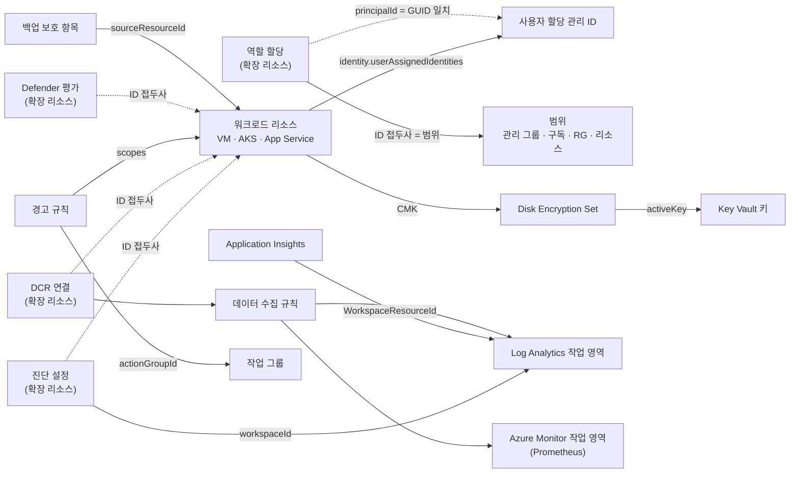

# 신원·보안·모니터링·거버넌스 — Azure 리소스 관계 사전

> 대상: 관리 ID·RBAC·정책·잠금·Key Vault·암호화(CMK)·Azure Monitor(진단 설정·DCR·경고·작업 영역)·Defender for Cloud·Backup을 그리거나 검토하는 개발자와 운영자
>
> 근거: Azure REST API 최신 스펙(파일별 최신 stable, stable이 없으면 최신 preview) + providers API + 실제 테넌트 교차 검증 (2026-10-15). 쓴 스펙 버전은 다음과 같습니다.
> - authorization 2022-04-01, resources(policy) 2026-07-01, msi 2024-11-30, keyvault 2026-05-15
> - monitor 2026-03-01, monitoringservice 2025-10-03, operationalinsights 2026-03-01, alertsmanagement 2021-08-08/2023-03-01
> - dashboard 2025-08-01, recoveryservicesbackup 2026-10-01, dataprotection 2026-07-01
> - 다른 영역에서 가져온 참조: compute 2026-04-01, containerservice 2026-07-01, web 2026-07-15, sql 2025-01-01
>
> 문서 출처: learn.microsoft.com(모든 URL은 2026-10-15에 HTTP 200 확인)
>
> 범례
> - 근거 `spec:*`: 다이제스트의 스펙 경로입니다.
> - 근거 `tenant`: 최신 stable 스펙 파싱 결과에는 없고 실제 테넌트에서만 본 경로입니다. 다이제스트처럼 소문자로 적습니다. 실제 JSON 대소문자는 템플릿 참조 문서를 따르므로, 코드에서는 대소문자를 무시하고 비교해야 합니다.
> - 근거 `docs`: 다이제스트에 경로가 없습니다. 속성 이름은 learn 템플릿·REST 참조에서 확인했고, 그 사실을 행에 적었습니다.
> - `(name)` 표시: 대상 유형을 속성 이름으로 추정한 가설입니다. 문서로 확인한 경우에만 그렇다고 적었습니다.

## 1. 한눈에 보기

이 영역의 리소스는 대부분 **다른 리소스에 붙어서만 의미가 있습니다**. 역할 할당·정책 할당·잠금·진단 설정·DCR 연결·Defender 평가는 모두 **확장 리소스**입니다. 이들의 ID는 `{대상 리소스 ID}/providers/{네임스페이스}/{유형}/{이름}` 모양이고, "누구에게 붙었나"가 별도 속성이 아니라 **ID 접두사**에 들어 있습니다.

나머지 관계는 세 갈래입니다.
- **신원**: 리소스 → 관리 ID → 역할 할당
- **키**: 디스크·Storage·SQL·AKS → Key Vault 키(CMK)
- **관측 데이터 흐름**: 리소스 → 진단 설정·DCR → Log Analytics 작업 영역 또는 Azure Monitor 작업 영역 → 경고 규칙 → 작업 그룹

이 영역에서 가장 위험한 착각은 두 가지입니다.
- 역할 할당의 `principalId`는 ARM ID가 아니라 **Entra 개체 GUID**입니다. 관리 ID와는 GUID가 정확히 같을 때만 이어집니다.
- Key Vault·Storage CMK의 키 참조는 **URI**입니다. ARM ID 파서로는 찾을 수 없습니다.

**5살 비유**: Azure는 커다란 **아파트 단지**예요. 관리 ID는 단지에 사는 리소스가 목에 거는 **이름표**예요. 역할 할당은 "이 번호 이름표를 단 사람은 이 방에 들어와도 돼"라고 방문에 붙인 **쪽지**고요. 쪽지에는 이름 대신 **번호**만 적혀 있어서, 이름표 번호와 정확히 맞춰 봐야 누구인지 알 수 있어요. Key Vault는 단지의 **금고**예요. 진단 설정은 집마다 달린 **CCTV 선**이에요. 녹화 테이프는 큰 **녹화 창고**(작업 영역)에 모이고, 경비 아저씨(경고 규칙)가 이상한 걸 보면 비상 연락망(작업 그룹)에 전화해요. (비유 대응표: 핵심 사전 입문 7)

## 2. 리소스 유형

| 유형 (ARM type) | 범위 | 한 줄 설명 | 문서 |
|---|---|---|---|
| `microsoft.managedidentity/userassignedidentities` | 리전 | 독립 리소스인 관리 ID입니다. 여러 리소스가 공유합니다 | https://learn.microsoft.com/en-us/entra/identity/managed-identities-azure-resources/overview |
| `microsoft.managedidentity/userassignedidentities/federatedidentitycredentials` | 자식 | 외부 IdP 토큰(AKS 워크로드 ID·GitHub)을 신뢰합니다 | https://learn.microsoft.com/en-us/azure/templates/microsoft.managedidentity/userassignedidentities/federatedidentitycredentials |
| (시스템 할당 ID — 별도 유형 없음) | 리소스의 일부 | 리소스의 `identity` 블록이며 수명이 리소스와 같습니다 | https://learn.microsoft.com/en-us/entra/identity/managed-identities-azure-resources/overview |
| `microsoft.authorization/roleassignments` | 확장 | 주체 × 역할 정의 × 범위입니다 | https://learn.microsoft.com/en-us/azure/role-based-access-control/scope-overview |
| `microsoft.authorization/roledefinitions` | 확장 | 기본 제공·사용자 지정 역할입니다 | https://learn.microsoft.com/en-us/azure/azure-resource-manager/management/extension-resource-types |
| `microsoft.authorization/denyassignments` | 확장 | 거부 할당입니다. Azure만 만듭니다 | https://learn.microsoft.com/en-us/azure/role-based-access-control/deny-assignments |
| `microsoft.authorization/policyassignments` | 확장 | 정책·이니셔티브를 범위에 적용합니다 | https://learn.microsoft.com/en-us/azure/governance/policy/concepts/assignment-structure |
| `microsoft.authorization/policydefinitions`, `policysetdefinitions` | 확장(관리 그룹·구독) | 정책 규칙과 그 묶음(이니셔티브)입니다 | https://learn.microsoft.com/en-us/azure/governance/policy/concepts/assignment-structure |
| `microsoft.policyinsights/remediations` | 확장 | DINE·modify 정책의 수정 작업입니다 | https://learn.microsoft.com/en-us/azure/governance/policy/how-to/remediate-resources |
| `microsoft.authorization/locks` | 확장 | 삭제 금지(CanNotDelete)·읽기 전용(ReadOnly) 잠금입니다 | https://learn.microsoft.com/en-us/azure/azure-resource-manager/management/lock-resources |
| `microsoft.management/managementgroups` | 위치 없음(테넌트 계층) | 구독 위의 계층입니다. 부모는 하나만 둘 수 있습니다 | https://learn.microsoft.com/en-us/azure/governance/management-groups/overview |
| `microsoft.keyvault/vaults` | 리전 | 키·비밀·인증서를 보관합니다. 데이터 권한은 RBAC 또는 액세스 정책으로 줍니다 | https://learn.microsoft.com/en-us/azure/key-vault/general/rbac-guide |
| `microsoft.keyvault/managedhsms` | 리전 | 단일 테넌트 HSM 키 저장소입니다(TDE 보호기 등) | https://learn.microsoft.com/en-us/azure/azure-sql/database/transparent-data-encryption-byok-overview |
| `microsoft.compute/diskencryptionsets` | 리전 | 디스크 CMK 키를 참조하는 중간 리소스이며 자기 관리 ID를 가집니다 | https://learn.microsoft.com/en-us/azure/virtual-machines/disk-encryption |
| `microsoft.insights/diagnosticsettings` | 확장 (providers API는 regional로 표기) | 리소스 로그·메트릭을 작업 영역·Storage·Event Hubs·파트너로 보냅니다 | https://learn.microsoft.com/en-us/azure/azure-monitor/data-collection/diagnostic-settings |
| `microsoft.insights/datacollectionrules` | 리전 | 수집할 데이터·변환·목적지를 정의합니다 | https://learn.microsoft.com/en-us/azure/azure-monitor/data-collection/data-collection-rule-overview |
| `microsoft.insights/datacollectionendpoints` | 리전 | 수집 엔드포인트입니다. Private Link 등 일부 시나리오에서만 필요합니다 | https://learn.microsoft.com/en-us/azure/azure-monitor/data-collection/data-collection-endpoint-overview |
| `microsoft.insights/datacollectionruleassociations` | 확장 (providers API는 regional로 표기) | 리소스와 DCR을 N:M으로 연결합니다 | https://learn.microsoft.com/en-us/azure/azure-monitor/data-collection/data-collection-rule-overview |
| `microsoft.operationalinsights/workspaces` | 리전 | 로그 저장·쿼리(KQL) 작업 영역입니다 | https://learn.microsoft.com/en-us/azure/azure-monitor/logs/log-analytics-workspace-overview |
| `microsoft.operationalinsights/clusters` | 리전 | 전용 클러스터입니다(CMK·약정). 작업 영역을 연결합니다 | https://learn.microsoft.com/en-us/azure/azure-monitor/logs/logs-dedicated-clusters |
| `microsoft.operationalinsights/workspaces/dataexports` | 리전(작업 영역 자식) | 표 단위 연속 내보내기입니다 | https://learn.microsoft.com/en-us/azure/azure-monitor/logs/logs-data-export |
| `microsoft.insights/components` | 리전 | Application Insights입니다. 작업 영역 기반만 남았습니다 | https://learn.microsoft.com/en-us/azure/azure-monitor/app/create-workspace-resource |
| `microsoft.monitor/accounts` | 리전 | Azure Monitor 작업 영역입니다. 현재는 Prometheus 메트릭만 담습니다 | https://learn.microsoft.com/en-us/azure/azure-monitor/metrics/azure-monitor-workspace-overview |
| `microsoft.dashboard/grafana` | 리전 | Azure Managed Grafana입니다 | https://learn.microsoft.com/en-us/azure/managed-grafana/how-to-connect-azure-monitor-workspace |
| `microsoft.insights/actiongroups` | 혼합 (Global 또는 리전 처리) | 알림·자동화 묶음입니다. 여러 경고 규칙이 공유합니다 | https://learn.microsoft.com/en-us/azure/azure-monitor/alerts/action-groups |
| `microsoft.insights/metricalerts` | 혼합 | 메트릭 경고입니다 | https://learn.microsoft.com/en-us/azure/templates/microsoft.insights/metricalerts |
| `microsoft.insights/scheduledqueryrules` | 리전 | 로그 검색 경고입니다 | https://learn.microsoft.com/en-us/azure/azure-monitor/alerts/alerts-create-log-alert-rule |
| `microsoft.insights/activitylogalerts` | 혼합 | 활동 로그 경고입니다(Service Health 포함) | https://learn.microsoft.com/en-us/azure/templates/microsoft.insights/activitylogalerts |
| `microsoft.alertsmanagement/smartdetectoralertrules` | 글로벌 | Application Insights 스마트 감지 경고입니다 | https://learn.microsoft.com/en-us/azure/azure-monitor/alerts/alerts-overview |
| `microsoft.alertsmanagement/prometheusrulegroups` | 리전 | Prometheus 경고·기록 규칙 그룹입니다 | https://learn.microsoft.com/en-us/azure/azure-monitor/metrics/prometheus-rule-groups |
| `microsoft.alertsmanagement/actionrules` | 글로벌 | 경고 처리 규칙입니다(작업 그룹 추가·억제) | https://learn.microsoft.com/en-us/azure/azure-monitor/alerts/alerts-processing-rules |
| `microsoft.insights/privatelinkscopes` | 글로벌 | Azure Monitor Private Link Scope(AMPLS)입니다 | https://learn.microsoft.com/en-us/azure/azure-monitor/fundamentals/private-link-security |
| `microsoft.security/assessments` | 확장 | Defender 권고의 리소스별 평가 결과입니다 | https://learn.microsoft.com/en-us/azure/templates/microsoft.security/assessments |
| `microsoft.security/pricings` | 확장(구독) | Defender 플랜(Free/Standard)입니다 | https://learn.microsoft.com/en-us/azure/templates/microsoft.security/pricings |
| `microsoft.recoveryservices/vaults` | 리전 | Recovery Services 자격 증명 모음입니다(VM·SQL in VM·Files 백업, ASR) | https://learn.microsoft.com/en-us/azure/backup/backup-azure-recovery-services-vault-overview |
| `microsoft.recoveryservices/vaults/backupfabrics/protectioncontainers/protecteditems` | 자식 | 백업 중인 항목 하나입니다 | https://learn.microsoft.com/en-us/azure/templates/microsoft.recoveryservices/vaults/backupfabrics/protectioncontainers/protecteditems |
| `microsoft.dataprotection/backupvaults` | 리전 | Backup 자격 증명 모음입니다(Blob·디스크·PostgreSQL·AKS 등) | https://learn.microsoft.com/en-us/azure/backup/backup-vault-overview |
| `microsoft.dataprotection/backupvaults/backupinstances` | 자식 (확장 유형 목록에도 있음) | 백업 중인 데이터 원본 하나입니다 | https://learn.microsoft.com/en-us/azure/templates/microsoft.dataprotection/backupvaults/backupinstances |

## 3. 관계 표

관계 하나에 주인 페이지 하나: 신원·키·로그 전송은 IDM, 배치·네트워크는 서비스 페이지. 다른 페이지에는 '→ <ID> 참고' 한 줄만 둔다. 핵심 사전 행을 다시 쓰는 행은 새 ID 없이 메모로 둔다.

핵심 사전 행: HIER-01, HIER-02, LOG-01, LOG-02, PL-01
- HIER-01·02: IDM-08이 그 위 계층(관리 그룹)을 덧붙입니다.
- PL-01: 대상이 `microsoft.keyvault/vaults`·`microsoft.recoveryservices/vaults`·AMPLS일 때도 같은 행입니다. 볼트 쪽 `privateendpointconnections[].privateendpoint`는 테넌트에서 본 **읽기 전용 역참조**입니다. 설정의 권위는 PE 쪽에 있습니다.

### 신원 (관리 ID)

| ID | 관계 (source → target) | 의미·방향 | ARM 속성 경로 | 근거 | 다이어그램 표현 | 출처 |
|---|---|---|---|---|---|---|
| IDM-01 | 워크로드 리소스 → 사용자 할당 관리 ID | 신원: 리소스가 이 ID로 Entra 토큰을 받습니다. ID 하나를 여러 리소스가 공유합니다(N:M) | `identity.userAssignedIdentities{<UAMI ARM ID>: {}}`. `properties` 밖 최상위 블록이고 **키가 ARM ID**입니다. 다이제스트에 없는 이유는 스펙 파서가 `properties`만 읽기 때문입니다 | docs | chip (카드 'ID n') + panel. 선은 쓰지 않습니다. 공유 ID는 거미줄을 만듭니다 | https://learn.microsoft.com/en-us/entra/identity/managed-identities-azure-resources/overview — "The same user-assigned managed identity can be associated with more than one Azure resource" |
| IDM-02 | 리소스 = 시스템 할당 관리 ID | 1:1, 수명을 공유합니다. 별도 ARM 리소스가 없습니다 | `identity.type`(`SystemAssigned`), `identity.principalId`(읽기 전용, Entra 개체 GUID) | docs | badge ('시스템 ID') | https://learn.microsoft.com/en-us/entra/identity/managed-identities-azure-resources/overview — "When the parent resource is deleted, the managed identity is deleted as well."  |
| IDM-03 | 사용자 할당 ID ⊃ 페더레이션 자격 증명 | 신원 신뢰: 외부 IdP(AKS OIDC 발급자, GitHub 등) 토큰을 이 ID 토큰으로 교환합니다. ID 하나에 최대 20개까지 둘 수 있습니다(AKS 문서) | 자식 `…/userAssignedIdentities/{n}/federatedIdentityCredentials/{m}`. `issuer`·`subject`는 URL·문자열이고 ARM ID가 아닙니다 | docs | panel. AKS와 이으려면 클러스터 OIDC 발급자 URL과 `issuer`가 문자열로 정확히 같아야 합니다(미검증 규칙이라 미구현) | https://learn.microsoft.com/en-us/entra/workload-id/workload-identity-federation — "trust tokens from an external identity provider (IdP), such as GitHub or Google" |
| IDM-04 | AKS → kubelet 관리 ID | 신원: 노드가 ACR 이미지 끌어오기 등에 씁니다. 지정하지 않으면 AKS가 노드 RG에 만듭니다. 애드온 ID `addonProfiles{}.identity.resourceId`는 읽기 전용 역참조입니다 | `identityProfile{}.resourceId` (키 `kubeletidentity`) | spec+tenant. 스펙은 `identityProfile{}.resourceId` arm-id이고, 테넌트에서는 `identityprofile.kubeletidentity.resourceid`로 보입니다. 같은 경로입니다 | chip ('kubelet ID') | https://learn.microsoft.com/en-us/azure/aks/managed-identity-overview — "AKS creates a user-assigned kubelet identity in the node resource group." 주인 행 (CMP-25 대체) |
| IDM-05 | VM·VMSS·SQL MI·MySQL·MongoDB vCore → 암호화용 사용자 할당 ID | 신원 선택: 붙은 UAMI 중 CMK(Key Vault)에 접근할 하나를 고릅니다 | VM: `securityProfile.encryptionIdentity.userAssignedIdentityResourceId` VMSS: `virtualMachineProfile.securityProfile.encryptionIdentity.userAssignedIdentityResourceId` SQL MI: `primaryUserAssignedIdentityId` MySQL Flexible: `dataEncryption.primaryUserAssignedIdentityId` MongoDB vCore: `encryption.customerManagedKeyEncryption.keyEncryptionKeyIdentity.userAssignedIdentityResourceId` | VM·VMSS: spec:id-string (name), 문서로 UAMI 확인 SQL MI: spec:arm-id MySQL: spec:id-string, 대상은 ?(가설) MongoDB vCore: spec:id-string (name, 이름 추정) | panel | https://learn.microsoft.com/en-us/azure/templates/microsoft.compute/virtualmachines — "Specifies ARM Resource ID of one of the user identities associated with the VM." 주인 행 — DAT-34 대체 |

### 권한·거버넌스 (RBAC·정책·잠금)

| ID | 관계 (source → target) | 의미·방향 | ARM 속성 경로 | 근거 | 다이어그램 표현 | 출처 |
|---|---|---|---|---|---|---|
| IDM-06 | 역할 할당 → 범위 · 역할 정의 | 권한 부여입니다. 범위는 할당 ID에서 `/providers/Microsoft.Authorization/roleAssignments/{guid}` 앞부분이며, 관리 그룹·구독·RG·리소스 어디든 될 수 있습니다 | ID 접두사(범위), `roleDefinitionId` | docs. 다이제스트에서 roleassignments는 참조 속성 0개입니다 | panel (리소스 '접근 권한' 탭). 선은 쓰지 않습니다. 상속까지 그리면 모든 리소스가 이어집니다 | https://learn.microsoft.com/en-us/azure/role-based-access-control/scope-overview — "A role assignment is a special type in Azure Resource Manager called an extension resource." |
| IDM-07 | 역할 할당 → 주체 (관리 ID·사용자·그룹·SP) | 누구에게 준 권한인지입니다. `principalId`는 **Entra 개체 GUID**이고 ARM ID가 아닙니다 | `principalId`, `principalType` ↔ UAMI `properties.principalId`(읽기 전용) 또는 리소스 `identity.principalId` | docs. 조인은 GUID 정확 일치(principalMatch)이며 0개·여러 개면 미확인입니다 | panel (관리 ID 카드 → '이 ID의 권한') | https://learn.microsoft.com/en-us/rest/api/managedidentity/user-assigned-identities/get — "The id of the service principal object associated with the created identity." |
| IDM-08 | 관리 그룹 ⊃ 구독 ⊃ RG ⊃ 리소스 | 상속: 위에서 준 역할·정책·잠금이 아래로 내려옵니다. 관리 그룹·구독의 부모는 하나뿐입니다 | 자식 `managementGroups/{mg}/subscriptions/{sub}`. 아래 계층은 HIER-01/02 | docs | none (계층 필터). 상속된 할당에는 '상속' 표시를 답니다 | https://learn.microsoft.com/en-us/azure/role-based-access-control/scope-overview — "Lower levels inherit role permissions from higher levels." |
| IDM-09 | 거부 할당 → 범위 | 허용 할당보다 먼저 거부합니다. 사용자는 직접 만들 수 없습니다 | ID 접두사 | docs | panel | https://learn.microsoft.com/en-us/azure/role-based-access-control/deny-assignments — "You can't directly create your own deny assignments." |
| IDM-10 | 정책 할당 → 정책/이니셔티브 정의 (+ 범위·제외) | 평가 규칙입니다. 범위는 ID 접두사, 제외 범위는 `notScopes`입니다 | `policyDefinitionId` (정의 또는 집합 정의), `notScopes` | spec:id-string. 대상은 ?이고 문서로 정의·집합 정의임을 확인했습니다 | panel (리소스 '규정 준수'. 판정은 `policyresources`) | https://learn.microsoft.com/en-us/azure/governance/policy/concepts/assignment-structure — "each can be excluded from evaluation by setting notScopes" |
| IDM-11 | 정책 할당 → 관리 ID / 수정 작업·증명 → 정책 할당 | DINE·modify 정책은 할당의 관리 ID로 배포·수정합니다(평가에는 쓰지 않음). 수정 작업과 증명(attestation)은 할당을 가리킵니다 | 할당의 `identity`(최상위, docs) `remediations.policyAssignmentId`, `attestations.policyAssignmentId` | docs / spec:id-string | panel (관리 ID 패널에 '정책 할당 ID' 표시 — 이 ID에도 역할 할당이 있습니다) | https://learn.microsoft.com/en-us/azure/governance/policy/how-to/remediate-resources — "Policy assignments use managed identities for Azure resource authorization during remediation." |
| IDM-12 | 잠금 → 범위 (확장 리소스는 대상의 잠금을 상속) | 삭제 금지·읽기 전용입니다. 상위 잠금은 아래로 상속되고, 진단 설정 같은 확장 리소스도 잠깁니다 | ID 접두사 `{scope}/providers/Microsoft.Authorization/locks/{n}`, `level` | docs | badge (자물쇠, 상속이면 흐리게) | https://learn.microsoft.com/en-us/azure/azure-resource-manager/management/lock-resources — "Extension resources inherit locks from the resource to which they're applied." |
| IDM-41 | NSP 연결 → PaaS 리소스 (경계) | 리소스를 네트워크 보안 경계에 넣음 | `networkSecurityPerimeters/resourceAssociations.privateLinkResource` / `profile` (spec:subresource → ?), 원격 경계 `links.autoApprovedRemotePerimeterResourceId` (arm-id → networksecurityperimeters), 서비스 쪽 `<서비스>/networkSecurityPerimeterConfigurations.networkSecurityPerimeter.id` (예: `workspaces`, Storage, SQL, Service Bus) | spec | chip 'NSP: <경계>/<프로필>' (+ 접근 모드) — 포함 아님 | https://learn.microsoft.com/azure/private-link/network-security-perimeter-concepts |
| IDM-46 | 정책(DeployIfNotExists) → 만든 리소스 | 정책이 진단 설정 등을 만듦 | 할당 `policyDefinitionId` → 정의 효과 `deployIfNotExists` (docs) | docs | LOG-01 패널에 'Policy가 만든 설정'(설정 이름·태그가 정책과 일치할 때만) | https://learn.microsoft.com/azure/governance/policy/concepts/effect-deploy-if-not-exists |

### Key Vault·암호화 (CMK)

| ID | 관계 (source → target) | 의미·방향 | ARM 속성 경로 | 근거 | 다이어그램 표현 | 출처 |
|---|---|---|---|---|---|---|
| IDM-13 | Key Vault 데이터 접근 = RBAC 또는 액세스 정책 | 데이터 평면 권한 모델을 고르는 스위치입니다. RBAC면 IDM-06/07을 따르고, 아니면 `accessPolicies[].objectId`(GUID, principalMatch)를 봅니다 | `enableRbacAuthorization`, `accessPolicies[].objectId`, 자식 `vaults/accessPolicies` | docs. 다이제스트에서 vaults는 `hsmPoolResourceId` 역참조뿐입니다 | badge ('RBAC' / '액세스 정책(레거시)') | https://learn.microsoft.com/en-us/azure/key-vault/general/rbac-guide — "the data plane uses a Key Vault access policy (legacy) or Azure RBAC" |
| IDM-14 | Disk Encryption Set → Key Vault 키 | 키 참조(CMK)입니다. DES의 시스템 할당 ID가 키 권한을 받습니다. 볼트가 다른 구독에 있으면 `sourceVault`를 쓸 수 없습니다 | `activeKey.sourceVault.id`, `activeKey.keyUrl`(버전이 포함된 키 URL) | docs. 다이제스트에 DES 절이 없습니다 | chip (VM·디스크 'CMK · 볼트 이름'). `sourceVault`가 없으면 `keyUrl` 호스트와 볼트 `vaultUri`가 정확히 같을 때만 잇습니다(fqdnMatch) | https://learn.microsoft.com/en-us/azure/virtual-machines/disk-encryption — "A disk references a key via its disk encryption set." 주인 행 (CMP-10·11 대체) |
| IDM-15 | 디스크·VMSS 모델·AKS → Disk Encryption Set | 어떤 키로 저장 데이터를 암호화할지 고릅니다 | 디스크: `encryption.diskEncryptionSetId` VMSS: `virtualMachineProfile.storageProfile.osDisk.managedDisk.diskEncryptionSet`, `…dataDisks[].managedDisk.diskEncryptionSet` AKS: `diskEncryptionSetID` | 디스크 docs · VMSS spec:subresource (name) · AKS spec:arm-id | absorb (디스크는 VM에 흡수 → VM 칩 'CMK') | https://learn.microsoft.com/en-us/azure/templates/microsoft.compute/disks — "ResourceId of the disk encryption set to use for enabling encryption at rest." 주인 행 (CMP-10·11 대체) |
| IDM-16 | Storage 계정 → Key Vault 키 (CMK) | 계정이 관리 ID로 계정 키를 wrap·unwrap합니다 | `encryption.keySource`(=`Microsoft.Keyvault`), `encryption.keyvaultproperties.keyvaulturi`(**URI**), `encryption.identity.userAssignedIdentity` | docs. URI라서 ARM ID 파서가 잡지 못합니다 | chip ('CMK'). 볼트와는 URI 호스트와 `vaultUri`가 정확히 같을 때만 잇습니다 | https://learn.microsoft.com/en-us/azure/storage/common/customer-managed-keys-overview — "An Azure Key Vault admin grants permissions to encryption keys to a managed identity." 주인 행 (DAT-21 대체) |
| IDM-17 | SQL 논리 서버 → TDE 보호기 → Key Vault 키 | 서버 수준 보호기를 그 서버의 암호화된 DB가 상속합니다. 서버 ID는 시스템 또는 사용자 할당입니다 | 자식 `servers/encryptionProtector`(`serverKeyType`=`AzureKeyVault`, `serverKeyName`) → 자식 `servers/keys` | docs. 다이제스트에서 두 유형 모두 참조 속성 0개입니다 | chip (SQL 'TDE CMK') | https://learn.microsoft.com/en-us/azure/azure-sql/database/transparent-data-encryption-byok-overview — "For Azure SQL Database, you set the TDE protector at the server level" |
| IDM-18 | AKS → Key Vault (etcd KMS · Istio CA) | 클러스터 비밀 암호화 키와 메시 인증서를 참조합니다 | `securityProfile.azureKeyVaultKms.keyVaultResourceId`, `serviceMeshProfile.istio.certificateAuthority.plugin.keyVaultId` | spec:arm-id | chip ('KMS') + panel. 트래픽이 아니라 구성 참조라서 선을 쓰지 않습니다 | https://learn.microsoft.com/en-us/azure/aks/use-kms-etcd-encryption — "Use a key in a key vault for etcd encryption." 주인 행 (CMP-28 대체) |
| IDM-19 | VM·VMSS·확장 → Key Vault (인증서·보호 설정) | 배포 시 인증서와 확장 비밀을 볼트에서 가져옵니다 | VM: `osProfile.secrets[].sourceVault` 확장: `protectedSettingsFromKeyVault.sourceVault` VMSS: `virtualMachineProfile.extensionProfile.extensions[].protectedSettingsFromKeyVault.sourceVault` | spec:subresource. 대상은 ?이고 문서로 Key Vault임을 확인했습니다 | panel | https://learn.microsoft.com/en-us/azure/templates/microsoft.compute/virtualmachines — "The relative URL of the Key Vault containing all of the certificates" 주인 행 (CMP-07 대체) |
| IDM-20 | App Service 인증서 → Key Vault | 인증서를 가져옵니다. App Service 리소스 공급자에게 볼트 읽기 권한이 필요합니다 | `microsoft.web/certificates`·`sites/certificates`·`sites/slots/certificates`의 `keyVaultId` | spec:arm-id | chip | https://learn.microsoft.com/en-us/azure/app-service/configure-ssl-certificate — "By default, the App Service resource provider doesn't have access to your key vault." 주인 행 (APP-10 대체) |
| IDM-21 | ARM 배포·배포 스택 → Key Vault (매개변수 비밀) | 배포할 때 비밀을 참조합니다. 볼트에 `enabledForTemplateDeployment`가 켜져 있어야 합니다 | `parameters{}.reference.keyVault`, `extensionConfigs{}{}.keyVaultReference.keyVault` | spec:subresource (name), 문서로 확인 | none (배포 이력은 구성도 대상이 아닙니다) | https://learn.microsoft.com/en-us/azure/azure-resource-manager/templates/key-vault-parameter — "make sure it allows template deployments" |
| IDM-44 | Key Vault 방화벽 | 허용 서브넷·IP | `vaults.networkAcls.virtualNetworkRules[].id`, `networkAcls.ipRules[]` | docs | chip (DAT-06·15·18과 같은 모양, 배치 아님) | https://learn.microsoft.com/azure/key-vault/general/network-security |

### 모니터링 (Azure Monitor)

| ID | 관계 (source → target) | 의미·방향 | ARM 속성 경로 | 근거 | 다이어그램 표현 | 출처 |
|---|---|---|---|---|---|---|
| IDM-22 | 진단 설정 → Event Hubs 권한 규칙 / 파트너 솔루션 | 로그 전송: LOG-01이 다루지 않는 나머지 목적지입니다. 원본은 설정 ID의 접두사입니다(확장 리소스). 리소스당 최대 5개이고, Storage·Event Hubs는 리전 리소스와 같은 리전이어야 합니다 | `eventHubAuthorizationRuleId`, `eventHubName`, `marketplacePartnerId` | docs. 이 유형은 다이제스트의 스펙·테넌트 어디에도 없습니다 | 로그 선 (기본 끔) | https://learn.microsoft.com/en-us/azure/azure-monitor/data-collection/diagnostic-settings — "Each resource can have up to five diagnostic settings." |
| IDM-23 | DCR → 목적지 (Log Analytics 작업 영역 · Azure Monitor 작업 영역) | 로그 전송, Prometheus 메트릭 전송 | `destinations.loganalytics[].workspaceresourceid`, `destinations.monitoringaccounts[].accountresourceid` | tenant | 로그 선 | https://learn.microsoft.com/en-us/azure/azure-monitor/data-collection/data-collection-rule-overview — "Destination where the data should be sent." |
| IDM-24 | DCR → DCE | 수집 엔드포인트를 지정합니다. AMA는 Private Link를 쓸 때만 DCE가 필요합니다 | `datacollectionendpointid` | tenant | panel | https://learn.microsoft.com/en-us/azure/azure-monitor/data-collection/data-collection-endpoint-overview — "A DCE is only required if you're using Private Link." |
| IDM-25 | 리소스 ← DCR 연결(DCRA) → DCR / DCE | 어떤 VM·클러스터가 어떤 규칙으로 수집되는지 정합니다. N:M이며 리소스당 DCR은 최대 30개입니다. AKS → Azure Monitor 작업 영역은 AKS 속성이 아니라 이 경로(DCRA → DCR → IDM-23)로 이어집니다 | 확장 `{리소스}/providers/Microsoft.Insights/dataCollectionRuleAssociations/{n}`의 `dataCollectionRuleId`, `dataCollectionEndpointId`. Resource Graph에서는 `insightresources` 표에 있습니다 | docs | chip (VM·AKS '수집 규칙 n') + panel | 같은 DCR 문서 — "This relationship is many-to-many" |
| IDM-26 | Log Analytics 작업 영역 → 작업 영역 변환 DCR | DCR을 쓰지 않는 수집 경로(예: 진단 설정)에 변환을 겁니다 | `defaultDataCollectionRuleResourceId` | spec:id-string. 대상은 ?이고 문서로 확인했습니다 | panel | 같은 DCR 문서 — "DCR is applied directly to the workspace." |
| IDM-27 | Azure Monitor 작업 영역 → 기본 DCR·DCE | Prometheus 수집 기본값입니다. Azure가 채웁니다 | `defaultIngestionSettings.dataCollectionRuleResourceId`, `defaultIngestionSettings.dataCollectionEndpointResourceId` (읽기 전용 역참조) | spec (back-ref) | none (관리형이라 사용자 리소스처럼 그리지 않습니다) | https://learn.microsoft.com/en-us/azure/azure-monitor/metrics/azure-monitor-workspace-overview — "Currently, only Prometheus metrics are data hosted in an Azure Monitor workspace." |
| IDM-28 | AKS → Log Analytics 작업 영역 (Container insights · Defender) | 컨테이너 로그와 Defender 센서 데이터를 보냅니다. 작업 영역을 지정하지 않으면 RG 기본 작업 영역을 씁니다 | `azureMonitorProfile.containerInsights.logAnalyticsWorkspaceResourceId` ✓ 레거시 `addonprofiles.omsagent.config.loganalyticsworkspaceresourceid` `securityProfile.defender.logAnalyticsWorkspaceResourceId` | spec+tenant / tenant / spec:arm-id | 로그 선 | https://learn.microsoft.com/en-us/azure/azure-monitor/containers/kubernetes-monitoring-enable — "the default workspace for the resource group is used" 주인 행 (CMP-27 대체) |
| IDM-29 | Managed Grafana → Azure Monitor 작업 영역 | 대시보드 데이터 원본입니다. Grafana 관리 ID에 작업 영역의 Monitoring Data Reader 역할이 있어야 합니다(IDM-06/07) | `grafanaIntegrations.azureMonitorWorkspaceIntegrations[].azureMonitorWorkspaceResourceId` | spec+tenant ✓. 스펙은 id-string이고 대상은 테넌트로 확인했습니다 | line-dashed (조회 관계, 트래픽 아님) | https://learn.microsoft.com/en-us/azure/managed-grafana/how-to-connect-azure-monitor-workspace — "In the Azure Monitor workspace, assign the Monitoring Data Reader" |
| IDM-30 | 경고 규칙 → 감시 대상 (scopes) | 무엇을 감시하는지입니다 | 메트릭 경고: `scopes[]`(테넌트에서 components·webtests 확인), `criteria.componentid`, `criteria.webtestid`. 대상이 여러 개면 `targetResourceRegion`이 필수입니다 로그 검색 경고: `scopes`(작업 영역 또는 리소스, docs) 활동 로그 경고: `scopes`(ID 접두사로 매칭, docs) 스마트 감지: `scope[]` → App Insights | tenant / docs | panel (리소스 '경고 규칙 n'). 라이브 다이어그램은 알림 배지 | https://learn.microsoft.com/en-us/azure/templates/microsoft.insights/metricalerts — "The list of resource id's that this metric alert is scoped to." |
| IDM-31 | 경고 규칙 → 작업 그룹 | 경고가 발생하면 알림·자동화를 실행합니다. 규칙당 작업 그룹은 최대 5개이고, 여러 규칙이 같은 그룹을 공유합니다 | 메트릭: `actions[].actiongroupid` 활동 로그: `actions.actiongroups[].actiongroupid` 스마트 감지: `actiongroups.groupids[]` Prometheus: `rules[].actions[].actiongroupid` 로그 검색: `actions.actionGroups[]`(docs) | tenant / docs | panel. 선은 쓰지 않습니다. 공유되는 그룹이라 허브가 됩니다 | https://learn.microsoft.com/en-us/azure/azure-monitor/alerts/action-groups — "You can add up to five action groups to a single alert rule." |
| IDM-32 | Prometheus 규칙 그룹 → Azure Monitor 작업 영역 (+ 클러스터) | 쿼리할 작업 영역입니다(나중에 바꿀 수 없음). `clusterName`으로 특정 클러스터만 대상으로 삼을 수 있습니다 | `scopes[]` → `microsoft.monitor/accounts`, `clusterName`(문자열, ARM ID 아님) | tenant + docs | panel | https://learn.microsoft.com/en-us/azure/azure-monitor/metrics/prometheus-rule-groups — "You can't apply individual rules directly to a Kubernetes cluster." |
| IDM-33 | 경고 처리 규칙 → 작업 그룹 · 범위 | 발생한 경고에 작업 그룹을 더하거나 알림을 억제합니다. 범위는 같은 구독 안이어야 합니다 | `actions[].actiongroupids[]`, `scopes`(docs) | tenant / docs | panel | https://learn.microsoft.com/en-us/azure/azure-monitor/alerts/alerts-processing-rules — "as long as they are within the same subscription as the alert processing rule" |
| IDM-34 | AMPLS → 범위 리소스 (작업 영역 · App Insights) | 모니터링용 Private Link의 경계입니다. PL-01의 대상이 AMPLS일 때 실제로 닿는 곳입니다 | 자식 `privateLinkScopes/{n}/scopedResources/{m}`의 `linkedResourceId`. 작업 영역 쪽 `privateLinkScopedResources[].resourceId`는 읽기 전용 역참조입니다 | docs + spec back-ref | line-dashed (PE → AMPLS → 작업 영역) | https://learn.microsoft.com/en-us/azure/azure-monitor/fundamentals/private-link-security — "a set of Azure Monitor resources that define the boundaries" |
| IDM-35 | Log Analytics 작업 영역 → 전용 클러스터 | CMK·이중 암호화·비용 약정을 씁니다 | 자식 `workspaces/{n}/linkedServices/cluster`의 `writeAccessResourceId`. 클러스터 쪽 `associatedWorkspaces[].resourceId`는 읽기 전용입니다 | spec:id-string. 대상은 ?이고 문서로 클러스터임을 확인했습니다 | absorb (작업 영역 칩 '전용 클러스터') | https://learn.microsoft.com/en-us/azure/azure-monitor/logs/logs-dedicated-clusters — "A dedicated cluster in Azure Monitor provides advanced security and control capabilities, and cost optimization." |
| IDM-36 | Log Analytics 데이터 내보내기 → Storage / Event Hubs | 표 단위로 연속 내보냅니다 | 자식 `dataExports`의 `destination.resourceId` | spec:id-string. 대상은 ?이고 문서로 Storage 계정·Event Hubs 네임스페이스임을 확인했습니다 | 로그 선 (기본 끔) | https://learn.microsoft.com/en-us/azure/azure-monitor/logs/logs-data-export — "continuously export data per selected tables" |
| IDM-42 | 작업 그룹 → 수신자 | 경고가 울리면 무엇이 실행되나 | `logicAppReceivers[].resourceId`, `azureFunctionReceivers[].functionAppResourceId`, `automationRunbookReceivers[].automationAccountId`, `eventHubReceivers[]`, `webhookReceivers[].serviceUri` (docs) | docs | panel(작업 그룹 → 수신자 사슬) | https://learn.microsoft.com/azure/azure-monitor/alerts/action-groups |
| IDM-43 | Grafana 관리형 PE → 대상 | Grafana가 데이터 원본에 사설 접근 | `grafana/managedPrivateEndpoints.privateLinkResourceId` | spec:id-string, tenant ✓(대상 privateLinkServices) | 서비스 → 대상 line, 서브넷 밖(관리형 PE 공통 규칙: "관리형 PE·공유 프라이빗 링크는 고객 쪽 NIC를 만들지 않는다 — Learn: 'Managed private endpoints … don't create customer-visible network interfaces' (foundry/how-to/managed-virtual-network). 서비스 → 대상 선으로 그리고 서브넷 안에 두지 않는다. 승인 상태는 대상의 `privateEndpointConnections`에서 읽는다.") | https://learn.microsoft.com/azure/managed-grafana/how-to-connect-to-data-source-privately |
| IDM-45 | 레거시 솔루션 → 작업 영역 | 작업 영역에 설치된 솔루션(Container Insights·Sentinel 등) | `microsoft.operationsmanagement/solutions.workspaceResourceId` | tenant ✓ | 작업 영역 chip '솔루션 X' | https://learn.microsoft.com/azure/azure-monitor/insights/solutions |

### Defender for Cloud·Backup

| ID | 관계 (source → target) | 의미·방향 | ARM 속성 경로 | 근거 | 다이어그램 표현 | 출처 |
|---|---|---|---|---|---|---|
| IDM-37 | Defender 평가(권고) → 평가 대상 리소스 | 리소스별 Healthy/Unhealthy입니다. ID 권고에서는 대상이 Entra 사용자일 수 있습니다(ARM 리소스 아님) | 확장 `{리소스 ID}/providers/Microsoft.Security/assessments/{n}`. Resource Graph `securityresources`에서는 `properties.resourceDetails.Id` | docs. 다이제스트 스펙에 security/assessments 절이 없습니다 | badge (심각도) + panel | https://learn.microsoft.com/en-us/azure/templates/microsoft.security/assessments — "The ID of the resource to apply this extension resource" |
| IDM-38 | Defender 플랜 → 구독 | 보호 범위입니다. Free 플랜이면 위협 탐지에 공백이 생깁니다 | 확장 `…/providers/Microsoft.Security/pricings/{plan}`, `pricingTier`, `subPlan` | docs | panel (보호 범위) | https://learn.microsoft.com/azure/defender-for-cloud/connect-azure-subscription |
| IDM-39 | Recovery Services 보호 항목 → 원본 리소스 (+ 백업 정책) | 무엇을 백업하는지입니다(VM·SQL in VM·Azure Files) | `vaults/backupFabrics/protectionContainers/protectedItems`의 `sourceResourceId`, `policyId` | `sourceResourceId`: spec:id-string `* (name)`, 문서로 확인. `policyId`: docs | badge (원본 '백업 보호') + panel(볼트·정책). 선은 쓰지 않습니다. 볼트가 리전 허브가 됩니다 | https://learn.microsoft.com/en-us/azure/templates/microsoft.recoveryservices/vaults/backupfabrics/protectioncontainers/protecteditems — "ARM ID of the resource to be backed up." |
| IDM-40 | Backup 자격 증명 모음 백업 인스턴스 → 데이터 원본 | Blob·디스크·PostgreSQL·AKS 등의 백업입니다 | `backupInstances`의 `dataSourceInfo.resourceID`, `dataSourceSetInfo.resourceID` | spec:id-string. 대상은 ?이고 문서로 Azure 리소스의 ARM ID임을 확인했습니다 | badge + panel | https://learn.microsoft.com/en-us/azure/templates/microsoft.dataprotection/backupvaults/backupinstances — "Full ARM ID of the resource." |

## 4. 자주 하는 오해

- **"진단 설정은 Resource Graph `resources` 표에서 다 찾을 수 있다"는 틀립니다.**
  - Resource Graph 지원 유형 표에는 `microsoft.insights/guestdiagnosticsettings`만 있고 `microsoft.insights/diagnosticsettings`는 없습니다.
  - 리소스마다 ARM `GET {resourceUri}/providers/Microsoft.Insights/diagnosticSettings`로 읽어야 합니다.
  - 출처: https://learn.microsoft.com/en-us/azure/governance/resource-graph/reference/supported-tables-resources , https://learn.microsoft.com/en-us/rest/api/monitor/diagnostic-settings/list
  - 실제 테넌트에서는 아직 확인하지 않았습니다.
- **"역할 할당의 `principalId`로 관리 ID 리소스를 찾을 수 있다"는 반만 맞습니다.**
  - `principalId`는 Entra 개체 GUID입니다.
  - UAMI의 `properties.principalId`나 리소스의 `identity.principalId`와 **GUID가 정확히 같을 때만** 이어집니다. 0개나 여러 개면 미확인으로 남깁니다.
  - 출처: IDM-07
- **"시스템 할당 관리 ID는 별도 리소스다"는 틀립니다.**
  - 리소스의 `identity` 블록일 뿐이고, 리소스를 지우면 함께 지워집니다. 그래서 카드에 그리는 것은 배지이지 노드가 아닙니다.
  - 출처: IDM-02
- **"Key Vault의 Contributor는 관리만 할 수 있고 비밀은 못 읽는다"는 위험한 오해입니다.**
  - 액세스 정책 모델에서는 Contributor가 스스로 액세스 정책을 추가할 수 있습니다. rbac-guide: "can grant themselves access to the data plane".
  - 그래서 IDM-13 배지('액세스 정책(레거시)')는 보안 검토 대상입니다.
  - 출처: https://learn.microsoft.com/en-us/azure/key-vault/general/rbac-guide
- **"DCR을 만들면 VM에서 바로 수집된다"는 틀립니다.**
  - AMA 시나리오에서는 리소스와 DCR 사이에 **DCR 연결(DCRA)** 이 있어야 합니다. 연결 없는 DCR은 아무것도 수집하지 않습니다.
  - 출처: IDM-25
- **"Azure Monitor 작업 영역은 Log Analytics 작업 영역의 새 이름이다"는 틀립니다.**
  - 다른 리소스 유형(`microsoft.monitor/accounts`)이고, 현재는 Prometheus 메트릭만 담습니다.
  - 출처: IDM-27
- **"잠금은 그 리소스 하나에만 걸린다"는 틀립니다.**
  - 상위 범위의 잠금이 아래로 상속됩니다.
  - 진단 설정 같은 확장 리소스도 대상의 잠금을 따릅니다. 잠긴 Storage에 붙은 진단 설정은 삭제할 수 없습니다.
  - 출처: IDM-12
- **"리소스를 지우면 진단 설정도 깔끔히 사라진다"는 보장되지 않습니다.**
  - 문서 경고: "any diagnostic settings for the deleted resource could be applied to the new one."
  - 같은 이름으로 다시 만들면 예전 설정이 적용될 수 있습니다.
  - 출처: https://learn.microsoft.com/en-us/azure/azure-monitor/data-collection/diagnostic-settings

## 5. 이 플랫폼 반영 상태

**이미 그리는 것 (핵심 사전 ID)**
- **LOG-02** App Insights → 작업 영역 (`azure.ts`): `WorkspaceResourceId`와 `workspaceResourceId` 두 표기를 모두 읽습니다. 정상입니다.
- **LOG-01** 진단 설정 → 작업 영역·Storage (`azure.ts`)
  - Resource Graph `resources | where type =~ 'microsoft.insights/diagnosticsettings'`로 읽고, 실패하면 빈 배열로 넘어갑니다.
  - 위 오해 1처럼 이 유형은 Resource Graph에 없으므로, **선이 한 번도 만들어지지 않았을 가능성이 높습니다.** 실측 확인이 필요합니다.
  - 같은 저장소의 `privateLinkUsageCollector.ts`는 진단 설정을 리소스별 ARM 호출(`…/providers/Microsoft.Insights/diagnosticSettings?api-version=2021-05-01-preview`)로 올바르게 읽고 있습니다.
- **PL-01** PE → Key Vault·Recovery Services (`azure.ts`): 대상 유형에 제한이 없어 그대로 동작합니다.

**선 없이 이미 쓰는 것**
- IDM-30: `alertRulesCollector.ts`가 메트릭 경고와 로그 검색 경고의 `scopes`로 노드를 매칭합니다.
  - 작업 그룹(IDM-31)은 읽지 않습니다.
  - 로그 검색 경고의 scope가 작업 영역이면 경고가 작업 영역 노드에만 붙습니다. 실제 대상 리소스는 쿼리 안에 있어서 알 수 없습니다.
- IDM-28: `containerInsightsCollector.ts`가 AMA 경로와 레거시 omsagent 경로를 둘 다 읽습니다. 관측 데이터 조회용입니다.
- IDM-37: `securityPosture.ts`가 `properties.resourceDetails.Id`를 모읍니다. `lib/riskJoin.ts`는 (RG, 유형, 이름)으로 조인합니다.

**다음에 할 것 (우선순위 순)**

새 선·배지는 핵심 사전 §0의 순서를 따릅니다: 핵심 사전에 행 추가 → `REL` → 코드. 이 페이지의 `IDM-` ID를 그대로 `REL`에 올릴지는 결정이 필요합니다.

1. **LOG-01 수집 경로를 Resource Graph에서 ARM 리소스별 목록으로 바꿉니다.**
   - `privateLinkUsageCollector.ts` 방식을 재사용합니다.
   - 대상은 그래프에 있는 로그 대상 종류로 한정하고, 사용자별 캐시를 둡니다.
   - 함께 할 것: IDM-22 Event Hubs 목적지, 원본 리소스가 없는 고아 설정 표시(오해 8).
   - 이유: 지금은 선이 비어 있을 가능성이 높습니다.
2. **관리 ID 칩과 '이 ID의 권한' 패널을 만듭니다 (IDM-01·02·07).**
   - 읽을 곳: Resource Graph `resources`의 `identity` 블록, `authorizationresources`의 `roleassignments`.
   - 조인은 `principalId` GUID 정확 일치로 합니다.
   - 이유: `/security/identity`(CIEM) 권고를 실제 워크로드와 잇는 유일한 근거입니다.
3. **CMK 칩을 답니다 (IDM-14·15·16·17).**
   - 디스크·VMSS는 DES ID로, Storage·DES `keyUrl`은 `vaultUri` 호스트가 정확히 같을 때만 볼트와 잇습니다.
   - `azureEndpoints.ts`에 이미 Key Vault `vaultUri` 호스트 매핑이 있습니다.
4. **백업 보호 배지를 답니다 (IDM-39·40).** Resource Graph `recoveryservicesresources`의 `sourceResourceId`·`dataSourceInfo.resourceID`를 씁니다. 운영자가 가장 자주 묻는 "이거 백업되나요?"에 답합니다.
5. **잠금 배지를 답니다 (IDM-12).** 지원 유형 표에서 locks를 찾지 못했으므로 ARM 잠금 목록 API로 읽어야 합니다. 정확한 API는 미확인입니다.
6. **패널 정보를 늘립니다.** 작업 그룹(IDM-31), DCR 연결(IDM-25, `insightresources`), AMPLS 범위 리소스(IDM-34 — PL-01 대상이 AMPLS일 때 실제로 닿는 작업 영역).
7. **그리지 않을 것**
   - 역할 할당·정책 할당의 범위 선(IDM-06·10): 상속 때문에 모든 노드가 이어집니다.
   - 작업 그룹 선(IDM-31): 공유 허브가 됩니다.
   - Grafana → 작업 영역(IDM-29): 트래픽이 아닙니다. 그려야 한다면 점선으로만 그립니다.
