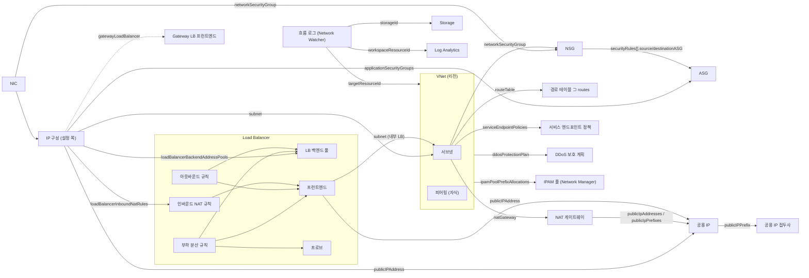

# 네트워크 기본 — Azure 리소스 관계 사전

> 대상: VNet·서브넷·NIC(IP 구성)·NSG/ASG·경로 테이블(UDR)·NAT 게이트웨이·공용 IP/접두사·Load Balancer(프런트엔드·풀·규칙·프로브·인바운드 NAT·아웃바운드·Gateway LB)·서비스 엔드포인트(정책)·DDoS·Virtual Network Manager(IPAM)·Network Watcher 흐름 로그 · 근거: Azure REST API 최신 스펙(파일별 최신 stable, stable이 없으면 최신 preview) + providers API + 실제 테넌트 교차 검증 (2026-10-15)

## 1. 한눈에 보기

VNet은 리전 하나에 있는 사설 주소 공간입니다. 그 안의 서브넷이 실제 배치 단위입니다. 리소스는 NIC의 **IP 구성(ipConfiguration)** 을 통해 서브넷에 들어갑니다. 이 IP 구성이 거의 모든 소속 관계의 **설정 쪽(권위 있는 쪽)** 입니다. LB 백엔드 풀, AGW 백엔드 풀, ASG, 공용 IP, 인바운드 NAT 규칙, Gateway LB 체인, TAP 소속은 모두 NIC 쪽에서 설정합니다. LB·AGW·ASG 쪽에 보이는 목록은 Azure가 채워 넣는 읽기 전용 역참조입니다.

서브넷에는 NSG·경로 테이블·NAT 게이트웨이·서비스 엔드포인트 정책이 붙습니다. 이 네 가지가 그 서브넷의 출입 규칙과 출구를 정합니다. 그 위에는 리전·구독을 넘는 관리 계층이 있습니다. DDoS 보호 계획, Virtual Network Manager(네트워크 그룹·연결·보안 관리 규칙·IPAM 풀), Network Watcher 흐름 로그(저장소·Log Analytics)입니다.

**5살 비유**: VNet은 아파트 단지이고 서브넷은 단지 안의 동, NIC는 각 집의 현관문(문패 = IP)이에요. "나는 3번 줄(LB 풀)에 서요", "나는 축구반(ASG)이에요" 같은 이름표는 **집 현관문에 붙입니다**. 줄 서는 곳의 명단은 그 이름표를 보고 자동으로 만들어지는 거예요. 경비원 명단(NSG)은 동 입구와 집 현관문에 둘 다 있을 수 있어요. 들어올 때는 동 입구 → 현관문 순서로 둘 다 통과해야 해요. 단지 밖으로 나가는 문은 길 안내판(경로 테이블)이 먼저 정하고, 그다음이 공용 출구(NAT 게이트웨이)예요. (비유 대응표: 핵심 사전 입문 7)

## 2. 리소스 유형

| 유형 (ARM type) | 범위 | 한 줄 설명 | 문서 |
|---|---|---|---|
| `microsoft.network/virtualnetworks` | 리전 | 사설 주소 공간. 서브넷·피어링을 자식으로 가짐 | https://learn.microsoft.com/azure/virtual-network/virtual-networks-overview |
| `microsoft.network/virtualnetworks/subnets` | 자식 | 배치 단위. NSG·경로 테이블·NAT·SE 정책·위임이 붙는 곳 | https://learn.microsoft.com/azure/templates/microsoft.network/virtualnetworks/subnets |
| `microsoft.network/virtualnetworks/virtualnetworkpeerings` | 자식 | VNet↔VNet 연결. 양쪽에 각각 하나씩 있음 | https://learn.microsoft.com/azure/virtual-network/virtual-network-peering-overview |
| `microsoft.network/networkinterfaces` | 리전 | NIC. VM 등에 붙고 NSG를 직접 가질 수 있음 | https://learn.microsoft.com/azure/templates/microsoft.network/networkinterfaces |
| `microsoft.network/networkinterfaces/ipconfigurations` | 자식 | 서브넷·공용 IP·LB/AGW 풀·ASG·NAT 규칙·Gateway LB·TAP 소속의 **설정 쪽** | https://learn.microsoft.com/azure/templates/microsoft.network/networkinterfaces |
| `microsoft.network/networksecuritygroups` | 리전 | 5튜플 허용/거부 규칙(상태 저장) | https://learn.microsoft.com/azure/virtual-network/network-security-groups-overview |
| `microsoft.network/applicationsecuritygroups` | 리전 | NIC 묶음에 붙이는 이름. NSG 규칙의 원본/대상으로 씀 | https://learn.microsoft.com/azure/virtual-network/application-security-groups |
| `microsoft.network/routetables` (+ `/routes` 자식) | 리전 | 사용자 정의 경로(UDR). 서브넷당 0~1개 | https://learn.microsoft.com/azure/virtual-network/virtual-networks-udr-overview |
| `microsoft.network/natgateways` | 리전 | 서브넷 단위 아웃바운드 SNAT. 인바운드 없음 | https://learn.microsoft.com/azure/nat-gateway/nat-overview |
| `microsoft.network/publicipaddresses` | 리전 | 공용 IP. Global tier IP도 홈 리전에 배포됨 | https://learn.microsoft.com/azure/virtual-network/ip-services/public-ip-addresses |
| `microsoft.network/publicipprefixes` | 리전 | 연속된 공용 IP 예약 범위 | https://learn.microsoft.com/azure/virtual-network/ip-services/public-ip-address-prefix |
| `microsoft.network/customipprefixes` | 리전 | BYOIP(내 소유 주소 범위) | https://learn.microsoft.com/azure/virtual-network/ip-services/public-ip-address-prefix |
| `microsoft.network/loadbalancers` | 리전 | L4 부하 분산(Standard / Gateway / Global tier) | https://learn.microsoft.com/azure/load-balancer/components |
| `microsoft.network/loadbalancers/{frontendipconfigurations, backendaddresspools, loadbalancingrules, probes, inboundnatrules, outboundrules}` | 자식 | LB 구성 요소. 규칙이 프런트엔드·풀·프로브를 참조 | https://learn.microsoft.com/azure/load-balancer/components |
| `microsoft.network/serviceendpointpolicies` | 리전 | 서비스 엔드포인트로 갈 수 있는 Storage 계정을 허용 목록으로 제한 | https://learn.microsoft.com/azure/virtual-network/virtual-network-service-endpoint-policies-overview |
| `microsoft.network/ddosprotectionplans` | 리전 | DDoS Network Protection 계획. 다른 리전·구독(같은 테넌트)의 VNet도 연결 가능 | https://learn.microsoft.com/azure/ddos-protection/manage-ddos-protection |
| `microsoft.network/networkmanagers` | 리전 | Virtual Network Manager. 관리 범위는 구독·관리 그룹 | https://learn.microsoft.com/azure/virtual-network-manager/overview |
| `microsoft.network/networkmanagers/{networkgroups, connectivityconfigurations, securityadminconfigurations, routingconfigurations}` | 자식 | 네트워크 그룹과 그 그룹에 배포하는 구성 | https://learn.microsoft.com/azure/virtual-network-manager/concept-connectivity-configuration |
| `microsoft.network/networkmanagers/ipampools` | 리전 (Network Manager 하위 경로, 자체 location) | IP 주소 풀(루트·자식, 최대 7단) | https://learn.microsoft.com/azure/virtual-network-manager/concept-ip-address-management |
| `microsoft.network/networkwatchers` | 리전 | 리전별 네트워크 진단 서비스 | https://learn.microsoft.com/azure/network-watcher/network-watcher-overview |
| `microsoft.network/networkwatchers/flowlogs` | 리전 (Network Watcher 하위, 자체 location) | VNet·서브넷·NIC(·옛 NSG) 흐름 로그 | https://learn.microsoft.com/azure/network-watcher/vnet-flow-logs-overview |
| `microsoft.network/virtualnetworktaps` | 리전 (공개 미리 보기) | NIC 트래픽 미러링 목적지 | https://learn.microsoft.com/azure/virtual-network/virtual-network-tap-overview |
| `microsoft.network/servicegateways` | 리전 | ⚠ 2026-03-01 스펙에 새로 보이는 유형. VNet·서브넷을 참조하지만 의미를 문서로 확인하지 못함 | (미확인) |

## 3. 관계 표

관계 하나에 주인 페이지 하나: 신원·키·로그 전송은 IDM, 배치·네트워크는 서비스 페이지. 다른 페이지에는 '→ <ID> 참고' 한 줄만 둔다. 핵심 사전 행을 다시 쓰는 행은 새 ID 없이 메모로 둔다.

핵심 사전 행(여기서 반복하지 않음): CT-01, CT-02, CT-03, CT-05, CT-06, CT-07, CT-08, CT-09, SEC-01, SEC-02, SEC-03, SEC-04, SEC-05, SEC-07, PIP-01, PIP-02, PIP-03, PIP-04, LB-01, LB-02, LB-03, LB-04, LB-05, LB-06, LB-07, AGW-03, EDGE-01, EDGE-02.

**핵심 행의 설정(권위) 쪽 경로** — 핵심 행이 읽는 목록 중 상당수는 읽기 전용 역참조입니다. 같은 사실을 설정하는 쪽은 아래와 같습니다.
- SEC-01: NSG `subnets[]`·`networkInterfaces[]`는 읽기 전용입니다. 설정 쪽은 VNet `subnets[].networkSecurityGroup` ✓와 NIC `networkSecurityGroup` ✓입니다.
- SEC-03: 경로 테이블 `subnets[]`는 읽기 전용입니다. 설정 쪽은 `subnets[].routeTable` ✓입니다.
- EDGE-01: NAT 게이트웨이 `subnets[]`는 읽기 전용입니다. 설정 쪽은 `subnets[].natGateway` ✓입니다.
- PIP-01: 공용 IP `ipConfiguration`은 읽기 전용입니다. 테넌트에서 확인된 대상은 NIC ipconfig, LB 프런트엔드, AGW 프런트엔드, VNet 게이트웨이 ipconfig입니다. 설정 쪽은 NIC `ipConfigurations[].publicIPAddress` ✓와 LB `frontendIPConfigurations[].publicIPAddress` ✓입니다.
- PIP-02: NAT `publicIpAddresses[]` ✓와 공용 IP 쪽 `natGateway` ✓ 둘 다 스펙에 있습니다.
- PIP-04: 진입 여부는 관계 하나가 아니라 계산입니다. NIC `ipConfigurations[].publicIPAddress` ✓ + 서브넷 `networkSecurityGroup` ✓ + NIC `networkSecurityGroup` ✓의 `securityRules[]`(복수 필드 `sourceAddressPrefixes`·`destinationPortRanges`·`destinationApplicationSecurityGroups` 포함)와 기본 규칙 65000/65001/65500을 함께 봅니다. 구현은 `services/nsgExposure.ts`.
- LB-02: LB `backendAddressPools[].backendIPConfigurations[]`는 읽기 전용입니다. 설정 쪽은 NIC `ipConfigurations[].loadBalancerBackendAddressPools[]` ✓ 또는 VMSS 모델(VMSS-04)입니다.
- AGW-03: AGW 쪽 `backendIPConfigurations`는 읽기 전용입니다. 설정 쪽은 NIC `ipConfigurations[].applicationGatewayBackendAddressPools[]`입니다.
  - 스캐너는 이 속성 안의 읽기 전용 `backendIPConfigurations[]`만 기록했습니다.
  - 속성이 있다는 것 자체는 ARM 템플릿 참조(`Microsoft.Network/networkInterfaces@2025-09-01`)로 확인했습니다.

| ID | 관계 (source → target) | 의미·방향 | ARM 속성 경로 | 근거 | 다이어그램 표현 | 출처 |
|---|---|---|---|---|---|---|
| NET-01 | 서브넷 → 그 서브넷 주소를 쓰는 IP 구성 (역참조) | 포함(읽기 전용). "이 서브넷을 누가 쓰나" 역색인 | virtualnetworks `subnets[].ipConfigurations[]` (읽기 전용). 테넌트 대상: NIC ipconfig, Uniform VMSS 인스턴스 NIC ipconfig, LB 프런트엔드, Private Link Service ipconfig, VNet 게이트웨이 ipconfig, AGW 프런트엔드 | tenant | absorb(서브넷 '사용 IP n') — CT-02·CT-05·CT-09 결과를 대조 검증하는 용도, 선 아님 | https://learn.microsoft.com/azure/templates/microsoft.network/virtualnetworks/subnets |
| NET-02 | → APP-03 참고 (서비스 연결 링크 `serviceAssociationLinks`의 주인은 APP-03). | | | | | |
| NET-03 | NSG 규칙 → ASG (원본/대상) | 규칙이 적용될 NIC 집합을 이름으로 지정 | `securityRules[].sourceApplicationSecurityGroups[]`, `securityRules[].destinationApplicationSecurityGroups[]` (`defaultSecurityRules[]` 쪽은 읽기 전용) | spec:typed-ref | panel(규칙 표의 원본/대상 = ASG 이름 + 멤버 NIC 수) — 규칙마다 선을 그리면 폭증 | https://learn.microsoft.com/azure/virtual-network/application-security-groups — "You can't add network interfaces from different virtual networks to the same application security group." |
| NET-04 | 서브넷 NSG ↔ NIC NSG 평가 순서 | 인바운드는 서브넷 → NIC, 아웃바운드는 NIC → 서브넷 순서. 인바운드는 **둘 다** 허용해야 통과 | — (SEC-01 두 연결의 조합 규칙) | docs | panel(유효 규칙 순서) + 양쪽 모두 NSG가 있으면 칩 '이중 NSG' | https://learn.microsoft.com/azure/virtual-network/network-security-group-how-it-works — "Azure first processes the rules in a network security group associated with a subnet" |
| NET-05 | Network Manager 보안 관리 규칙 → NSG보다 먼저 평가 | 'Always allow'·'Deny'는 NSG 평가를 건너뜀 | securityadminconfigurations (digest에 참조 속성 없음 — 적용 그룹은 docs만) | docs | panel(VNet '보안 관리 규칙 적용됨'). 수집하지 않았으면 '미확인' | https://learn.microsoft.com/azure/virtual-network/network-security-groups-overview — "Security admin rules always have a higher priority than network security group rules" |
| NET-06 | 경로 테이블 ⊃ 경로 | 포함(자식). 값 속성 `addressPrefix`·`nextHopType`·`nextHopIpAddress`는 참조가 아님 | routetables `routes[]` → `routetables/routes` | tenant | panel(경로 표, 최장 접두사 일치 순) | https://learn.microsoft.com/azure/virtual-network/virtual-networks-udr-overview — "Each subnet can have zero or one route table associated to it." |
| NET-07 | UDR 다음 홉 유형 → 표현 | `VirtualAppliance`(SEC-04) / `VirtualNetworkGateway`(그 VNet의 게이트웨이) / `Internet` / `VnetLocal` / `None`(버림) | `routes[].nextHopType` (값 — digest 대상 아님) | docs | VirtualAppliance만 line-dashed(SEC-04). 게이트웨이는 서브넷 출구 칩 '게이트웨이', None은 칩 '차단 경로 n', 나머지는 선 없음 | https://learn.microsoft.com/azure/virtual-network/virtual-networks-udr-overview — "You can't specify Virtual network peering or VirtualNetworkServiceEndpoint as the next hop type in UDRs."  |
| NET-08 | 경로 테이블 → 게이트웨이 경로 전파 끔 | VPN/ER·BGP 경로가 그 서브넷에 들어오지 않음 | `disableBgpRoutePropagation` (값 — 이름은 REST 기준, digest 대상 아님) | docs | chip('게이트웨이 경로 끔'). GatewaySubnet이면 경고 | https://learn.microsoft.com/azure/virtual-network/virtual-networks-udr-overview — "Route propagation shouldn't be disabled on GatewaySubnet."  |
| NET-09 | 서브넷 아웃바운드 출구 결정 순서 | 아웃바운드 출구 우선순위: 유효 경로 0.0.0.0/0의 다음 홉(UDR의 NVA·게이트웨이 또는 BGP 전파 경로 — ExpressRoute/VPN 강제 터널링) > NAT 게이트웨이 > 인스턴스 공용 IP > LB 아웃바운드 규칙 > 기본 아웃바운드. 유효 경로는 ARM 속성이 아니라 런타임 API(`networkInterfaces/effectiveRouteTable`)라서 구성도는 UDR·BGP 전파 여부(`disableBgpRoutePropagation`)만 보고 '경로 우회 가능' chip을 단다. | 조합: NET-07·SEC-03, EDGE-01, PIP-01, LB-06, SEC-07 | docs | 서브넷 출구 칩은 이 순서의 **첫 번째 하나만** 표시. 출구 선을 동시에 여러 개 그리지 않음 | https://learn.microsoft.com/azure/nat-gateway/nat-overview — "Azure NAT Gateway takes precedence over other outbound connectivity methods" |
| NET-10 | NAT 게이트웨이 ↔ VNet 경계 | NAT 게이트웨이 v1은 VNet 하나의 서브넷에만 붙는다. v2의 VNet 수준 연결(`natGateways.sourceVirtualNetwork` → ?, VNet 역참조 `defaultPublicNatGateway`)은 미확인이다 — 다른 VNet의 서브넷이 보여도 데이터 오류로 단정하지 않는다. 서브넷당 NAT는 최대 1개 | 설정 쪽 `subnets[].natGateway` ✓ (natgateways `subnets[]`는 읽기 전용) | spec+tenant | EDGE-01 검증 규칙: 한 NAT에 다른 VNet 서브넷이 붙어 보여도 데이터 오류로 단정하지 않음(v2 미확인) | https://learn.microsoft.com/azure/nat-gateway/nat-overview — "A NAT gateway can't span multiple virtual networks."  |
| NET-11 | NAT 게이트웨이 → 공용 IP 접두사 | 아웃바운드 주소 범위 | natgateways `publicIpPrefixes[]` (대상은 이름 추론) / 접두사 쪽 `natGateway` (typed-ref) | spec:subresource + spec:typed-ref | absorb(NAT 칩 '접두사 /n') | https://learn.microsoft.com/azure/virtual-network/ip-services/public-ip-address-prefix — "A public IP prefix can be used to scale a NAT gateway" |
| NET-12 | 공용 IP → 공용 IP 접두사 | 이 IP가 어느 예약 범위에서 나왔는지 | publicipaddresses `publicIPPrefix` (대상은 이름 추론) | spec:subresource | chip(공용 IP '접두사 x') | https://learn.microsoft.com/azure/virtual-network/ip-services/public-ip-address-prefix — "must exist in the same Azure region and subscription as the prefix"  |
| NET-13 | 공용 IP 접두사 → 사용자 지정 IP 접두사 (BYOIP) | 내 소유 범위에서 파생 | publicipprefixes `customIPPrefix` → ? ; customipprefixes `publicIpPrefixes[]` 읽기 전용, `customIpPrefixParent` → ? (상위 BYOIP 범위로 추정, 미확인) | spec:subresource (대상 미확정) | panel | https://learn.microsoft.com/azure/virtual-network/ip-services/public-ip-address-prefix — "deriving a Public IP Prefix from a Custom IP Prefix (BYOIP range)"  |
| NET-14 | LB 프런트엔드 → 공용 IP 접두사 | **아웃바운드 전용** SNAT 주소 범위 | loadbalancers `frontendIPConfigurations[].publicIPPrefix` (대상은 이름 추론). 접두사 쪽 `loadBalancerFrontendIpConfiguration`은 읽기 전용 | spec:subresource | chip(LB 프런트엔드 '접두사(아웃바운드)'). 이 프런트엔드로 인입 선 금지 | https://learn.microsoft.com/azure/virtual-network/ip-services/public-ip-address-prefix — "the prefix can't be used for inbound connections, only outbound."  |
| NET-15 | LB 부하 분산 규칙 → 프런트엔드 + 백엔드 풀 | 인바운드: 프런트엔드 IP:포트 → 풀 전체 | `loadBalancingRules[].frontendIPConfiguration` ✓, `.backendAddressPool` ✓, `.backendAddressPools[]` ✓ (Gateway LB 규칙은 풀 최대 2개) | spec+tenant | line(프런트엔드 → 풀 멤버, LB-02/03과 결합). 규칙 없는 프런트엔드에는 인입 선 없음 | https://learn.microsoft.com/azure/load-balancer/components — "Load balancer rules apply to inbound traffic only." |
| NET-16 | LB 규칙 → 상태 프로브 | 풀 멤버의 정상 판정 | `loadBalancingRules[].probe` ✓ (probes `loadBalancingRules[]`는 읽기 전용) | spec+tenant | panel(규칙별 프로브 프로토콜·포트) + LB-02의 `tr:DipAvailability` | https://learn.microsoft.com/azure/load-balancer/components — "This health probe decides if an instance is healthy and can handle traffic."  |
| NET-17 | 인바운드 NAT 규칙 v1 ← NIC IP 구성 | 프런트엔드 포트 → VM 한 대(SSH/RDP 등), 인바운드. **설정은 NIC 쪽** | NIC `ipConfigurations[].loadBalancerInboundNatRules[]` ✓ (설정 쪽) + LB `inboundNatRules[].frontendIPConfiguration` ✓. LB 쪽 `backendIPConfiguration`은 읽기 전용 | spec+tenant | line(프런트엔드 → VM, 포트 라벨). 관리 포트면 위험 칩 | https://learn.microsoft.com/azure/load-balancer/inbound-nat-rules — "1:1 port mapping between a load balancer frontend IP/port and a specific backend virtual machine" |
| NET-18 | 인바운드 NAT 규칙 v2 → 백엔드 풀 | 포트 범위를 풀 멤버에 자동으로 매핑 | `inboundNatRules[].backendAddressPool` (대상은 이름 추론). IP 기반 풀은 불가 | spec:subresource | line(프런트엔드 → 풀) + panel(포트 매핑) | https://learn.microsoft.com/azure/load-balancer/inbound-nat-rules — "An inbound NAT rule targeting multiple virtual machines references the entire backend pool."  |
| NET-19 | 인바운드 NAT 풀 ← VMSS 모델 (퇴역 예정) | VMSS 인스턴스마다 포트 매핑. 생성 중단: Learn 'starting November 15, 2026, you will not be able to create new Inbound NAT Pools' (load-balancer/inbound-nat-rules). 은퇴 2027-09-30 — 은퇴 chip. 주인 행 (CMP-16은 `healthProbe`만 남김) | LB `inboundNatPools[].frontendIPConfiguration` (이름 추론). VMSS `virtualMachineProfile.networkProfile.networkInterfaceConfigurations[].ipConfigurations[].loadBalancerInboundNatPools[]` (이름 추론, compute 2026-04-01) | spec:subresource | line-dashed(모델 기준, VMSS-04와 같은 표현) + 칩 '퇴역 2027-09-30' | https://learn.microsoft.com/azure/load-balancer/inbound-nat-rules — "On September 30, 2027, Inbound NAT Pools … will be retired"  |
| NET-20 | 아웃바운드 규칙 → 프런트엔드(복수) + 백엔드 풀 | SNAT에 쓰는 공용 IP(아웃바운드). LB-06 출구의 실제 주소 | `outboundRules[].frontendIPConfigurations[]` ✓ (대상은 테넌트에서 LB 프런트엔드로 해석), `outboundRules[].backendAddressPool` ✓ | spec+tenant | LB-06 출구 선 끝에 이 프런트엔드의 공용 IP 칩. 멤버 VM에 공용 IP가 있으면 그 VM은 제외 | https://learn.microsoft.com/azure/load-balancer/outbound-rules — "Outbound rules are only followed if the backend VM doesn't have an instance-level public IP" |
| NET-21 | NIC IP 구성 → Gateway LB 프런트엔드 | VM 공용 IP 트래픽에 NVA를 투명하게 끼움(인·아웃바운드) | NIC `ipConfigurations[].gatewayLoadBalancer` (대상은 이름 추론) | spec:subresource | line-dashed(LB-07과 같은 표현) | https://learn.microsoft.com/azure/load-balancer/gateway-overview — "NIC IP configuration contains a reference to a Gateway Load Balancer frontend IP configuration" |
| NET-22 | Global LB 백엔드 → 지역 LB 프런트엔드 | 리전 간 분산(인바운드, 공용 전용) | `backendAddressPools[].loadBalancerBackendAddresses[].loadBalancerFrontendIPConfiguration` → ? (스펙은 대상 미지정, docs상 지역 LB 프런트엔드) | spec:subresource (대상은 docs로 추정) | line(Global LB → 지역 LB, 리전 박스를 넘는 선). Global LB 자체는 홈 리전 위치 | https://learn.microsoft.com/azure/load-balancer/cross-region-overview — "The backend pool of global load balancer contains one or more regional load balancers." |
| NET-23 | VNet → DDoS 보호 계획 | VNet 안 공용 IP 전부 보호 | virtualnetworks `ddosProtectionPlan` (이름 추론, 값 `enableDdosProtection` 함께). 계획 쪽 `virtualNetworks[]`는 읽기 전용 | spec:subresource | badge(VNet 머리글 'DDoS'). 계획은 다른 구독·리전에 있을 수 있어 선은 그리지 않음 | https://learn.microsoft.com/azure/ddos-protection/manage-ddos-protection — "defines a set of virtual networks that have DDoS Network Protection enabled" |
| NET-24 | 공용 IP → DDoS (IP Protection / 계획) | 공용 IP 단위 보호 | `virtualNetworks.ddosSettings.protectionMode` = `VirtualNetworkInherited \| Enabled \| Disabled`(공용 IP 쪽 설정). `ddosProtectionPlan`은 `Enabled`일 때만 유효하고, `ddosCustomPolicy`는 레거시이다. 계획 쪽 `publicIPAddresses[]`는 읽기 전용 | docs(템플릿 참조) | Enabled이고 계획이 없으면 chip 'DDoS IP 보호', 계획이 연결돼 있으면 chip 'DDoS 계획' | https://learn.microsoft.com/azure/ddos-protection/ddos-protection-overview — "Customers can enable DDoS IP protection on any public IP resource." |
| NET-25 | 서브넷 → 서비스 엔드포인트 정책 → Storage 계정 | 서비스 엔드포인트로 나가는 Storage 트래픽을 허용 목록 계정으로 제한(아웃바운드) | VNet `subnets[].serviceEndpointPolicies[]` (typed-ref). 정책 쪽 `subnets[]`는 읽기 전용. 정의의 `serviceResources[]`(계정/RG/구독 ID)는 digest에 없음 → docs | spec:typed-ref + docs | chip(서브넷 'SE 정책 n') + panel(허용 계정) | https://learn.microsoft.com/azure/virtual-network/virtual-network-service-endpoint-policies-overview — "Endpoint policy is configured on a subnet in a virtual network." |
| NET-26 | VNet·서브넷 주소 → IPAM 풀 | 주소 공간을 풀에서 할당받음 | virtualnetworks `addressSpace.ipamPoolPrefixAllocations[].pool.id`, `subnets[].ipamPoolPrefixAllocations[].pool.id` (arm-id, 대상 유형 미지정 — docs상 `networkManagers/ipamPools`). 피어링의 `localAddressSpace`·`remoteAddressSpace`… `.ipamPoolPrefixAllocations[]`에도 있음 | spec:arm-id | panel(VNet 'IPAM 풀 x'). 풀은 다른 리전일 수 있음 | https://learn.microsoft.com/azure/virtual-network-manager/concept-ip-address-management — "You can associate a single IPAM pool with virtual networks in multiple regions." |
| NET-27 | Network Manager ⊃ IPAM 풀 (루트 ⊃ 자식) | 포함(계층, 최대 7단) | ID 경로 `networkManagers/{nm}/ipamPools/{pool}`. 상위 풀 속성은 digest에 없음 → docs | docs | none(구성도 밖 — 주소 계획 화면의 범위) | https://learn.microsoft.com/azure/virtual-network-manager/concept-ip-address-management — "You can have up to seven layers of pools."  |
| NET-28 | 네트워크 그룹 ← 정적 멤버 / 동적 멤버(Azure Policy) | Network Manager 구성이 적용될 VNet 집합 | `networkGroups/staticMembers.resourceId` (id-string → ?, docs상 VNet). 동적 멤버는 Azure Policy 조건이라 속성 없음 | spec:id-string + docs | panel(VNet '네트워크 그룹 x') | https://learn.microsoft.com/azure/virtual-network-manager/overview — "use Azure Policy to define conditions that govern your group membership dynamically" |
| NET-29 | 연결 구성 → 허브 / 그룹 | 허브-스포크(허브가 VNet일 때)는 **피어링을 만듦**. 메시·직접 연결은 **연결 그룹**(피어링 목록에 없음, 유효 경로 다음 홉 `ConnectedGroup`) | connectivityconfigurations `hubs[].resourceId` (id-string → ?, docs상 허브 VNet 또는 vWAN 허브). 적용 그룹 속성은 digest에 없음 | spec:id-string + docs | 허브-스포크는 EDGE-02 피어링 선으로 이미 보임. 메시는 line-dashed '연결 그룹'(별도 수집 필요) | https://learn.microsoft.com/azure/virtual-network-manager/concept-connectivity-configuration — "Virtual networks connected together in a connected group don't have a peering configuration listed" |
| NET-30 | 커밋(배포) → 구성 | 구성은 리전에 배포돼야 효력이 생김 | networkmanagers/commits `configurationIds[]` (arm-id → *) | spec:arm-id | panel('배포됨/미배포'). 미배포 구성은 그리지 않음 | https://learn.microsoft.com/azure/virtual-network-manager/overview — "Configurations don't take effect until you deploy them to regions containing your target network resources." |
| NET-31 | 흐름 로그 → 대상 (VNet / 서브넷 / NIC / 옛 NSG) | 어떤 범위의 트래픽을 기록하는지. 겹치면 NIC > 서브넷 > VNet 순으로 적용 | networkwatchers/flowlogs `targetResourceId` (테넌트 대상: VNet, NSG. docs: VNet·서브넷·NIC) | tenant + docs | 선 아님 — /network '수집 범위' 표(`flowLogCoverage.ts`) | https://learn.microsoft.com/azure/network-watcher/vnet-flow-logs-manage — "the enablement preference follows this order: NIC > subnet > virtual network." |
| NET-32 | 흐름 로그 → Storage 계정 | 원본 로그 저장(로그 전송) | flowlogs `storageId` | tenant | 로그 선(기본 끔, LOG-01과 같은 표현) | https://learn.microsoft.com/azure/network-watcher/vnet-flow-logs-overview — "The storage account must be in the same region as the virtual network." |
| NET-33 | 흐름 로그 → Log Analytics (Traffic Analytics) | 집계 결과 저장(`NTANetAnalytics`)(로그 전송) | flowlogs `flowAnalyticsConfiguration.networkWatcherFlowAnalyticsConfiguration.workspaceResourceId` ✓ | spec+tenant | 로그 선(기본 끔) + /network 작업 영역 일치 검사 | https://learn.microsoft.com/azure/network-watcher/traffic-analytics — "then stored in a Log Analytics workspace" |
| NET-34 | NSG 흐름 로그 (퇴역) | NSG 단위 기록. 2027-09-30 종료 | 같은 `targetResourceId` → NSG (테넌트). NSG 쪽 `flowLogs[]`는 읽기 전용 | tenant + docs | chip('이전 필요') — 옛 테이블은 집계하지 않음 | https://learn.microsoft.com/azure/virtual-network/network-security-groups-overview — "Network security group (NSG) flow logs retire on September 30, 2027." |
| NET-35 | NIC IP 구성 → VNet TAP | 트래픽 미러링 원본(사본, 실제 경로 아님) | 설정 쪽: 자식 `networkInterfaces/tapConfigurations`의 `virtualNetworkTap` (spec:typed-ref → `virtualnetworktaps`), 또는 `ipConfigurations[].virtualNetworkTaps[]`. NIC의 `tapConfigurations[].virtualNetworkTap`은 읽기 전용 역참조 | spec:typed-ref | line-dashed (미러, 데이터 경로 아님) | https://learn.microsoft.com/azure/virtual-network/virtual-network-tap-overview — "You can add a TAP configuration on a network interface" |
| NET-36 | VNet TAP → 수집기 (NIC IP 구성 / 내부 LB 프런트엔드) | 미러 사본의 목적지 | virtualnetworktaps `destinationNetworkInterfaceIPConfiguration`, `destinationLoadBalancerFrontEndIPConfiguration` (typed-ref) | spec:typed-ref | line-dashed | https://learn.microsoft.com/azure/virtual-network/virtual-network-tap-overview — "Mirrored traffic can be sent only to a load balancer or a VM network interface."  |
| NET-37 | 피어링 → 원격 게이트웨이 사용 (게이트웨이 전송) | 스포크가 허브의 VPN/ER 게이트웨이로 온프레미스에 감 | `virtualNetworkPeerings[].remoteVirtualNetwork` ✓ + 값 `useRemoteGateways`·`allowGatewayTransit` (digest 대상 아님) | spec+tenant (원격 VNet) + docs (전송) | EDGE-02 선 라벨 '게이트웨이 전송' | https://learn.microsoft.com/azure/virtual-network/virtual-network-peering-overview — "the virtual network that's using a remote gateway can't have its own gateway." |
| NET-38 | VNet 피어링 상태 | 피어링이 실제로 이어졌는지 | `virtualNetworkPeerings[].peeringState`(Initiated/Connected/Disconnected), `peeringSyncLevel`(값 — 참조 아님) | docs | EDGE-02 선을 `Connected`가 아니면 회색 '연결 안 됨', 동기화 수준이 FullyInSync가 아니면 '동기화 필요' — 지금은 반쯤 지워진 피어링이 살아 있는 선으로 그려짐 | https://learn.microsoft.com/azure/virtual-network/virtual-network-manage-peering |
| NET-39 | NIC → Private Link Service | PLS가 만든 NIC | `networkInterfaces.privateLinkService` | spec:typed-ref ✓ | absorb(PLS 카드) — '소유자 없는 NIC'로 보이지 않게 | https://learn.microsoft.com/azure/private-link/private-link-service-overview |

## 4. 자주 하는 오해

- **"LB(또는 AGW) 백엔드 풀 목록을 고치면 멤버가 바뀐다"** → 거짓입니다. 풀의 `backendIPConfigurations[]`는 읽기 전용입니다. NIC 기반 멤버십은 NIC IP 구성의 `loadBalancerBackendAddressPools[]`(AGW는 `applicationGatewayBackendAddressPools[]`)에서 설정합니다. 풀을 직접 편집하는 방식은 IP 기반 풀(LB-03)뿐이고, 한 풀에서 두 방식을 섞을 수 없습니다. — https://learn.microsoft.com/azure/load-balancer/backend-pool-management ("can't create a single backend pool that mixes … NIC and IP address")
- **"서브넷과 NIC에 NSG를 둘 다 걸면 하나만 허용해도 들어온다"** → 거짓입니다. 인바운드는 서브넷 NSG와 NIC NSG가 **둘 다** 허용해야 통과합니다. 문서는 둘 중 한 곳에만 걸라고 권장합니다. — https://learn.microsoft.com/azure/virtual-network/network-security-group-how-it-works ("avoid associating network security groups with both a subnet and its network interfaces at the same time")
- **"NAT 게이트웨이를 붙인 서브넷은 무조건 NAT로 나간다"** → 거짓입니다. 0.0.0.0/0 UDR이 NVA·VNet 게이트웨이를 가리키면 그쪽이 먼저입니다(NET-09). 출구 칩을 NAT로만 판정하면 방화벽 경유 서브넷을 잘못 그립니다. — https://learn.microsoft.com/azure/nat-gateway/nat-overview
- **"피어링 목록에 없으면 두 VNet은 통신하지 않는다"** → 거짓입니다. Virtual Network Manager의 메시·직접 연결은 연결 그룹으로 이어집니다. 연결 그룹은 피어링 목록에 나타나지 않습니다(NET-29). — https://learn.microsoft.com/azure/virtual-network-manager/concept-connectivity-configuration
- **"허브-스포크로 피어링하면 스포크끼리도 통신된다"** → 피어링만으로는 아닙니다. 허브 NVA와 UDR(service chaining)을 두거나 Virtual Network Manager 직접 연결을 켜야 합니다. — https://learn.microsoft.com/azure/virtual-network/virtual-network-peering-overview ("direct traffic … to a virtual appliance or gateway in a peered network through user-defined routes")
- **"공용 IP 접두사를 LB 프런트엔드에 붙이면 그 범위로 인바운드도 받는다"** → 거짓입니다. LB에 붙인 접두사는 아웃바운드 전용입니다(NET-14). — https://learn.microsoft.com/azure/virtual-network/ip-services/public-ip-address-prefix
- **"내부 Standard LB 뒤의 VM은 LB를 통해 인터넷으로 나간다"** → 거짓입니다. NAT 게이트웨이, 인스턴스 공용 IP, 아웃바운드 전용 LB 같은 명시적 출구가 필요합니다. 2026-03-31 이후 API로 만든 새 VNet은 서브넷이 기본으로 private이라 기본 아웃바운드도 없습니다. 판정은 서브넷 `defaultOutboundAccess`(SEC-07)로 한다 — `false`면 명시적 출구(NAT·공용 IP·LB 아웃바운드·UDR) 없이는 인터넷에 못 나간다. — https://learn.microsoft.com/azure/load-balancer/outbound-rules ("An internal standard load balancer doesn't have outbound connectivity until you explicitly enable it")
- **"서비스 엔드포인트를 켜면 PaaS가 VNet 안으로 들어온다"** → 거짓입니다. 원본 IP만 사설 주소로 바뀌고, DNS는 여전히 공용 주소를 돌려줍니다. 그래서 배치(contain)가 아니라 칩입니다(SEC-05, NET-25). — https://learn.microsoft.com/azure/virtual-network/virtual-network-service-endpoints-overview ("DNS entries for Azure services remain as-is")

## 5. 이 플랫폼 반영 상태

**이미 그리는 것** (`relationships.ts`의 `REL` 기준)
- 포함: CT-01·CT-02·CT-03·CT-05·CT-06·CT-09
- 배지: NSG 배지 SEC-01
- 공용 IP: PIP-01·PIP-03(`archModel.ts`), PIP-02
- LB: 백엔드 LB-02·LB-03, 규칙 수 판정 LB-04(`backendMembers.ts` — `loadBalancingRules`·`inboundNatRules`·`inboundNatPools`를 셈), SNAT LB-06
- 연결: NAT 출구 EDGE-01, 피어링 EDGE-02
- 출구 칩: 서브넷 기본 아웃바운드 SEC-07(`specGenerator.ts`)
- 그래프 간선이 아닌 형태로 이미 쓰는 관계
  - NET-31~34: `flowLogCoverage.ts`가 흐름 로그 대상·작업 영역 일치를 /network '수집 범위'에 반영합니다.
  - SEC-03 일부: `edgeDetailService.ts`가 노드의 `routeTableId`로 UDR을 읽어 선 상세 패널에만 표시합니다.
  - NET-16: 프로브는 선 상세의 첫 프로브와 `DipAvailability` 바인딩에만 쓰입니다.

**다음에 추가할 것** (우선순위순)
1. ~~**NET-09 + NET-07 (서브넷 출구 판정)**~~ → 구현됨: `apps/api/src/services/subnetEgress.ts`(순수) `resolveSubnetEgress` — UDR 기본 경로(0.0.0.0/0, 같은 다음 홉의 0.0.0.0/1+128.0.0.0/1) → `VirtualAppliance`는 SEC-04 ipMatch(정확히 하나: 방화벽·NVA VM·내부 LB), `VirtualNetworkGateway`·`None`·`VnetLocal` 순 → BGP 전파가 켜져 있고 게이트웨이(자기 VNet 또는 양쪽 플래그가 맞는 허브)가 로컬 네트워크 게이트웨이 `0.0.0.0/0`·`gatewayDefaultSite`면 강제 터널링 → NAT(EDGE-01) → 방화벽 서브넷의 공용 IP → 기본 아웃바운드(SEC-07). 서브넷 메타 `egress`(via·대상·근거·`natBypassed`·`bgpMayOverride`), 첫 출구만. 구성도: NAT는 '송신' 레인(오른쪽) + 오른쪽 '인터넷 (송신)', 출구가 아닌 NAT는 칩 '출구 아님', UDR 출구는 서브넷 → 어플라이언스 점선
2. **NET-17·NET-18 (인바운드 NAT 규칙 진입 선)**
   - 근거 속성: NIC `loadBalancerInboundNatRules[]` ✓, `inboundNatRules[].frontendIPConfiguration` ✓
   - 인터넷에서 특정 VM의 관리 포트로 바로 들어오는 경로입니다. 보안 검토에서 가장 먼저 찾는 선입니다.
   - 지금은 개수만 세고 그리지 않습니다.
3. **NET-29 (Virtual Network Manager 연결 그룹)**
   - 근거 속성: `networkManagers/connectivityConfigurations`, 유효 경로의 `ConnectedGroup`
   - 피어링이 없다고 '연결 없음'으로 그리면 사실과 다릅니다. 수집 전까지는 VNet 패널에 '연결 그룹 미확인'을 표시해야 합니다.
4. **NET-03·NET-04·NET-05 (NSG 유효 규칙 패널)**
   - ASG 이름을 멤버 NIC로 풀어 보여 주고, 평가 순서(서브넷 → NIC)와 보안 관리 규칙 적용 여부를 패널에 표시합니다.
   - SEC-02(NIC → ASG 칩)와 함께 구현합니다.
5. **NET-20·NET-14 (실제 아웃바운드 공용 IP)**
   - LB-06 선 끝에 SNAT 공용 IP·접두사 칩을 붙입니다. NET-11(NAT 접두사)과 같은 칩 형식으로 맞춥니다.
6. **NET-23 (DDoS 배지)**
   - 근거 속성: `virtualNetworks.properties.ddosProtectionPlan` 하나
   - 비용이 거의 들지 않습니다.
7. **NET-21·LB-07 (Gateway LB 체인)·NET-22 (Global LB)**
   - NVA 삽입·리전 간 진입을 드러냅니다. 해당 리소스가 있는 테넌트에서만 의미가 있습니다.
8. **NET-35·NET-36 (TAP)·NET-26·NET-27 (IPAM)**
   - 운영 다이어그램보다는 패널 정보입니다. 우선순위가 낮습니다.

**구현 시 주의**
- 핵심 행이 읽는 읽기 전용 역참조는 Resource Graph가 빈 배열을 생략할 수 있습니다(LB-04에 적힌 문제). 판정이 애매할 때는 위 '설정 쪽 경로'(✓ 표시)로 교차 확인합니다.

**아직 확인하지 못한 것** (그리지 말 것)
- `microsoft.network/servicegateways` 및 서브넷·NAT의 `serviceGateway` 참조의 의미
- 공용 IP의 `linkedPublicIPAddress`·`servicePublicIPAddress`의 의미
- 서브넷 `serviceEndpoints[].networkIdentifier`(표준 서비스 엔드포인트, 미리 보기)의 대상
- `customIpPrefixParent`의 대상
- `natGateways.sourceVirtualNetwork` (subresource → ?, v2 NAT 게이트웨이로 추정)
- VNet 읽기 전용 `defaultPublicNatGateway`의 의미
- Network Security Perimeter의 `resourceAssociations.privateLinkResource` → ? — PaaS 경계 관계라 identity-security 쪽 페이지에서 다룰 후보
