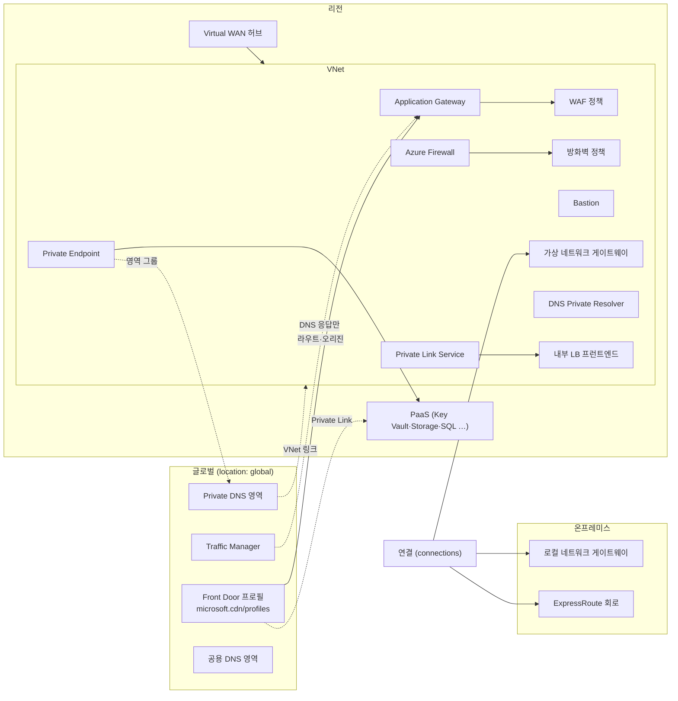

# 네트워크 경계·연결 — Azure 리소스 관계 사전
> 대상: 구성도·라이브 다이어그램 코드를 고치는 개발자, 네트워크 경계를 검토하는 운영자·보안 담당자, Azure 네트워크를 처음 익히는 사람
> 근거: Azure REST API 최신 스펙(파일별 최신 stable, stable이 없으면 최신 preview) + providers API + 실제 테넌트 교차 검증 (2026-10-15)
> 표기: ✓ = 실제 테넌트에서 본 참조, ⚠ = 스펙과 테넌트가 다름, "(name) 추정" = 속성 이름으로 대상을 짐작한 것(가설), "?" = 스펙에 대상이 없어 문서로만 확인한 것

## 1. 한눈에 보기

이 영역의 리소스는 VNet의 **문**과 **다리**입니다. 문은 바깥에서 들어오는 입구와 나가는 출구입니다.
- **인터넷 쪽 문**: Front Door, Application Gateway(AGW)+WAF
- **나가는 문·검문소**: Azure Firewall
- **관리용 문**: Bastion
- **사무실(온프레미스)로 가는 다리**: VPN 게이트웨이, ExpressRoute, Virtual WAN 허브
- **PaaS로 가는 사설 다리**: Private Endpoint, Private Link Service
- **주소록**: Azure DNS, Private DNS 영역, DNS Private Resolver, Traffic Manager

대부분은 **리전 리소스**이고 자기 VNet의 전용 서브넷 안에 놓입니다(`GatewaySubnet`·`AzureFirewallSubnet`·`AzureBastionSubnet`·DNS Resolver 위임 서브넷). **Front Door·Traffic Manager·DNS 영역(공용·사설)** 은 비지역(global) 서비스라 리전 상자 밖에 그립니다. 관계의 근거는 대부분 "한 리소스가 다른 리소스의 ID를 속성으로 가진다"는 구성 참조입니다. 다만 Traffic Manager와 DNS는 **이름 해석만** 합니다. 트래픽 자체는 그 리소스를 지나가지 않습니다.

**5살 비유**: VNet은 우리 아파트 단지예요.
- Front Door와 AGW는 단지 정문에서 손님을 맞는 문지기예요. WAF는 문지기가 들고 있는 "들어오면 안 되는 사람" 목록이에요.
- Firewall은 들어오고, 나가고, 옆집 사이로 오가는 모든 택배를 검사하는 경비실이에요.
- VPN·ExpressRoute는 할머니 집(사무실)까지 놓인 전용 다리예요. VPN은 잠긴 터널이고, ExpressRoute는 남과 같이 쓰지 않는 전용 도로예요(기본으로 암호화되지는 않아요).
- Private Endpoint는 이웃 가게(PaaS)로 바로 통하는 우리 단지 전용 쪽문이고, DNS는 "가게가 어느 문에 있는지" 알려 주는 주소록이에요.
- Traffic Manager는 길을 알려 주기만 하고 손님과 함께 걷지는 않는 안내원이에요.

(비유 대응표: 핵심 사전 입문 7)

## 2. 리소스 유형

범위는 providers API로 판정했습니다(`scope.txt`). 자식 유형은 부모와 같은 위치에 있습니다. ARM에서 "mixed"인 유형은 위치 값이 `global`인 것과 리전인 것이 섞여 있다는 뜻입니다.

| 유형 (ARM type) | 범위 | 한 줄 설명 | 문서 |
|---|---|---|---|
| `microsoft.network/applicationgateways` | 리전 | L7 부하 분산기(리스너·규칙·백엔드 풀). 전용 서브넷 | https://learn.microsoft.com/azure/application-gateway/overview |
| `microsoft.network/applicationgatewaywebapplicationfirewallpolicies` | 리전 | AGW용 WAF 정책(전역·사이트·URI 단위로 연결) | https://learn.microsoft.com/azure/web-application-firewall/ag/policy-overview |
| `microsoft.network/azurefirewalls` | 리전 | 상태 저장 방화벽. VNet(`AzureFirewallSubnet`) 또는 vWAN 허브에 배포 | https://learn.microsoft.com/azure/firewall/overview |
| `microsoft.network/firewallpolicies` | 리전(ARM 위치) | 방화벽 규칙 묶음. 다른 리전 방화벽에도 연결 가능 | https://learn.microsoft.com/azure/firewall-manager/policy-overview |
| `microsoft.network/firewallpolicies/rulecollectiongroups` | 자식 | 정책 안의 규칙 컬렉션 그룹 | 〃 |
| `microsoft.network/ipgroups` | 리전 | 규칙에서 쓰는 IP 묶음 (이 다이제스트에는 참조 없음) | https://learn.microsoft.com/azure/firewall/ip-groups |
| `microsoft.network/bastionhosts` | 리전 | 브라우저 RDP/SSH 관문(`AzureBastionSubnet`, Developer SKU는 공유 풀) | https://learn.microsoft.com/azure/bastion/configuration-settings |
| `microsoft.network/virtualnetworkgateways` | 리전 | VPN 또는 ExpressRoute 게이트웨이(`GatewaySubnet`) | https://learn.microsoft.com/azure/vpn-gateway/design |
| `microsoft.network/localnetworkgateways` | 리전 | 온프레미스 사이트(장치 공용 IP·주소 범위)를 나타내는 객체 | https://learn.microsoft.com/azure/vpn-gateway/tutorial-site-to-site-portal |
| `microsoft.network/connections` | 리전 | 게이트웨이 ↔ 사이트/게이트웨이/회로 연결(IPsec·VNet2VNet·ExpressRoute) | 〃 |
| `microsoft.network/expressroutecircuits` | 리전 | 공급자 또는 ExpressRoute Direct를 통한 사설 회선 | https://learn.microsoft.com/azure/expressroute/expressroute-howto-linkvnet-arm |
| `microsoft.network/expressroutecircuits/peerings` | 자식 | 개인(Private)·Microsoft 피어링 | https://learn.microsoft.com/azure/expressroute/how-to-routefilter-portal |
| `microsoft.network/expressroutecircuits/authorizations` | 자식 | 다른 구독이 회로에 연결할 때 쓰는 권한 부여 키 | https://learn.microsoft.com/azure/expressroute/expressroute-howto-linkvnet-arm |
| `microsoft.network/expressrouteports` | 리전 | ExpressRoute Direct 포트 쌍 | https://learn.microsoft.com/azure/expressroute/expressroute-erdirect-about |
| `microsoft.network/routefilters` | 리전 | Microsoft 피어링으로 받을 서비스(BGP 커뮤니티) 허용 목록 | https://learn.microsoft.com/azure/expressroute/how-to-routefilter-portal |
| `microsoft.network/virtualwans` | 리전(ARM 위치) | 허브들을 묶는 오버레이(논리 객체) | https://learn.microsoft.com/azure/virtual-wan/virtual-wan-about |
| `microsoft.network/virtualhubs` | 리전 | Microsoft 관리 허브 VNet(라우터·게이트웨이·방화벽 탑재) | 〃 |
| `microsoft.network/virtualhubs/hubvirtualnetworkconnections` | 자식 | 허브 ↔ 스포크 VNet 연결 | 〃 |
| `microsoft.network/virtualhubs/hubroutetables` | 자식 | 허브 경로 테이블(연결의 연결·전파 대상) | https://learn.microsoft.com/azure/virtual-wan/about-virtual-hub-routing |
| `microsoft.network/virtualhubs/routingintent` | 자식 | 인터넷·사설 트래픽을 허브 방화벽으로 보내는 정책 | 〃 |
| `microsoft.network/vpngateways` | 리전 | vWAN 허브의 사이트 간 VPN 게이트웨이 | https://learn.microsoft.com/azure/virtual-wan/virtual-wan-about |
| `microsoft.network/expressroutegateways` | 리전 | vWAN 허브의 ExpressRoute 게이트웨이 | 〃 |
| `microsoft.network/p2svpngateways` | 리전 | vWAN 허브의 사용자(P2S) VPN 게이트웨이 | 〃 |
| `microsoft.network/vpnsites` | 리전 | vWAN에서 온프레미스 VPN 장치를 나타냄 | 〃 |
| `microsoft.network/privateendpoints` | 리전 | VNet 안의 사설 IP NIC → Private Link 리소스 | https://learn.microsoft.com/azure/private-link/private-endpoint-overview |
| `microsoft.network/privateendpoints/privatednszonegroups` | 자식 | PE ↔ Private DNS 영역 A 레코드 자동 관리 | https://learn.microsoft.com/azure/private-link/private-endpoint-dns-integration |
| `microsoft.network/privatelinkservices` | 리전 | Standard LB 뒤의 내 서비스를 PE로 노출 | https://learn.microsoft.com/azure/private-link/private-link-service-overview |
| `microsoft.network/privatednszones` | 글로벌 | 사설 DNS 영역 | https://learn.microsoft.com/azure/dns/private-dns-virtual-network-links |
| `microsoft.network/privatednszones/virtualnetworklinks` | 글로벌(자식) | 영역 ↔ VNet 링크(등록/해석) | 〃 |
| `microsoft.network/dnszones` | 글로벌 | 공용 DNS 영역(별칭 레코드로 Azure 리소스를 가리킬 수 있음) | https://learn.microsoft.com/azure/dns/dns-alias |
| `microsoft.network/dnsresolvers` | 리전 | DNS Private Resolver(VNet 1개 참조) | https://learn.microsoft.com/azure/dns/dns-private-resolver-overview |
| `microsoft.network/dnsresolvers/inboundendpoints` · `/outboundendpoints` | 리전(자식) | 들어오는·나가는 DNS 엔드포인트(위임 서브넷) | https://learn.microsoft.com/azure/dns/private-resolver-endpoints-rulesets |
| `microsoft.network/dnsforwardingrulesets` | 리전 | 조건부 전달 규칙 묶음 | 〃 |
| `microsoft.network/dnsresolverpolicies` | 리전 | VNet 단위 DNS 질의 필터·로그(DNS 보안 정책) | https://learn.microsoft.com/azure/dns/dns-security-policy |
| `microsoft.cdn/profiles` | 혼합 | Front Door Standard/Premium 프로필(및 Azure CDN 프로필) | https://learn.microsoft.com/azure/frontdoor/origin |
| `microsoft.cdn/profiles/afdendpoints` · `/afdendpoints/routes` | 혼합(자식) | 엔드포인트, 도메인+경로 → 오리진 그룹 라우트 | https://learn.microsoft.com/azure/frontdoor/front-door-route-matching |
| `microsoft.cdn/profiles/origingroups` · `/origingroups/origins` | 혼합(자식) | 오리진 그룹(프로브·부하 분산)과 오리진 | https://learn.microsoft.com/azure/frontdoor/origin |
| `microsoft.cdn/profiles/customdomains` · `/securitypolicies` · `/secrets` | 혼합(자식) | 사용자 지정 도메인, WAF 연결, 인증서 | https://learn.microsoft.com/azure/frontdoor/standard-premium/how-to-add-custom-domain |
| `microsoft.network/frontdoorwebapplicationfirewallpolicies` | 혼합 | Front Door용 WAF 정책(엣지 전체에 복제) | https://learn.microsoft.com/azure/web-application-firewall/afds/afds-overview |
| `microsoft.network/frontdoors` | 혼합 | **Front Door (classic)** — 2027-03-31 종료 | https://learn.microsoft.com/azure/frontdoor/classic-retirement-faq |
| `microsoft.network/trafficmanagerprofiles` | 글로벌 | DNS 기반 트래픽 분배(엔드포인트: Azure·외부·중첩) | https://learn.microsoft.com/azure/traffic-manager/traffic-manager-endpoint-types |

## 3. 관계 표

핵심 사전에 이미 있어 이 페이지에서 반복하지 않는 행은 다음과 같습니다. **CT-04**(AGW 서브넷), **CT-06**(PE 서브넷), **CT-07**(Bastion·Firewall·VPN/ER 게이트웨이 전용 서브넷), **PIP-01**(공용 IP → 소유자: AGW·Bastion·Firewall·게이트웨이 포함), **AGW-01~07**, **LB-07**, **SEC-04**(UDR 다음 홉 → 방화벽 사설 IP), **EDGE-01**, **EDGE-02**, **EDGE-04**(Front Door 오리진 `hostName` fqdnMatch), **PL-01**(PE → 대상, `groupIds`·승인 상태), **PL-03**(Private DNS 영역 → VNet 링크), **PL-05**, **REG-02**, **REG-04**.

관계 하나에 주인 페이지 하나: 신원·키·로그 전송은 IDM, 배치·네트워크는 서비스 페이지. 다른 페이지에는 '→ <ID> 참고' 한 줄만 둔다. 핵심 사전 행을 다시 쓰는 행은 새 ID 없이 메모로 둔다.

| ID | 관계 (source → target) | 의미·방향 | ARM 속성 경로 | 근거 | 다이어그램 표현 | 출처 |
|---|---|---|---|---|---|---|
| EDG-01 | AGW(전역)·리스너(사이트)·경로 규칙(URI) → WAF 정책 | 보안 정책 적용. 더 좁은 범위가 우선(URI > 리스너 > 게이트웨이) | `firewallPolicy`(게이트웨이 전체), `httpListeners[].firewallPolicy`, `urlPathMaps[].pathRules[].firewallPolicy` → 실제 대상은 `applicationGatewayWebApplicationFirewallPolicies` (docs: 템플릿 참조 microsoft.network/applicationgateways). ⚠ 다이제스트의 (name) 추론 `→ firewallpolicies`(Azure Firewall 정책)는 틀렸다. 정책 쪽 `applicationGateways[]`·`httpListeners[]`·`pathBasedRules[]`는 **읽기 전용 역참조** | spec:subresource + docs (템플릿 참조) ⚠ | badge (AGW 타일 'WAF'·리스너별 정책 수) — 정책은 별도 노드가 아닌 속성. WAF 없는 공용 리스너는 보안 검토 대상 | https://learn.microsoft.com/azure/web-application-firewall/ag/policy-overview — "more specific policies override less specific ones" |
| EDG-02 | AGW 프런트엔드 → Private Link 구성 (← 소비자 PE) | 다른 VNet·구독·테넌트에서 사설 진입. 진입 방향 | `frontendIPConfigurations[].privateLinkConfiguration` → ? (AGW 자식). 소비자 연결은 `privateEndpointConnections[].privateEndpoint`(읽기 전용) | spec:subresource + docs | chip 'Private Link' + 소비자 PE에서 오는 선(PL-01, PE 대상 유형 = applicationGateways) | https://learn.microsoft.com/azure/application-gateway/private-link — "subnet used for PrivateLinkConfiguration can't be same as the Application Gateway subnet" |
| EDG-03 | Azure Firewall → 방화벽 정책 | 구성 참조(규칙의 출처) | `firewallPolicy` → firewallPolicies (name) 추정. 정책 쪽 `firewalls[]`는 읽기 전용 | spec:subresource | panel(정책 이름·계층) + badge. 정책은 리전 상자에 넣지 않음(다른 리전 방화벽도 씀) | https://learn.microsoft.com/azure/firewall-manager/policy-overview — "Policies can be associated with one or more firewalls" |
| EDG-04 | 방화벽 정책(자식) → 부모 정책 | 상속(부모의 네트워크·앱 규칙 컬렉션 우선, NAT는 상속 안 됨) | `basePolicy` → ? (문서상 firewallPolicies). 부모 쪽 `childPolicies[]`는 읽기 전용 | spec:subresource + docs | panel(상속 사슬) / none | https://learn.microsoft.com/azure/firewall-manager/policy-overview — "Both the parent and child policies must reside in the same region."  |
| EDG-05 | 방화벽 정책 → Log Analytics 작업 영역 | 정책 분석(Policy Analytics) 데이터 위치 | `insights.logAnalyticsResources.workspaces[].workspaceId` → workspaces (name) 추정, `insights.logAnalyticsResources.defaultWorkspaceId` → ? | spec:subresource | 로그 선(기본 끔, LOG-01과 같은 레이어) | https://learn.microsoft.com/azure/firewall/policy-analytics — "should be the same workspace configured in the firewall Diagnostic settings" |
| EDG-06 | Azure Firewall → 관리 서브넷·관리 공용 IP | 관리 트래픽 분리(강제 터널링 전제) | `managementIpConfiguration.subnet`, `managementIpConfiguration.publicIPAddress` → subnets / publicIPAddresses (name) 추정 | spec:subresource | contain(`AzureFirewallManagementSubnet`) + chip '관리 IP'. 이 공용 IP는 진입점이 아님 | https://learn.microsoft.com/azure/firewall/management-nic — "routes its management traffic through the AzureFirewallManagementSubnet" |
| EDG-07 | Azure Firewall → vWAN 허브 (보안 허브) | 허브 안 배포(사용자 VNet 서브넷 없음) | 방화벽: `virtualHub` → virtualHubs (name) 추정. 허브: `azureFirewall` → ? (문서상 azureFirewalls), `securityPartnerProvider` → ? | spec:subresource + docs | contain(허브 상자 안) — `AzureFirewallSubnet`을 찾지 않음 | https://learn.microsoft.com/azure/firewall-manager/secured-virtual-hub — "security and routing policies configured by Azure Firewall Manager" |
| EDG-08 | Bastion (Developer SKU) → VNet | 전용 서브넷 없이 VNet에 붙는 공유 풀 | `virtualNetwork` → virtualNetworks (name) 추정 — 테넌트 미관측 | spec:subresource | chip(VNet 머리글 'Bastion Developer'), 서브넷 박스 없음 | https://learn.microsoft.com/azure/bastion/configuration-settings — "any SKU except the Bastion Developer offering … requires a dedicated subnet" |
| EDG-09 | Bastion → 대상 VM (자기 VNet + 피어링 VNet) | 관리 접속 도달 범위(속성 없음) | — (Bastion 쪽 `ipConfigurations[].subnet`의 VNet + EDGE-02 피어링으로 계산) | docs | panel '도달 가능 VNet n'. VM마다 선은 긋지 않음(구성 근거 없음) | https://learn.microsoft.com/azure/bastion/vnet-peering — "available to all your virtual machines in the same virtual network and peered virtual networks" |
| EDG-10 | 연결 → 가상 네트워크 게이트웨이(로컬 쪽) | 연결의 Azure 쪽 끝 | `connections`: `virtualNetworkGateway1` → virtualNetworkGateways ✓ | spec+tenant (typed-ref ✓) | absorb(게이트웨이 카드에 '연결 n') | https://learn.microsoft.com/azure/vpn-gateway/tutorial-site-to-site-portal |
| EDG-11 | 연결 → 로컬 네트워크 게이트웨이 (S2S IPsec) | 하이브리드. 온프레미스 사이트까지 터널 | `localNetworkGateway2` → localNetworkGateways ✓ | spec+tenant (typed-ref ✓) | line(게이트웨이 → '온프레미스' 노드, 사이트 이름·주소 범위는 패널) | https://learn.microsoft.com/azure/vpn-gateway/tutorial-site-to-site-portal — "represents your on-premises location (the site) for routing purposes"  |
| EDG-12 | 연결 → 원격 가상 네트워크 게이트웨이 (VNet-to-VNet) | VNet 간 IPsec 터널(피어링 아님) | `virtualNetworkGateway2` → virtualNetworkGateways | spec:typed-ref | line(두 VNet 게이트웨이 사이, 피어링 선과 다른 스타일) | https://learn.microsoft.com/azure/vpn-gateway/design — "Both connectivity types use a VPN gateway" |
| EDG-13 | 연결 → ExpressRoute 회로 (+ 권한 부여) | ER 게이트웨이와 회로의 링크. 다른 구독은 권한 부여 키를 씀 | `peer` → ? (문서: `-PeerId $circuit.Id`). 키는 자식 `expressRouteCircuits/authorizations`(참조 속성 없음) | spec:subresource + docs | line(게이트웨이 → 회로 → '온프레미스'), 다른 구독 회로는 고스트 | https://learn.microsoft.com/azure/expressroute/expressroute-howto-linkvnet-arm — "An authorization is valid for only one connection." |
| EDG-14 | 가상 네트워크 게이트웨이 → 기본 사이트(로컬 네트워크 게이트웨이) | 강제 터널링: 인터넷행 트래픽을 온프레미스로 보냄 | `gatewayDefaultSite` → ? (문서상 localNetworkGateways) | spec:subresource + docs | chip '강제 터널링' (서브넷 출구 칩과 함께 표시) | https://learn.microsoft.com/azure/vpn-gateway/about-site-to-site-tunneling — "setting the Default Site for your route-based VPN gateway" |
| EDG-15 | ExpressRoute 회로 → ExpressRoute Direct 포트 | 회로가 그 포트 쌍 위에 만들어짐 | `expressRoutePort` → ? (문서상 expressRoutePorts). 포트 쪽 `circuits[]`는 읽기 전용. `expressRouteLag`도 같은 형태 | spec:subresource + docs | panel(회로 상세: 'Direct 포트') | https://learn.microsoft.com/azure/expressroute/expressroute-erdirect-about — "provisioned on an ExpressRoute Direct port pair" |
| EDG-16 | ER 회로 피어링 → 경로 필터 | Microsoft 피어링에서 받을 서비스 접두사 허용 목록 | `peerings[].routeFilter`, `peerings[].ipv6PeeringConfig.routeFilter` → ? (문서상 routeFilters) | spec:subresource + docs | panel. 필터 없는 Microsoft 피어링은 '광고 경로 없음'으로 표시 | https://learn.microsoft.com/azure/expressroute/how-to-routefilter-portal — "No routes are advertised to your network until you associate a route filter." |
| EDG-17 | ER 회로 ↔ ER 회로 (Global Reach) | 온프레미스 ↔ 온프레미스를 Microsoft 백본으로 연결 | `peerings[].connections[].expressRouteCircuitPeering`, `peerings[].connections[].peerExpressRouteCircuitPeering` → ? (회로 피어링). 상대 쪽 `peeredConnections[]`는 읽기 전용 | spec:subresource + docs | line-dashed(회로 ↔ 회로, Azure VNet을 지나지 않음) | https://learn.microsoft.com/azure/expressroute/expressroute-global-reach — "link ExpressRoute circuits to create a private network" |
| EDG-18 | vWAN ⊃ 가상 허브 | 포함(허브는 리전마다, WAN은 묶음) | 허브: `virtualWan` → virtualWans (name) 추정. WAN 쪽 `virtualHubs[]`·`vpnSites[]`는 읽기 전용 | spec:subresource | contain(WAN 상자 ⊃ 리전별 허브 상자) | https://learn.microsoft.com/azure/virtual-wan/virtual-wan-about — "Virtual WANs are isolated from each other" |
| EDG-19 | 가상 허브 → 허브 게이트웨이·방화벽 | 허브가 품은 구성 요소 | 허브: `vpnGateway` → vpnGateways (name) 추정, `p2SVpnGateway`·`expressRouteGateway`·`azureFirewall`·`securityPartnerProvider` → ?. 역방향: `vpnGateways.virtualHub`, `azureFirewalls.virtualHub` | spec:subresource + docs | contain(허브 상자 안 아이콘) | https://learn.microsoft.com/azure/virtual-wan/about-virtual-hub-routing — "A virtual hub can contain multiple gateways" |
| EDG-20 | 허브 VNet 연결 → 스포크 VNet | 허브 ↔ 스포크(전이 라우팅은 허브 라우터) | `hubVirtualNetworkConnections`: `remoteVirtualNetwork` → virtualNetworks (name) 추정 | spec:subresource | line(허브 → VNet, 피어링 선과 구분) | https://learn.microsoft.com/azure/virtual-wan/virtual-wan-about — "One virtual network can be connected to only one virtual hub." |
| EDG-21 | 허브 연결 → 허브 경로 테이블 (연결·전파) | 라우팅: 1개 테이블에 연결, 여러 테이블로 전파 | `routingConfiguration.associatedRouteTable`, `routingConfiguration.propagatedRouteTables.ids[]` → ? (문서상 hubRouteTables). VPN·ER·허브 VNet 연결에 공통 | spec:subresource + docs | panel(연결별 '연결 테이블 / 전파 테이블') | https://learn.microsoft.com/azure/virtual-wan/about-virtual-hub-routing — "Each connection is associated to one route table." |
| EDG-22 | 허브 VPN 게이트웨이 연결 → VPN 사이트 → vWAN | 지점 사이트 | `vpnGateways`: `connections[].remoteVpnSite` → ?, `connections[].vpnLinkConnections[].vpnSiteLink` → ?. 사이트: `vpnSites.virtualWan` → virtualWans (name) 추정 | spec:subresource + docs | line(허브 VPN 게이트웨이 → '사이트' 노드) | https://learn.microsoft.com/azure/virtual-wan/virtual-wan-about — "It represents your on-premises VPN device" |
| EDG-23 | 가상 허브 → 라우팅 의도(Routing Intent) | 인터넷·사설 트래픽을 허브 방화벽/NVA로 강제 | 자식 `virtualHubs/routingIntent` — 다이제스트에 참조 속성 없음 | docs | chip '라우팅 의도: 인터넷 / 사설' (허브 상자) | https://learn.microsoft.com/azure/virtual-wan/about-virtual-hub-routing — "at most, one Internet Traffic Routing Policy and one Private Traffic Routing Policy" |
| EDG-24 | Private Endpoint → 대상 (수동 승인 연결) | 권한 없는 쪽이 요청하면 처음에는 Pending | `manualPrivateLinkServiceConnections[].privateLinkServiceId` → privateLinkServices (name) 추정. **⚠ 자동 연결(`privateLinkServiceConnections[]`)은 테넌트에서 Key Vault·Storage·Web·Redis·Recovery Services 대상이 관측됨 — 수동도 같다고 보되 미관측** | spec:id-string | line-dashed 회색 '승인 대기'(PL-01의 '연결 끊김'과 구분) | https://learn.microsoft.com/azure/private-link/private-endpoint-overview — "created in a *Pending* state" |
| EDG-25 | Private Endpoint → Private DNS 영역 (영역 그룹) | PE A 레코드를 영역에 자동 등록·삭제 | `privateEndpoints/privateDnsZoneGroups`: `privateDnsZoneConfigs[].privateDnsZoneId` → ? (문서상 privateDnsZones) | spec:id-string + docs | chip 'DNS 등록됨 / 영역 그룹 없음'. 영역 → VNet 링크(PL-03)까지 이어져야 해석됨 | https://learn.microsoft.com/azure/private-link/private-endpoint-dns-integration — "strong association between the private DNS zone and the private endpoint" · **주인 행** — DAT-22는 이 행을 인용한다 |
| EDG-26 | Private Endpoint → NIC | Azure가 만드는 읽기 전용 NIC | `networkInterfaces[]` (**읽기 전용 역참조**) | spec (read-only) | absorb(PE 카드에 사설 IP — NIC를 따로 그리지 않음) | https://learn.microsoft.com/azure/private-link/private-endpoint-overview — "A read-only network interface is *automatically created*" |
| EDG-27 | Private Endpoint → 애플리케이션 보안 그룹 | NSG 규칙 대상 묶음 | `applicationSecurityGroups[]` → applicationSecurityGroups | spec:typed-ref | chip(SEC-02와 같은 표기) | https://learn.microsoft.com/azure/private-link/configure-asg-private-endpoint |
| EDG-28 | Private Link Service → 내부 LB 프런트엔드 + NAT 서브넷 | 내 서비스 노출(공급자 쪽) | `loadBalancerFrontendIpConfigurations[]` → loadBalancers/frontendIPConfigurations ✓, `ipConfigurations[].subnet` → subnets ✓ | spec+tenant (typed-ref ✓) | line(PLS → LB) + contain(NAT 서브넷) | https://learn.microsoft.com/azure/private-link/private-link-service-overview — "tied to the frontend IP address of a Standard Load Balancer" |
| EDG-29 | Private Link Service ← 소비자 Private Endpoint | 다른 VNet·구독·테넌트의 소비자 | PLS: `privateEndpointConnections[].privateEndpoint` (**읽기 전용**). 소비자 쪽 설정 = PL-01 경로 ✓ | spec+tenant | line(소비자 PE → PLS). 남의 구독이면 고스트 노드 | https://learn.microsoft.com/azure/private-link/private-link-service-overview — "accessed from multiple Private Endpoints belonging to different virtual networks"  |
| EDG-30 | PL-03 확장 (등록/해석 플래그: `registrationEnabled`·`resolutionPolicy`) | 새 관계가 아니라 PL-03(Private DNS 영역 → VNet 링크)의 속성 설명. 등록 링크는 VM 레코드 자동 생성. VNet당 등록 영역 1개 | PL-03 경로(`virtualNetworkLinks`: `virtualNetwork` ✓). 등록 여부 플래그는 참조가 아니라 다이제스트 밖(문서 기준) | spec+tenant / docs | chip '등록' / '해석' 구분(PL-03 칩 확장) | https://learn.microsoft.com/azure/dns/private-dns-virtual-network-links — "every virtual network can only have one registration zone" |
| EDG-31 | DNS Private Resolver → VNet / 엔드포인트 → 위임 서브넷 | Resolver 1개 = VNet 1개, 엔드포인트마다 전용 서브넷 | `dnsResolvers`: `virtualNetwork` → virtualNetworks (name) 추정. `inboundEndpoints`: `ipConfigurations[].subnet`, `outboundEndpoints`: `subnet` → subnets (name) 추정 | spec:subresource | contain(엔드포인트를 위임 서브넷 안에), 인바운드 IP는 칩 | https://learn.microsoft.com/azure/dns/dns-private-resolver-overview — "A single DNS resolver can reference only one virtual network." |
| EDG-32 | DNS 전달 규칙 집합 → 아웃바운드 엔드포인트 / VNet 링크 | 조건부 전달(같은 리전 VNet만) | `dnsForwardingRulesets.dnsResolverOutboundEndpoints[]` (→ 아웃바운드 엔드포인트, 문서로 대상 확인) / 자식 `dnsForwardingRulesets/virtualNetworkLinks.virtualNetwork` (→ virtualnetworks (name)) | spec:subresource | line-dashed 규칙 집합 → VNet(같은 리전) | https://learn.microsoft.com/azure/dns/private-resolver-endpoints-rulesets — "A ruleset can't be linked to a virtual network in another region." |
| EDG-33 | DNS 보안 정책 → VNet / 규칙 → 도메인 목록 | VNet 단위 DNS 질의 차단·경고·로그 | `dnsResolverPolicies/virtualNetworkLinks`: `virtualNetwork` → virtualNetworks (name) 추정. `dnsSecurityRules`: `dnsResolverDomainLists[]` → ? | spec:subresource | chip(VNet 머리글 'DNS 정책') | https://learn.microsoft.com/azure/dns/dns-security-policy — "you can only link one DNS resolver policy to a single VNet" |
| EDG-34 | 공용 DNS 별칭 레코드 → Azure 리소스 | 이름 → 공용 IP·Traffic Manager·CDN/Front Door 엔드포인트. 수명 주기 연동 | — (레코드 집합 유형은 다이제스트 밖, 경로 미확인) | docs | line-dashed(DNS 영역 → 대상, 이름 해석일 뿐 트래픽 경로 아님) | https://learn.microsoft.com/azure/dns/dns-alias — "Alias records prevent dangling references" |
| EDG-35 | Front Door 라우트 → 오리진 그룹 · 사용자 지정 도메인 · 규칙 집합 | 도메인+경로 → 오리진 그룹(규칙 집합이 덮어쓸 수 있음) | `afdEndpoints/routes`: `originGroup` → ?, `customDomains[]` → ?, `ruleSets[]` → ? (문서상 각각 origingroups·customdomains·rulesets) | spec:subresource + docs | Front Door 패널(라우트 표) + 오리진 선의 그룹 단위 묶음 | https://learn.microsoft.com/azure/frontdoor/front-door-route-matching — "establish an association between a domain and an origin group" |
| EDG-36 | Front Door 사용자 지정 도메인 → Azure DNS 영역 · 인증서 비밀 | 도메인 검증·CNAME, TLS 인증서 | `customDomains`: `azureDnsZone` → ?, `tlsSettings.secret` → ?, `preValidatedCustomDomainResourceId` → ? | spec:subresource + docs | panel(도메인 → DNS 영역 링크) | https://learn.microsoft.com/azure/frontdoor/standard-premium/how-to-add-custom-domain — "supports Azure prevalidated domains and Azure DNS zones in different subscriptions" |
| EDG-37 | Front Door 오리진 → Azure 리소스 | 오리진이 가리키는 App Service·Storage 등 (EDGE-04 fqdnMatch보다 강한 근거 후보) | `originGroups/origins`: `azureOrigin` → ? (리소스 ID로 추정, 테넌트 미관측) | spec:subresource (가설) | line(글로벌 → 리전 리소스, REG-04처럼 리전을 넘음). 비어 있으면 EDGE-04로 대체 | https://learn.microsoft.com/azure/frontdoor/origin — "autodiscovery of your application backends from App Service, Cloud Service, or Storage" |
| EDG-38 | Front Door 오리진 → Private Link 대상 (Premium) · 클래식의 같은 설정 | Front Door가 대상에 관리형 PE를 만들고 대상 소유자가 승인 | `origins`: `sharedPrivateLinkResource.privateLink` → ?. classic: `frontDoors`: `backendPools[].backends[].privateLinkResourceId`, CDN: `endpoints`: `origins[].privateLinkResourceId` (id-string) | spec:subresource / id-string + docs | line(사설, PE 아이콘). 대상의 `privateEndpointConnections`가 Pending이면 회색. 관리형 PE 공통 규칙: 관리형 PE·공유 프라이빗 링크는 고객 쪽 NIC를 만들지 않는다 — Learn: 'Managed private endpoints … don't create customer-visible network interfaces' (foundry/how-to/managed-virtual-network). 서비스 → 대상 선으로 그리고 서브넷 안에 두지 않는다. 승인 상태는 대상의 `privateEndpointConnections`에서 읽는다. | https://learn.microsoft.com/azure/frontdoor/private-link — "You must approve the private endpoint connection before traffic can pass" |
| EDG-39 | Front Door WAF 정책 ← 보안 정책 (프로필·도메인·라우트) | 엣지 WAF 적용. 라우트 > 도메인 > 프로필 순으로 우선 | 설정 쪽: `profiles/securityPolicies`의 `parameters.wafPolicy.id`, `parameters.associations[].domains[].id` (docs, 템플릿 참조 — 다형 스키마라 파서가 놓침). WAF 정책의 `securityPolicyLinks[]`는 읽기 전용(tenant) | docs + tenant | badge(Front Door 'WAF', 도메인별) | https://learn.microsoft.com/azure/web-application-firewall/afds/afds-overview — "Azure Front Door WAF uses the most specific scope" |
| EDG-40 | Traffic Manager 엔드포인트 → 대상 (Azure·중첩 프로필) | **DNS 응답만** — 데이터 경로가 아님 | `endpoints[].targetResourceId` → ? (문서: 공용 IP·Web App·클라우드 서비스·자식 프로필). `endpoints[].id`(arm-id)는 엔드포인트 자기 ID라 관계가 아님 | spec:id-string + docs | line-dashed(글로벌 TM → 대상) + 라벨 'DNS'. 외부 엔드포인트는 이름만 칩 | https://learn.microsoft.com/azure/traffic-manager/traffic-manager-endpoint-types — "Traffic Manager works at the DNS level" |
| EDG-41 | Route Server → RouteServerSubnet / BGP 피어(NVA) | 경로 교환(데이터 경로 아님). 판별 규칙: `virtualWan`이 없는 `virtualHubs` = Route Server | `virtualHubs`(`virtualWan` 없음) + 자식 `virtualHubs/ipConfigurations.subnet` (spec:typed-ref, 서브넷 이름 `RouteServerSubnet`) + `virtualHubs/bgpConnections`(피어 IP) | spec+docs | contain(RouteServerSubnet) + BGP 피어는 ipMatch line-dashed | https://learn.microsoft.com/azure/route-server/quickstart-create-route-server-template |
| EDG-42 | vWAN 허브의 NVA → 허브·서브넷·인입 공용 IP | 허브에 배치된 NVA | `networkVirtualAppliances.virtualHub` (subresource → virtualhubs (name)), `nvaInterfaceConfigurations[].subnet.id` (arm-id), `internetIngressPublicIps[].id` (arm-id) | spec | absorb(허브 박스 안 NVA 카드) + 인입 IP chip | https://learn.microsoft.com/azure/virtual-wan/about-nva-hub |
| EDG-43 | 라우팅 의도 → 검사 장치 | 인터넷·사설 트래픽을 어느 방화벽/NVA로 보내는지 | `virtualHubs/routingIntent.routingPolicies[].nextHop` (docs) | docs | EDG-23 chip에 대상 이름 표시(허브 방화벽 또는 NVA) | https://learn.microsoft.com/azure/virtual-wan/how-to-routing-policies |
| EDG-44 | Application Gateway for Containers → WAF 정책 / 연결 서브넷 | AKS 인그레스용 L7 | `microsoft.servicenetworking/trafficcontrollers` — WAF 정책 쪽 `applicationGatewayForContainers[].id`는 읽기 전용(다이제스트). 연결 서브넷은 `trafficControllers/associations.properties.subnet.id`(추출 규칙 보강 후 catalog에서 확인) — 핵심 사전 AGC-01..05 | spec(역참조) + spec(association) + docs | 서브넷 contain + WAF chip | https://learn.microsoft.com/azure/application-gateway/for-containers/overview |
| EDG-45 | 허브 ExpressRoute 게이트웨이 → 회로 피어링 | 온프레미스 다리 | `expressRouteGateways.expressRouteConnections[].expressRouteCircuitPeering.id` (docs) | docs | line(허브 → 회로, 온프레미스 레인) | https://learn.microsoft.com/azure/virtual-wan/virtual-wan-expressroute-portal |

**참고 (표에 넣지 않은 것, 미확인)**
- `dnsZones`의 `registrationVirtualNetworks[]`·`resolutionVirtualNetworks[]`(dns 2018-05-01 스펙)는 공용 영역 유형에 남은 옛 사설 영역 방식으로 보입니다. 테넌트에서 관측되지 않았고 현재 문서도 찾지 못해 **미확인**입니다. 사설 영역은 `privateDnsZones`(PL-03·EDG-30)를 기준으로 합니다.
- `connections`의 `ingressNatRules[]`·`egressNatRules[]` → `virtualNetworkGateways/natRules`는 이름으로 추정한 것입니다.

## 4. 자주 하는 오해

- **"Traffic Manager도 Front Door처럼 트래픽이 지나간다"** → 거짓. Traffic Manager는 DNS 응답으로 엔드포인트를 알려 줄 뿐이라 바이트가 지나가지 않습니다. 그래서 선은 점선(EDG-40)이고 트래픽 값을 붙이지 않습니다. 반면 Front Door는 프록시라 요청이 실제로 지나갑니다.
  — 출처: [traffic-manager-endpoint-types](https://learn.microsoft.com/azure/traffic-manager/traffic-manager-endpoint-types) "Traffic Manager works at the DNS level"
- **"Private Endpoint를 만들면 이름이 자동으로 사설 IP로 풀린다"** → 거짓. 기본으로는 공용 IP로 풀립니다. 두 가지가 모두 있어야 사설 IP로 해석됩니다.
  1. PE의 DNS 영역 그룹(EDG-25)
  2. 그 Private DNS 영역의 **VNet 링크**(PL-03)

  — 출처: [private-endpoint-dns-integration](https://learn.microsoft.com/azure/private-link/private-endpoint-dns-integration) "The FQDN of the service automatically resolves to a public IP address."
- **"PE의 대상은 privateLinkServices뿐이다(스펙)"** → ⚠ 스펙과 실제가 다릅니다. 실제로는 Key Vault·Storage·Web·Redis·Recovery Services·AGW 등 **Private Link를 지원하는 모든 리소스**가 대상이 됩니다. 대상 유형은 ID에서 읽어야 합니다.
  — 출처: [private-endpoint-overview](https://learn.microsoft.com/azure/private-link/private-endpoint-overview) 리소스 표 + 테넌트 관측
- **"Bastion은 VNet마다 하나씩 있어야 한다"** → 거짓. Bastion 하나로 피어링된 VNet의 VM까지 접속할 수 있습니다. 단, vWAN 허브 **안**에는 배포할 수 없습니다.
  — 출처: [bastion/vnet-peering](https://learn.microsoft.com/azure/bastion/vnet-peering) "you don't have to deploy Azure Bastion in each peered VNet"
- **"방화벽 정책은 같은 리전의 방화벽에만 붙는다"** → 거짓. 정책은 어느 리전 방화벽에도 연결됩니다. 같은 리전이어야 하는 것은 **부모와 자식 정책**뿐입니다. 그래서 정책을 리전 상자 안에 가두어 그리면 안 됩니다.
  — 출처: [firewall-manager/policy-overview](https://learn.microsoft.com/azure/firewall-manager/policy-overview) "can be associated with firewalls in any region"
- **"Private DNS 영역도 리전 리소스다"** → 거짓. Private DNS 영역은 글로벌이라 모든 리전의 VNet에 링크할 수 있습니다. 반면 DNS Private Resolver·전달 규칙 집합·DNS 보안 정책은 **같은 리전 VNet에만** 붙습니다.
  — 출처: [regions-nonregional-services](https://learn.microsoft.com/azure/reliability/regions-nonregional-services) "Azure DNS private zones" 행, [private-resolver-endpoints-rulesets](https://learn.microsoft.com/azure/dns/private-resolver-endpoints-rulesets) "can't be linked to a virtual network in another region"
- **"Front Door = `microsoft.network/frontdoors`"** → 그것은 **classic**입니다. classic은 2025-04-01부터 새로 만들 수 없고 2027-03-31에 종료됩니다. 현재 Front Door(Standard/Premium)는 `microsoft.cdn/profiles`입니다.
  — 출처: [classic-retirement-faq](https://learn.microsoft.com/azure/frontdoor/classic-retirement-faq) "Azure Front Door (classic) retires on March 31, 2027."
- **"vWAN 허브는 내 VNet이고, 허브 방화벽은 `AzureFirewallSubnet`에 있다"** → 거짓. 허브는 Microsoft가 관리하는 VNet이라 사용자 서브넷이 없습니다. 허브 방화벽은 `virtualHub` 속성(EDG-07)으로만 식별됩니다.
  — 출처: [virtual-wan-about](https://learn.microsoft.com/azure/virtual-wan/virtual-wan-about) "A virtual hub is a Microsoft-managed virtual network."
- **"VNet에 VPN 게이트웨이를 여러 개 둘 수 있다"** → 거짓. VNet당 VPN 게이트웨이는 1개입니다. VPN과 공존하는 ExpressRoute 게이트웨이(유형이 다름)는 별개로 1개 더 둘 수 있습니다.
  — 출처: [vpn-gateway/design](https://learn.microsoft.com/azure/vpn-gateway/design) "each virtual network can only have one VPN gateway"

## 5. 이 플랫폼 반영 상태

**지금 그리는 것** (코드 확인: `azure.ts` Resource Graph 쿼리, `archModel.ts`)

| 대상 | 현재 처리 |
|---|---|
| AGW | CT-04, AGW-01~06 |
| PE | CT-06, PL-01 — 승인 안 됨은 회색 |
| NAT·피어링 | EDGE-01, EDGE-02 |
| 공용 IP | PIP-01·PIP-03 |
| 리전 | REG-02 — Front Door classic·Traffic Manager·DNS 영역은 글로벌 상자 |
| Azure Firewall | 조회해서 엣지·진입 유형으로 분류. 서브넷 배치는 CT-09 대체 규칙 |
| DNS 영역·Private DNS 영역 | 조회하지만 'dns' PaaS 타일로만 표시. 링크선(PL-03)은 없음 |

**구멍** (코드에서 확인)

1. `microsoft.cdn/profiles`(Front Door Standard/Premium)를 **조회하지 않습니다**. 예시 데이터(`mockData.ts`)에만 있습니다. classic은 새로 만들 수 없으므로 실제 테넌트의 새 Front Door는 구성도에 나오지 않습니다.
2. `virtualnetworkgateways`·`bastionhosts`·`connections`·`localnetworkgateways`·`expressroutecircuits`·`virtualhubs`·`privatelinkservices`·`dnsresolvers`·`firewallpolicies`·WAF 정책을 조회하지 않습니다.
   - 그 결과 VPN/ER 게이트웨이·Bastion의 공용 IP는 소유자가 그래프에 없습니다. 그래서 '정리 필요(소유자 유형 `virtualnetworkgateways`)'에 표시됩니다. `archModel.test.ts`가 이 동작을 검증하고 있습니다.
   - 미사용 IP처럼 보이지만 실제로는 사용 중인 IP라 운영자를 오해하게 만듭니다.

**제안** (우선순위 순)

| 순위 | 할 일 | 이유 | 쓸 속성·행 |
|---|---|---|---|
| 1 | `microsoft.cdn/profiles` + `afdEndpoints` 조회, 오리진 선 구현 | classic 종료(2027-03-31) 후에는 Front Door가 구성도에서 사라짐. EDGE-04(§14 미확인)를 구성 근거로 확정할 수 있음 | EDG-35 `routes.originGroup`, EDG-37 `origins.azureOrigin`(cfg) → 없으면 EDGE-04 `hostName` fqdnMatch, EDG-38 사설 오리진. ※ 자식 유형(origingroups/origins)이 Resource Graph `resources`에 있는지 미확인 → 없으면 ARM REST |
| 2 | `virtualnetworkgateways`·`connections`·`localnetworkgateways` 조회 | 하이브리드 경로가 구성도에 전혀 없고, 게이트웨이 공용 IP가 '정리 필요'로 잘못 분류됨 | CT-07(GatewaySubnet contain) + PIP-01 흡수, EDG-10/11/12/13 → '온프레미스' 노드 선, EDG-14 강제 터널링 칩 |
| 3 | `bastionhosts` 조회 | 관리 접속 경로(보안 검토 필수 항목), 공용 IP 오분류 해소 | CT-07(AzureBastionSubnet), EDG-08 Developer 칩, EDG-09 도달 VNet 패널 |
| 4 | PE의 DNS 영역 그룹 + Private DNS VNet 링크 | "PE는 있는데 공용으로 풀린다"는 가장 흔한 장애를 화면에서 바로 판정 | EDG-25 `privateDnsZoneConfigs[].privateDnsZoneId` + PL-03 → PE 칩 'DNS 등록됨/없음', VNet 칩 '해석 가능 영역 n'. ※ `privateDnsZoneGroups`가 Resource Graph에 있는지 미확인 |
| 5 | Firewall 정책 + UDR 다음 홉 | 출구 통제 경로를 보여 줌 | EDG-03(정책 패널), SEC-04 `nextHopIpAddress` ipMatch → 방화벽 `ipConfigurations[].privateIPAddress`(azure.ts가 이미 endpoint로 읽음), EDG-06 관리 IP는 진입점에서 제외 |
| 6 | AGW·Front Door WAF 배지 | "WAF 없는 공용 리스너"는 보안 점검의 핵심 질문 | EDG-01(정책 쪽 `applicationGateways[]`·`httpListeners[]` 읽기 전용 목록으로 판정), EDG-39 |
| 7 | Private Link Service | 내 서비스를 남에게 노출하는 경로(공급자 측) | EDG-28 PLS → 내부 LB(✓), EDG-29 소비자 PE(고스트) |
| 8 | Virtual WAN | 허브-스포크 대규모 테넌트에서 VNet 간 경로가 피어링이 아닌 허브로 보임 | EDG-18 contain, EDG-19 허브 구성 요소, EDG-20 스포크 선, EDG-21/23 라우팅 패널·칩 |
| 9 | Traffic Manager 엔드포인트 | 글로벌 상자에 타일만 있고 대상이 없음 | EDG-40 `endpoints[].targetResourceId` → line-dashed 'DNS' |

**사전에 추가할 때의 규칙** (핵심 사전 §0과 같음)
- 이 페이지의 EDG-행을 코드에 쓰려면 먼저 핵심 사전에 행을 올리고, 그다음 `relationships.ts`의 `REL`에 ID를 넣고, 마지막으로 `relEdge("EDG-xx", …)`로 간선을 만듭니다.
- "?" 또는 "(name) 추정" 대상은 실제 테넌트에서 한 번 관측해 ✓를 얻은 뒤에 `cfg`로 그립니다. 그 전에는 패널에만 표시합니다(추측 금지).
