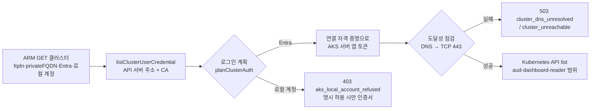

# AKS 클러스터 연동 (프라이빗 클러스터 포함)

> **대상**: 플랫폼 관리자, 고객 테넌트 관리자·보안 검토자 · **소요 시간**: 30분(클러스터당) · **필요 권한**: 클러스터 리소스의 역할 할당 권한(Owner / User Access Administrator) + 클러스터 RBAC 관리(GitOps 또는 `cluster-admin`)

## 1. 개요

대시보드는 AKS의 **Azure 쪽 정보**(구성·메트릭·Defender)를 Azure 연결만으로 읽습니다. 클러스터 **안쪽**(객체 브라우저·정책 점검·노드 상태·Pod 로그·Hubble)은 API 서버에 로그인해야 하며, 이 문서는 그 경로를 다룹니다.

- 지원: **AKS 관리형 Entra ID 연동** 클러스터(로컬 계정 꺼짐 포함), 공용 API·허용 IP 범위·**프라이빗 클러스터**
- 기본 거부: Entra 연동이 없는 클러스터(kubeconfig = 클러스터 관리자 인증서), Hubble exec(고객 클러스터)
- 지원 안 함: 구형 Entra 연동(고객 서버 앱), Lighthouse 위임으로 다른 테넌트의 Entra 클러스터 로그인, `az aks command invoke` 경유

> **5살 비유**: 클러스터는 경비가 있는 건물이에요. ① 출입증(Entra 토큰)을 받고 ② 건물 안 "보기만 하는 방" 열쇠(읽기 역할)를 받고 ③ 건물까지 가는 길(네트워크)이 있어야 들어갈 수 있어요. 비밀 금고(Secret), 기계실(exec)은 열쇠 꾸러미에 아예 없어요.

## 2. 동작 방식

요청마다 API(`services/kubernetes.ts` `loadKubeConfig`)가 아래 순서로 판단합니다. 하나라도 실패하면 **코드가 붙은 오류**로 바로 답합니다(오래 기다리거나 빈 화면을 '정상'으로 보이지 않음).



| 단계 | 하는 일 | 지키는 것 |
|---|---|---|
| 클러스터 정보 | ARM `GET managedClusters` (Reader) | 토큰을 보낼 수 있는 호스트 = `fqdn`·`privateFQDN`·`azurePortalFQDN`만 |
| kubeconfig | `listClusterUserCredential` (Cluster User Role) | Entra 클러스터의 kubeconfig에는 **비밀이 없음**(서버 주소·CA·kubelogin 설정뿐) |
| 로그인 | 연결의 자격 증명으로 `6dae42f8-4368-4678-94ff-3960e28e3630/.default` 토큰 (kubelogin이 내부에서 하는 일과 같음) | 외부 프로그램 실행 없음, 대상(aud)은 코드 상수 — kubeconfig의 `--server-id`는 **비교만**, 토큰 `aud`·`tid` 검증, TLS는 CA로 검증(`skipTLSVerify` 거부) |
| 도달성 | DNS 조회 → TCP 443 (단계마다 `AUD_AKS_PROBE_TIMEOUT_MS`, 결과 60초 캐시) | 대상 호스트는 ARM 값만(사용자 입력 없음), 오류 문구에 호스트 이름 없음 |
| 읽기 | `list`만 — 코드가 부르는 목록 = [`aud-dashboard-reader`](./templates/aks/aud-dashboard-reader.yaml) | `apps/api/test/k8sReadSurface.test.ts`가 코드 호출 ↔ 역할을 검사 |

### 접근 단계(Tier) — 고객이 고릅니다

| Tier | 내용 | 클러스터 권한 | 네트워크 |
|---|---|---|---|
| **0 Azure만** | 구성도·메트릭·Defender·Container Insights·Managed Prometheus | 없음 | 없음 |
| **1 인벤토리** (권장) | + 객체 브라우저·정책 점검·노드 Ready | `aud-dashboard-reader` (list) | API 서버 도달(아래) |
| **2 Pod 로그** | + 지정 네임스페이스의 kubelet 로그 | + [`aud-dashboard-pod-logs`](./templates/aks/aud-dashboard-pod-logs.yaml) (네임스페이스별 Role) | 같음 |
| 어느 단계에도 없음 | Secret·ConfigMap 읽기, exec·attach·port-forward·proxy, 모든 쓰기 | — | — |

Hubble exec는 Tier 밖의 **예외 옵트인**입니다(§11 보안 FAQ).

### 네트워크 경로 — 프라이빗 클러스터

| 순위 | 방식 | 판단 |
|---|---|---|
| 1 | **대시보드 API를 Azure 안에서 실행**(Container Apps/App Service VNet 통합) + 클러스터 `privatelink.<region>.azmk8s.io` DNS 영역 링크 | 우리 테넌트 클러스터의 표준 |
| 2 | **클러스터별 Private Endpoint**(고객이 승인, AKS private link 하위 리소스 `management`)를 플랫폼 VNet의 **고객별 서브넷 + NSG**로 | 다른 테넌트 엄격 고객의 표준. 대상은 API 서버 IP 하나, 고객이 PE를 거절하면 즉시 끊김 |
| 3 | 공용 API + **허용 IP 범위**(플랫폼 출구 NAT IP) | 공용 클러스터에서만. 출구 IP를 여러 고객이 공유하므로 경계로 믿지 않음 |
| 나중 | 클러스터 안 아웃바운드 전용 에이전트(Datadog Cluster Agent·Rancher agent 방식) | 인바운드 0이 필수인 고객용. 서명 이미지·egress 허용 목록 전제 |
| ✗ | VNet 피어링 | 양방향 L3 — 고객 VNet 전체가 폭발 반경, 고객이 늘면 CIDR 충돌 |
| ✗ | `az aks command invoke` | `runCommand/action` = 임의 명령 실행 통로, 대시보드 용도로 느리고 Gatekeeper 위반 |
| ✗ | 클러스터를 공용으로 열기 | — |

개발 중에는 점프박스(같은 VNet의 VM)에서 API를 실행합니다. 개발 PC(localhost)에서는 프라이빗 클러스터가 `cluster_dns_unresolved`로 답하는 것이 정상입니다.

## 3. 준비물

- 클러스터: **AKS 관리형 Entra ID 연동**(권장: 로컬 계정 끄기 `--disable-local-accounts`)
- 연결의 신원(고객 서비스 주체 또는 플랫폼 SP)의 **오브젝트 ID** (앱 ID 아님)
- 연결 방식: 고객 테넌트 클러스터는 `servicePrincipal` 연결(그 테넌트의 신원). `lighthouse`는 Entra 클러스터에 로그인할 수 없음(§9)
- 네트워크: §2 표의 1 또는 2

## 4. 설정 — 자동 (권장)

```bash
# 1) Azure: kubeconfig(서버 주소·CA) 조회 — 클러스터 범위에만
az role assignment create --assignee <CONNECTION_APP_ID> \
  --role "Azure Kubernetes Service Cluster User Role" --scope <CLUSTER_RESOURCE_ID>

# 2) Kubernetes: 읽기 역할 (GitOps 저장소에 넣는 것을 권장)
sed 's/<CONNECTION_IDENTITY_OBJECT_ID>/<오브젝트 ID>/' aud-dashboard-reader.yaml | kubectl apply -f -

# 3) (선택) Pod 로그 — 네임스페이스마다
sed -e 's/<NAMESPACE>/app/' -e 's/<CONNECTION_IDENTITY_OBJECT_ID>/<오브젝트 ID>/' aud-dashboard-pod-logs.yaml | kubectl apply -f -
```

| 자리표시자 | 값 |
|---|---|
| `<CONNECTION_APP_ID>` | 연결 서비스 주체의 앱(클라이언트) ID |
| `<CONNECTION_IDENTITY_OBJECT_ID>` | 같은 서비스 주체의 **오브젝트 ID** — Kubernetes가 보는 사용자 이름 |
| `<CLUSTER_RESOURCE_ID>` | `/subscriptions/<sub>/resourceGroups/<rg>/providers/Microsoft.ContainerService/managedClusters/<name>` |

템플릿은 [`templates/aks/`](./templates/aks/)에 있고 `apps/api/src/services/k8sReadSurface.ts`에서 생성됩니다(`npx tsx apps/api/scripts/gen-aks-rbac.ts`). 손으로 고치지 마세요 — 테스트가 실패합니다.

연결 파일(`AUD_CONNECTIONS_FILE`)의 클러스터 옵션(모두 기본 꺼짐):

```json
{ "key": "custb", "mode": "servicePrincipal", "...": "...",
  "aks": { "podLogNamespaces": ["app"], "allowLocalAccount": false, "hubbleExec": false } }
```

## 5. 설정 — 수동 (Portal)

1. 클러스터 › **액세스 제어(IAM)** › 추가 › 역할 할당 › `Azure Kubernetes Service Cluster User Role` › 구성원 = 연결의 서비스 주체
2. 클러스터 › **설정 › 보안 구성** › 인증 및 권한 부여 = "Kubernetes RBAC를 사용한 Microsoft Entra ID 인증"(또는 Azure RBAC), 로컬 계정 = 사용 안 함
3. 읽기 역할은 Portal에서 만들 수 없습니다 — §4의 YAML을 `kubectl`/GitOps로 적용
4. 프라이빗 클러스터: **네트워킹** › 프라이빗 엔드포인트 연결 › 플랫폼이 요청한 PE를 **승인**(방식 2)

## 6. 권한

| 기능 | 역할 | 범위 | 왜 필요한가 | 점검 키 |
|---|---|---|---|---|
| 클러스터 정보(Entra·프라이빗 여부) | Reader | 구독 | ARM GET | `inventory` |
| kubeconfig(서버 주소·CA) | Azure Kubernetes Service Cluster User Role | **클러스터** | `listClusterUserCredential` — Entra 클러스터에서는 비밀 없음 | `aksCredential` |
| 객체 브라우저·정책 점검·노드 | `aud-dashboard-reader` (ClusterRole, list) | 클러스터 | 24개 리소스 목록 | — |
| Pod 로그 | `aud-dashboard-pod-logs` (Role, `pods/log` get) | 네임스페이스 | 연결 옵션 `aks.podLogNamespaces`에도 있어야 함 | — |

**내장 `view`를 쓰지 않는 이유**: `view`는 ConfigMap을 읽습니다. 실제 고객 클러스터에서 `argocd-cm`에 비밀번호가 평문으로 있던 사례가 있습니다. **AKS RBAC Reader**(Azure RBAC 내장)는 roles/bindings를 못 읽어 정책 점검의 RBAC 영역이 비게 됩니다.

## 7. 수집 데이터

목록 응답을 메모리 캐시(15초~5분)에만 둡니다. 저장하지 않습니다. 이름·라벨·상태·리소스 요청량·RBAC 규칙·네트워크 정책. Secret·ConfigMap 값은 읽지 않습니다(권한도 없음). Pod 로그는 Tier 2에서 요청한 Pod만.

## 8. 확인

1. 대시보드 › AKS 클러스터 › 클러스터 선택 — 제목 옆 배지: `프라이빗`/`공용 API`, `Entra ID`/`로컬 계정`
2. 오류가 없으면 객체 목록이 보임. 오류는 아래 코드로 원인을 바로 알려 줌
3. 고객 쪽 확인: `kubectl auth can-i list pods --as <오브젝트 ID>` → yes, `kubectl auth can-i get secrets --as <오브젝트 ID>` → **no**
4. **연동 준비 상태**(같은 점검의 위쪽, 클러스터에 닿지 않아도 나옴 — `services/aksReadiness.ts`): Azure 정보만으로 항목마다 준비됨/필요/확인 못 함과 **고객에게 보낼 요청**(복사만)을 보여 줍니다

   | 단계 | 항목 | 근거(ARM·권한) | 필요할 때 요청 |
   |---|---|---|---|
   | Azure만 | Defender for Containers | `securityProfile.defender.securityMonitoring.enabled` | — |
   | Azure만 | Azure Policy 추가 기능 | `addonProfiles.azurepolicy.enabled` | — |
   | Azure만 | 관리형 Prometheus | `azureMonitorProfile.metrics.enabled` + **이 클러스터의** 작업 영역(데이터 수집 규칙 연결 → 규칙 → `monitoringAccounts`) + 그 작업 영역의 `Microsoft.Monitor/accounts/data/metrics/read` | Monitoring Data Reader(작업 영역 범위) |
   | Azure만 | Container Insights | `azureMonitorProfile.containerInsights` / `omsagent` | — |
   | 클러스터 안 | Entra 로그인·로컬 계정 | `aadProfile.managed`·`tenantID`·`disableLocalAccounts` | — |
   | 클러스터 안 | 권한 부여 방식 | `aadProfile.enableAzureRBAC` 꺼짐 → ClusterRoleBinding(개체 ID 채움) / 켜짐 → Azure 역할 | 바인딩 YAML 또는 역할 할당 |
   | 클러스터 안 | Cluster User Role | 클러스터 범위 `listClusterUserCredential/action` | 역할 할당 명령 |
   | 클러스터 안 | 네트워크 경로 | DNS → TCP 443(토큰 없음) | 프라이빗 = 클러스터별 PE(`management`), 공용 = 허용 IP |
   | 연결 | 자격 증명 | 비밀 / 인증서 / 페더레이션 | 비밀이면 페더레이션 자격 증명 JSON |

   ARM은 설정하지 않은 프로필을 응답에서 빼므로 클러스터를 읽었는데 값이 없으면 '꺼짐', 클러스터를 못 읽으면 모두 '확인 못 함'입니다
5. 대시보드 쪽 확인(관리자): **설정 › Azure 연결 › 점검 › 클러스터 권한 점검** — 연결의 자격 증명으로 로그인한 뒤 `SelfSubjectAccessReview`로 읽기 범위 규칙 24개·Pod 로그·Hubble exec(켠 경우)를 묻고, Secret 읽기·exec·`*` 권한이 있으면 경고합니다. 로그인 단계에서 막히면 이유가 그대로 나옵니다(`AKS Cluster User Role` 없음 → 자격 증명 권한 없음, 로컬 계정 클러스터 → 거부됨, 네트워크 → API 서버에 닿지 않음)

## 9. 문제 해결

| 코드 | 뜻 | 조치 |
|---|---|---|
| 403 `aks_credential_forbidden` | kubeconfig 조회 권한 없음 | §4-1 Cluster User Role |
| 503 `cluster_dns_unresolved` | API 서버 이름을 못 찾음 — 프라이빗 클러스터를 밖에서 읽음 | §2 네트워크 1·2 (localhost 개발 PC는 정상적으로 이 오류) |
| 503 `cluster_unreachable` | 443 연결 실패 | 경로·허용 IP 범위·방화벽·NSG |
| 409 `cluster_stopped` | 클러스터 중지 | 시작 |
| 403 `aks_rbac_forbidden` | 로그인은 됐지만 Kubernetes 읽기 역할 없음 | §4-2 바인딩, 이름이 **오브젝트 ID**인지 |
| 502 `aks_unauthorized` | API 서버가 토큰 거부 | 클러스터 Entra 테넌트 = 연결 테넌트인지 |
| 501 `aks_aad_cross_tenant_unsupported` | 다른 테넌트의 Entra 클러스터(Lighthouse) | 그 테넌트의 `servicePrincipal` 연결 추가 |
| 403 `aks_local_account_refused` | Entra 연동 없음(관리자 인증서) | Entra 연동 켜기. 불가피하면 검토 후 `aks.allowLocalAccount: true` |
| 501 `aad_cluster_unsupported` | 구형 Entra 연동 | AKS 관리형 Entra로 전환 |
| 502 `aks_server_mismatch` / `aks_server_id_mismatch` / `aks_kubeconfig_invalid` / `aks_token_audience` | kubeconfig가 안전 점검 실패 → 토큰을 보내지 않음 | 클러스터 FQDN·CA 확인, 재현되면 보안 사고로 취급 |
| 501 `hubble_exec_disabled` | Hubble exec 꺼짐 | §11 — Hubble 메트릭·ACNS 흐름 로그 |
| 403 `pod_log_namespace_denied` | 이 네임스페이스는 kubelet 로그를 읽지 않음 → Container Insights로 대체 | `aks.podLogNamespaces` + §4-3 |

## 10. 교체

- 비밀 없는 순서: **워크로드 ID 페더레이션**(고객 앱이 플랫폼 API의 Kubernetes 서비스 계정을 신뢰 — ArgoCD Entra SSO와 같은 방식, [connect-tenant.md](./connect-tenant.md) B-2) → **인증서**(90일 이하, OIDC 발급자가 없는 곳) → 비밀(최후, 만료 12개월 이하). 고객이 페더레이션 자격 증명을 지우면 즉시 차단
- 관리 ID를 자격 증명으로 쓰는 방식은 앱과 관리 ID가 같은 테넌트여야 해서(Microsoft Learn) 고객 앱에는 쓸 수 없음
- 환경(stg/prd)마다 신원을 나눕니다 — 하나가 새도 다른 환경은 안전

## 11. 해제

고객이 혼자 할 수 있는 순서(어느 하나만 해도 즉시 차단): ClusterRoleBinding 삭제 · Cluster User Role 할당 삭제 · 서비스 주체 비활성화/FIC 삭제 · Private Endpoint 거절. 플랫폼 쪽: 연결 파일에서 연결 제거(재시작).

## 12. 보안 FAQ

**Q. 왜 kubelogin을 실행하지 않나요?** API 호스트에서 외부 프로그램을 실행하면 그 프로그램이 호스트의 모든 신원을 쓸 수 있습니다. kubelogin이 하는 일(AKS 서버 앱 토큰 받기)을 API가 연결의 자격 증명으로 직접 하므로 결과는 같고 실행 파일은 없습니다.

**Q. 왜 Hubble exec가 기본으로 꺼져 있나요?** `cilium-agent`는 노드 최고 권한 파드입니다. 그 안에서 명령을 실행할 수 있다는 것은 사실상 노드 장악 권한이고, RBAC로 "hubble 명령만"으로 좁힐 수 없습니다. Defender for Containers도 이 행동을 감시합니다. 그래서 프로덕션 기본은 꺼짐(`HUBBLE_EXEC_ENABLED`), 켜도 **홈 연결**이나 `aks.hubbleExec: true`인 연결만, 역할은 kube-system 한정 [`aud-dashboard-hubble-exec`](./templates/aks/aud-dashboard-hubble-exec.yaml)입니다. 대안: Hubble 메트릭(Managed Prometheus — 집계값, 흐름 단위 아님), ACNS 컨테이너 네트워크 로그(흐름 단위, ACNS 비용).

**Q. 로컬 계정 클러스터는 왜 거부하나요?** Entra 연동이 없으면 Cluster User Role로 받은 kubeconfig가 **클러스터 관리자 인증서**입니다. 읽기 대시보드가 쓰기 권한까지 갖게 되고, 회수하려면 클러스터 CA를 교체해야 합니다.

**Q. 플랫폼 VNet이 여러 고객을 잇는 허브가 되지 않나요?** 그래서 피어링이 아니라 **클러스터별 PE**(대상 IP 하나)를 쓰고, 고객마다 서브넷·NSG를 나눕니다.

---

### 부록: 설계 결정 기록 (2026-10-15)

보안 아키텍트와 플랫폼·연결 아키텍트가 두 라운드 토론한 결과입니다.

| 쟁점 | 보안 | 플랫폼 | 결정 |
|---|---|---|---|
| 로그인 | Entra 토큰 직접 발급, aud 상수 | 같음, server-id는 kubeconfig에서 | **상수로 발급, kubeconfig 값은 비교만**(데이터가 토큰 대상을 정하지 못하게) |
| 로컬 계정 | 기본 거부 | 처음엔 허용 → 양보 | **기본 거부**, 연결별 명시 허용, 프로덕션 env 스위치 금지 |
| Hubble exec | 코드 제거 | 유지 | **유지하되 3중 게이트**(배포 스위치·홈/옵트인·kube-system Role) |
| 동사 | list만 | get/list/watch → 양보 | **list만**(+ Pod 로그 get, 네임스페이스 Role) |
| Pod 로그 | 사용자 OBO만 | 운영자 역할 유지 | **운영자 역할 + 연결별 네임스페이스 허용 목록**, 그 밖은 Container Insights. 사용자 OBO는 후속 |
| 네트워크 | 클러스터별 PE, 고객별 격리 | 처음엔 허브 PE → 양보 | **클러스터별 PE + 고객별 서브넷·NSG**, 피어링·command invoke 금지 |
| 도달성 | 호스트는 ARM 값만, 상세는 숨김 | DNS→TCP 사전 점검 | **사전 점검 + 호스트 이름 없는 오류 코드** |
| 빈 클러스터 | — | 전부 실패해도 성공 응답(버그) | **전부 실패 = 오류** |

후속 과제: ~~연결 점검에 클러스터별 SelfSubjectAccessReview(과도 권한 경고)~~ (완료 — §8 확인 4), 에이전트 없는 대체 데이터(Container Insights·kube-state-metrics), ACNS 흐름 로그 수집기, Azure RBAC용 사용자 지정 역할 JSON, ~~페더레이션 자격 증명~~ (완료 — Kubernetes 서비스 계정, connect-tenant B-2), ~~연동 준비 상태~~ (완료 — §8 확인 4), 사용자 OBO Pod 로그, 아웃바운드 에이전트 Tier, Azure Policy 준수 상태(`policyresources`).
