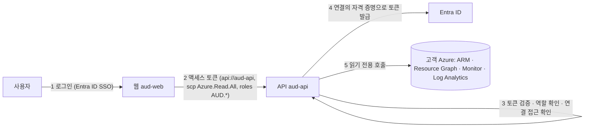

# Azure 연동 개요 — 로그인(SSO)과 Azure 연결

> **대상**: 플랫폼 관리자, 고객 테넌트 관리자 · **소요 시간**: 읽기 5분 · **필요 권한**: 없음(개념 문서)

## 1. 개요

이 플랫폼은 Datadog의 Azure 연동이나 Azure Managed Grafana처럼 동작합니다. **두 가지 신원을 분리**합니다.

| | 정하는 것 | 어떻게 | 문서 |
|---|---|---|---|
| **로그인 (SSO)** | **누가** 플랫폼을 쓰는가, 무엇을 할 수 있나 | Entra ID 로그인 + 앱 역할 `AUD.Viewer`·`AUD.Operator`·`AUD.Admin` | [sso.md](./sso.md) |
| **Azure 연결** | 플랫폼이 **어떤 Azure를 어떤 자격 증명으로** 읽는가 | 연결마다 플랫폼 소유 자격 증명(서비스 주체)과 최소 읽기 권한 | [connect-tenant.md](./connect-tenant.md) |

그래서 **사용자 개인에게 Azure 역할을 줄 필요가 없습니다.** 개인 계정에 넓은 Azure 권한을 나눠 주면 생기는 위험(퇴사자 권한 잔존, 과도한 권한, 감사 추적 분산)이 사라지고, 권한은 연결 하나에만 최소로 부여됩니다.

> **5살 비유**: 대시보드는 놀이공원이에요. 정문에서 **팔찌(SSO 역할)** 를 받아야 들어갈 수 있고, 팔찌 색(조회자·운영자·관리자)에 따라 할 수 있는 일이 달라요. 친구네 창고(고객 Azure)를 보려면 친구네 부모님이 놀이공원 직원에게 **"보기만 하는 열쇠"(연결)** 를 하나 맡겨요. 아이들 한 명 한 명에게 열쇠를 나눠 주지 않아요 — 잃어버리면 위험하니까요.

## 2. 동작 방식

1. 사용자는 Entra ID로 웹에 로그인하고, 웹은 **우리 API 전용** 토큰(대상 `api://<aud-api>`)만 받습니다. 사용자 토큰에는 Azure 권한이 없습니다.
2. API는 모든 토큰을 검증합니다(서명·발급자·대상·만료·범위 `Azure.Read.All`·홈 테넌트).
3. 토큰의 `roles`로 **플랫폼 역할**을 정하고, 요청이 가리키는 구독이 그 역할로 쓸 수 있는 연결인지 확인합니다(아니면 `403 connection_forbidden`, Azure 호출 전에 차단).
4. API는 그 구독을 가진 **연결의 자격 증명**으로 Azure 토큰을 받습니다. 한 연결이 실패해도 다른 자격 증명으로 넘어가지 않습니다.
5. 모든 호출은 읽기 전용입니다.

### 연결 방식 고르기

| 방식 (`mode`) | 언제 | 자격 증명 | 고객이 하는 일 | 상태 |
|---|---|---|---|---|
| `platform` | 플랫폼과 같은 테넌트(홈) | 플랫폼 앱(`aud-api`)의 서비스 주체 — 인증서 권장, 비밀 값 가능 | 해당 없음(홈) | **지원 (기본)** |
| `lighthouse` | 고객이 Azure Lighthouse로 구독을 위임할 수 있을 때 (MSP 모델) | 홈 플랫폼 자격 증명을 그대로 사용 — **새 비밀 값 없음** | 위임 템플릿 배포 | **지원** |
| `servicePrincipal` | Lighthouse를 쓸 수 없는 고객 | 고객 테넌트에 고객이 만든 서비스 주체 — 비밀 값은 환경 변수, 또는 인증서 | 앱 등록·역할 부여·자격 증명 전달 | **지원** |
| `delegated` | 고객이 상시 서비스 주체를 거부할 때, 또는 개발 중 | 로그인한 사용자 본인의 Azure 권한(OBO) | 사용자에게 Azure 역할 부여 | **선택 (opt-in)** |
| 멀티 테넌트 앱 + 관리자 동의 URL | 고객이 동의 버튼만 누르는 SaaS 온보딩 | 플랫폼 앱 하나(인증서·워크로드 ID 페더레이션) | 동의 + 역할 부여 | 후속 |

권장 순서: **홈은 `platform`**, 고객은 **`lighthouse`(가능하면) → `servicePrincipal`**. `delegated`는 사용자 개인에게 Azure 권한을 다시 요구하므로 예외적으로만 씁니다.

## 3. 준비물

- 홈 테넌트의 앱 등록 2개: `aud-api`(API, 기밀 클라이언트)와 `aud-web`(SPA) — [setup-guide](../../getting-started/setup-guide.md)
- 앱 역할 정의와 사용자·그룹 할당 — [sso.md](./sso.md)
- 연결 파일(`AUD_CONNECTIONS_FILE`, 저장소에 커밋 금지) — 연결이 홈 하나뿐이면 없어도 됩니다.

## 4–5. 설정

[connect-tenant.md](./connect-tenant.md) — A(홈), B(고객 서비스 주체), C(Lighthouse).

## 6. 권한

[permissions.md](./permissions.md).

## 7. 수집하는 데이터

[data-collected.md](./data-collected.md).

## 8. 확인

[verify.md](./verify.md) — 설정 › Azure 연결 › **점검**(관리자).

## 9. 문제 해결

[troubleshooting.md](./troubleshooting.md).

## 10–11. 자격 증명 교체 · 연동 해제

[lifecycle.md](./lifecycle.md).

## 12. 보안·FAQ

[security-faq.md](./security-faq.md).
